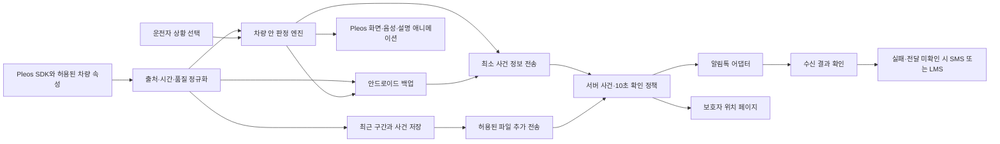
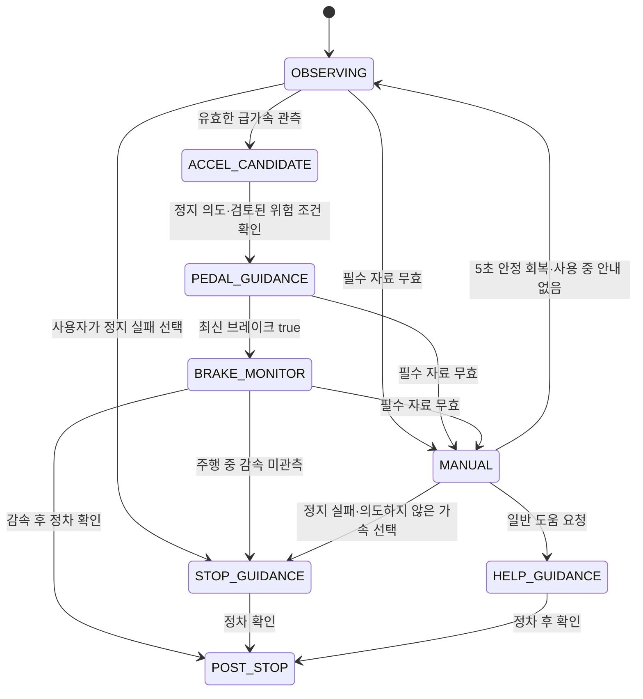
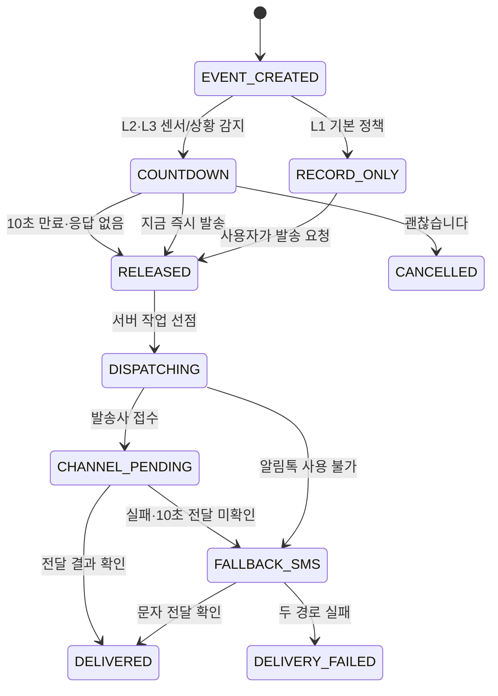

# Pleos 차량 이상 기록·긴급 안내 앱 PRD & Tech Spec

- 문서 버전: **2.0 / 2026-11-12 / Asia/Seoul**.
- 대상: **Pleos 탑재 차량 전용 앱**. 차량 앱이 중심이며 안드로이드 휴대폰은 해당 차량의 백업·보조 입력을 맡습니다.
- 문서 상태: 개발 착수용 제품 요구사항과 인터페이스 설계입니다. 센서·통신·화면·안전 성능을 검증한 출시 명세는 아닙니다.
- 이력: [통합 기획 v1](integrated-vehicle-care-2026-11-12-plan-v1.md). 기존 2·5·6번의 통합 범위를 유지하고 진동 분석·수동 대처·다중 채널 통지를 상세화했습니다.
- 개발 계약: [API 계약](../specs/vehicle-care/api.openapi.json), [DB DDL](../specs/vehicle-care/database.sql), [개발용 판정 설정](../specs/vehicle-care/rules-lab.json), [UI 토큰](../specs/vehicle-care/ui-tokens.json), [인수 시나리오](../specs/vehicle-care/acceptance-scenarios.json).
- 자료·검사 기록: [PRD 확인 기록](integrated-vehicle-care-prd-2026-11-12-evidence.json). SDK의 기존 정적 검사는 [종합 리뷰](pleos-sdk-review.md), [안전 기능 상세](../sdk/vehicle-safety-capabilities.md)에 있습니다.

수치의 지위는 세 가지로 구분합니다. **공식 계약**은 출처가 있는 플랫폼·발송사 조건입니다. **설계 결정**은 이 앱의 인터페이스·배치·처리 규칙입니다. **실험값**은 합성 입력과 대상 장치 시험을 시작하기 위한 값이며 차량 고장·사고를 확정하는 기준이 아닙니다. 진동·충격 판정의 실제 운영 적용은 검증 전 기본적으로 꺼 둡니다.

## 1. 서비스 개요 및 공모전 차별화 포인트

### 1.1 서비스 정의와 기능 번호

**차량의 이상을 이해하고, 사라지는 증상을 기록하고, 긴급 행동을 안내하며, 사고 후 보호자에게 상황을 전달하는 Pleos 앱입니다.**

| 기능 | 제품 범위 | 완료된 사용자 행동 |
| --- | --- | --- |
| F1. 경고등·오류 도감 | 지원 Pleos 차량의 전체 경고등·표시등·계기판 문구, 직접·사진 찾기, 공식 대처, 서비스센터 연결 | 자기 차에 맞는 안내를 확인하고 필요한 도움을 선택합니다. |
| F2. 증상·진동 기록 | 소음·떨림·순간 오류와 허용된 차량 정보·음성·영상을 같은 사건으로 보관 | 정비소에서 재현되지 않는 증상을 자료로 보여 줍니다. |
| F3. 긴급 행동·수동 선택 | 급가속·감속 실패 분기, 음성·설명 애니메이션, 자료 결측 시 상황 메뉴 | 센서가 없더라도 현재 상황을 선택하고 맞는 안내를 받습니다. |
| F4. 사고·보호자 통지 | 심각도 추정, 확인 카운트다운, 알림톡 우선·문자 대체, 차량 중단 시 휴대폰 백업 | 등록한 보호자에게 위치와 받은 사실을 전달합니다. |

‘전체 도감’은 지원 차량의 공식 목록 전체를 뜻합니다. 모든 제조사·과거 차량 지원이나 모든 제어기 고장 코드의 자동 접근을 뜻하지 않습니다. 기존의 경고등 세 항목 제한은 폐기합니다.

### 1.2 사용자·문제·사용 장면

| 사용자 | 구체적인 문제 | 이 앱의 사용 장면 |
| --- | --- | --- |
| Pleos 차량 운전자 | 표시 이름을 몰라 검색하기 어렵습니다. | 정차 후 같은 모양이나 사진으로 찾아 공식 행동 순서를 봅니다. |
| 간헐적 고장을 겪는 운전자 | 정비소에서는 소리·떨림이 사라집니다. | 최근 구간을 보관해 발생 시각·조건·소리를 함께 보여 줍니다. |
| 갑작스러운 가속에 당황한 운전자 | 페달 확인과 다음 행동이 어렵습니다. | 차량 배치에 맞는 음성과 화면 안내를 함께 받습니다. |
| 등록 보호자 | 사고 위치와 사용자의 응답 여부를 모릅니다. | 알림톡 또는 문자에서 사건 요약과 보호된 위치 페이지를 엽니다. |

사용자는 출발 전에 차량·휴대폰 연결, 수집 항목과 보호자를 준비합니다. 정차 중에는 도감·자료 정리·설정을 사용합니다. 주행 중에는 최소한의 상황 선택과 필요한 안내만 제공합니다.

### 1.3 공모전 평가항목과 제출 증거

공식 1차 항목은 차량특화성·창의성·기술 활용성·사업성입니다. 세부 배점과 2차 기준은 공개 안내의 확인 범위와 구분합니다. 수상·마켓 입점을 보장하는 문서로 작성하지 않습니다. [공식 심사 안내](https://appdevchallenge.auto-hmg.io/guide/judging-awards)

| 평가 관점 | 이 앱에서 제시할 내용 | 제출·시연으로 입증할 자료 |
| --- | --- | --- |
| 차량특화성 | 속도·브레이크·에어백과 증상을 같은 시각에 묶고 차량 화면에서 안내합니다. | 실제 SDK 수신과 시험 입력을 구별한 화면·기록 |
| 창의성 | 설명 찾기 → 순간 증상 보관 → 긴급 안내 → 보호자 통지를 같은 사건에서 이어갑니다. | 일반 메모·영상 앱과 작업 순서를 비교한 이용 시험 |
| 기술 활용성 | Pleos Vehicle·음성·위치·내비와 Android 백업을 역할에 맞게 사용합니다. | 권한·지원 목록, 정상·실패·결측 시연, 계약 파일 |
| 사업성 | Pleos 운전자와 보호자를 대상으로 반복되는 점검·고장 기록을 다룹니다. | 참여 동의한 시험 사용자와 정비 설명 자료의 활용 결과 |

최초 이용 시험 목표는 운전자 20명·정비 설명 수신자 5명, 기간 4주로 정합니다. 이는 모집 완료나 시장 규모가 아닙니다. 도감 탐색 성공률, 기록을 다시 여는 비율, 증상 설명에 걸린 시간, 수동 선택 오류, D7·D28 재사용률을 측정합니다. 사고 예방률·응급 구조 성공률을 이 작은 시험으로 계산하지 않습니다. 사업 모델은 수요 확인 뒤 결정하며 가상의 매출·MAU를 실적으로 쓰지 않습니다.

### 1.4 개발 범위와 출시 전 조건

프론트엔드·백엔드는 이 계약의 모의 입력으로 바로 개발할 수 있습니다. 실제 기능을 켜는 조건은 다음과 같습니다.

| 조건 | 통과 증거 | 미통과 시 제품 표시 |
| --- | --- | --- |
| 차량 센서 지원·권한·수집 속도 | 대상 Pleos 환경의 실제 설정과 수신 기록 | ‘미지원’ 또는 ‘수동 선택’ |
| 경고등 공식 자료 | 대상 차량·사양·버전의 전수 대조와 검토 | 해당 자료를 활성 목록에서 제외하고 이유 표시 |
| 긴급 안내 문구·장치 그림 | 해당 차량의 공식 절차와 배치를 검토한 서명·버전 | 검토되지 않은 조작 안내를 배포하지 않음 |
| 주행 중 화면·전면 표시 | 앱 분류·지역·주행 제한별 승인된 표시 경로 시험 | 표시 불가능 상태를 기능 미충족으로 기록 |
| 알림톡·문자 | 채널·템플릿·발신번호·계약·동의·결과 조회 시험 | 시험 채널로 표시. 실제 발송 버튼 비활성 |

## 2. 시스템 아키텍처 및 데이터 파이프라인

### 2.1 논리 구조와 개발 모듈



화면 갱신·파일 저장·인터넷·메시지 발송이 센서 수신 스레드를 막지 않도록 분리합니다. 판정은 차량 안에서 진행하고 서버 응답을 기다리지 않습니다. 사건 최초 전송은 영상 완성·새 위치 조회·파일 저장 성공을 기다리지 않습니다.

| 제안 모듈 경로 | 기술·책임 | 제공할 인터페이스 |
| --- | --- | --- |
| `apps/pleos-ivi` | Kotlin·Compose, SDK 연결·화면·음성 | `UiState`, 차량 상태와 사용자 명령 |
| `modules/vehicle-adapter` | SDK·허용된 AAOS 속성별 구현 | `capabilities()`, `observe(signalId)`, `read(signalId)` |
| `modules/event-engine` | 순수 Kotlin의 품질·판정·상태 전이 | `reduce(state, input, nowElapsedMs)` |
| `modules/signal-analysis` | 필터·주파수 분석. UI와 분리 | `analyze(window, profile, baseline)` |
| `modules/evidence-store` | Room·파일 분할·전송 대기열 | `pinWindow`, `appendAction`, `uploadPending` |
| `apps/android-companion` | 해당 Pleos 차량의 백업·사진/파일 입력 | 같은 사건 ID와 안내 버전, 자체 자료의 출처 |
| `services/api` | TypeScript HTTP API, 소유권·사건·자료·위치 | 첨부 OpenAPI의 `/v1` 계약 |
| `services/notification-worker` | PostgreSQL 작업 큐·발송사 어댑터 | 기한·취소 경쟁 처리, 수신 결과, 문자 전환 |

이 경로는 앞으로 만들 모듈 구조입니다. 현재 저장소에 구현되어 있다는 뜻은 아닙니다. 구체 패키지 버전은 첫 빌드에서 잠금 파일로 고정하고, 공모전의 API 28 이상·Pleos AVD 기준과 SDK 의존성을 함께 확인합니다.

### 2.2 센서 제공 범위와 VHAL의 경계

VHAL은 차량 하드웨어와 운영체제 사이의 계층입니다. 일반 Pleos 앱이 원시 CAN이나 VHAL 서비스에 직접 붙는 구조로 설계하지 않습니다. 앱은 SDK·`CarPropertyManager`와 승인된 서비스로 공개된 항목만 사용합니다. [Pleos 하드웨어 정책](https://document.pleos.ai/docs/pleos-only/vehicle-app-planning-guide/platform-api-architecture), [차종별 가용성](https://document.pleos.ai/docs/pleos-only/vehicle-app-planning-guide/api-compatibility-availability), [AOSP VHAL](https://source.android.com/docs/automotive/vhal/vhal-interface)

관성측정장치(IMU)는 가속도·회전 속도 같은 움직임을 측정하는 장치입니다. IMU가 있다는 사실만으로 차체와 고정되어 있거나 앱에 값이 공개됐다고 판단하지 않습니다.

| 신호 ID | 후보 경로·단위 | 현재 확인 수준 | 판정에 쓰기 위한 조건 |
| --- | --- | --- | --- |
| `vehicle_speed` | AAOS `PERF_VEHICLE_SPEED`, m/s, 전진 양수·후진 음수 | Pleos 공식 경로 확인 | 실제 권한·주기·시각·상태 정상 |
| `brake_pressed` | Vehicle `getCurrentBrakePedalStatus`·구독, Boolean | 기존 AAR 선언 확인, `CAR_DRIVE` | `true`·`false`·확인 불가 분리 |
| `steering_wheel_angle` | Vehicle 핸들 각도 조회·구독 | 기존 AAR 선언 확인 | 실제 단위·부호·범위 계약 확인. 전륜 각도와 구분 |
| `road_wheel_angle` | AAOS `PERF_STEERING_ANGLE`, degree | Android에 정의됨 | 대상 API·지원·읽기 권한 검증 |
| `wheel_tick` | AAOS `WHEEL_TICK`, reset + 바퀴별 누적 tick | Android에 정의됨 | 바퀴 지원 비트·tick당 거리·초기화 처리 |
| `engine_rpm` | AAOS `ENGINE_RPM`, rpm | Android에 정의됨 | 현재 문서의 3P 또는 특권 권한과 대상 Car API 확인 |
| `motor_rpm` | 제조사가 승인해 노출하는 속성·서비스 | 공개 범용 경로 미확인 | 임의 속성 ID를 만들지 않음. 미지원 가능 |
| `accel_linear` | 허용된 차량 고정 IMU·`TYPE_LINEAR_ACCELERATION`, m/s² | 대상 Pleos 장치 제공 미확인 | 차체 고정·축·보정·충분한 수집 속도 |
| `accel_raw` | 허용된 `TYPE_ACCELEROMETER`, 중력 포함 m/s² | Android 후보만 확인 | 중력 제거·대역 제한 후 사용 |
| `gyro` | 허용된 `TYPE_GYROSCOPE`, rad/s | 대상 차량 제공 미확인 | 장착·축·보정·시간 정렬 |
| `body_vibration` | 승인된 제조사 전용 진동 채널 | 공개 경로 미확인 | 제공되지 않으면 IMU의 측정 패턴으로만 설명 |
| `airbag_deployed` | Vehicle 좌석별 전개 상태, `CAR_SAFETY` | 기존 AAR 선언 확인 | 초기 참과 새 전개 이벤트 구분 |
| `telltales`·`dtc` | Vehicle 경고 표시 / 승인된 고장 코드 경로 | 경고 조회와 구독의 권한 차이 확인. DTC 미확인 | `PRIVATE_CAR_SAFETY`를 일반 허용으로 가정하지 않음 |

Android 정의는 대상 Pleos 차량·API 34 환경의 제공 증거가 아닙니다. `ENGINE_RPM`의 현재 공식 원문에는 `CAR_ENGINE_DETAILED_3P` 또는 특권 권한이 있고, 전륜 조향각은 핸들 각도와 별개입니다. 일반 앱이 모든 항목을 받을 수 있다고 쓰지 않습니다. [Google 차량 속성](https://developer.android.com/reference/android/car/VehiclePropertyIds)

### 2.3 표준 수신 레코드와 시간

```json
{
  "signal_id": "vehicle_speed",
  "value": 12.4,
  "unit": "m/s",
  "source": "AAOS_PROPERTY",
  "capability": "SUPPORTED",
  "quality": "VALID",
  "clock_domain": "ivi-boot-example",
  "source_elapsed_ns": "12000000000",
  "received_elapsed_ns": "12010000000",
  "observed_at": "2026-11-12T12:00:00Z",
  "freshness_basis": "SOURCE_TIMESTAMP",
  "sequence": 240,
  "calibration_id": null
}
```

- `quality`: `VALID`, `STALE`, `MISSING`, `TIMEOUT`, `UNSUPPORTED`, `DENIED`, `INVALID_CLOCK`, `OUT_OF_RANGE`, `GAPPED` 중 하나입니다.
- `value=null`은 0이나 브레이크 `false`가 아닙니다. 실제 값 0과 구별합니다.
- 경과 시각의 ns는 JSON 정수 정밀도 문제를 피하려고 십진 문자열로 전달합니다. 다른 부팅·기기의 시계는 변환 오차를 기록하기 전 서로 빼지 않습니다.
- SDK가 원 측정 시각을 주지 않으면 `freshness_basis=ARRIVAL_ONLY`로 표시합니다. 최근 콜백 수신이 실제 물리 센서의 최신 측정이라는 보장은 없습니다.
- 같은 값이 계속되는 ON_CHANGE 신호는 ‘변화 없음’과 ‘신호 중단’을 구분해야 합니다. 허용된 상태 재조회·건강 확인 경로가 없으면 신뢰도를 낮추고 F3의 수동 선택으로 갑니다. 캐시 재조회만으로 물리 측정 시각을 새로 만들지 않습니다.

### 2.4 수집·큐·파일·전송

IMU는 실험 목표 200Hz, 속도·회전수는 제공 가능한 주기를 사용합니다. 실제 속도가 낮으면 없는 샘플을 복제해 200Hz처럼 만들지 않습니다. 충분한 주기가 없을 때 F2의 주파수 판정을 끕니다. UI의 요약 수치는 최대 5Hz로 반영하고, 렌더링 주기와 센서 주기를 분리합니다.

최근 IMU 30초는 고정 크기 메모리 버퍼에 보관합니다. 큐가 넘치면 누락 수와 구간을 표시하고 해당 분석 창을 무효화합니다. 사건 뒤 60초를 추가하고 파일은 2초 단위로 마감합니다. 원본 보관과 특징값 생성은 별도 작업입니다.

예상 용량은 가정값입니다. 200Hz·6축 float·시각 8바이트·상태 4바이트는 샘플당 36바이트, 90초에 648,000바이트입니다. 16kHz·16bit 모노 소리는 채널당 90초에 2,880,000바이트입니다. 4Mbps 영상은 채널당 90초에 45,000,000바이트입니다. 실제 제공 포맷·코덱·채널 수를 시험하기 전 확보된 저장 성능으로 인용하지 않습니다.

차량의 메타데이터 예비 공간은 16MiB, 미디어 한도는 2GiB로 시작합니다. 사건으로 고정한 파일을 최근 캐시 정리 대상으로 지우지 않습니다. 부족하면 새 원본 수집 실패와 누락을 표시하고 작은 사건 정보의 전송을 계속 시도합니다. 보관 기간·추가 보관·삭제는 5절 정책을 따릅니다.

휴대폰에 전달하는 자료에도 원래 차량 출처와 마지막 시각을 유지합니다. 차량이 꺼진 뒤 휴대폰 GPS·가속도는 휴대폰 자료로 추가하며 차량 페달·에어백의 새 값으로 표시하지 않습니다.

## 3. 기능별 초정밀 상세 명세

### 3.1 기능 1: 전체 경고등·오류 도감과 공식 대처

#### 3.1.1 목록·사진 검색·공식 가이드 계약

도감의 키는 `vehicle_profile_id + software_range + warning_code + state_pattern + guide_version`입니다. 차량명 하나로 모든 사양을 합치지 않습니다. 목록은 공식 설명서의 경고등·표시등·계기판 문구를 전수 대조하고, `expected_count`, `imported_count`, `reviewed_count`, `coverage_checked_at`을 보관합니다. 검토되지 않은 항목을 수록 완료라고 표시하지 않습니다.

`GET /v1/vehicles/{vehicleId}/warning-guides`는 해당 차량에 검토·연결된 목록만 반환합니다. 직접 검색은 모양·색·문구·분류를 사용합니다. 사진 검색은 허용된 촬영 또는 보조 휴대폰의 이미지 입력 → 모양/문자 후보 추출 → 상위 후보 최대 3개 → 사용자 확인 순서입니다. 사진 속 표시가 여러 개면 각각 묶습니다. 후보 점수 0.85 미만, 1·2위 차이 0.15 미만은 ‘확인 필요’로 표시하는 실험값이며 진단 확률로 쓰지 않습니다. 사진 인식이 자동 긴급 제동 분기를 실행하지는 않습니다.

‘정확한 점등 원인’ 영역에는 **공식 설명서가 정의한 점등 의미와 조건**을 표시합니다. 경고등 하나나 DTC 하나만으로 고장 부품과 원인을 확정하지 않습니다. 화면은 ‘받은 표시’, ‘공식 설명’, ‘가능한 관련 증상’, ‘해야 할 행동’을 구별합니다.

#### 3.1.2 경고등·증상·고장 코드 매칭 표

아래는 자료 구조와 검토 항목의 예시입니다. 확인한 DN8HEV/2026 설명서 등의 의미를 참고했지만 해당 차량의 Pleos 탑재를 확인한 것은 아니며, 실제 배포 자료는 대상 Pleos 차량의 설명서로 다시 검토해야 합니다. [현대 공식 경고등 자료 예시](https://ownersmanual.hyundai.com/full_webhelp/DN8HEV/2026/ko_KR/warning_indicator_lights.html)

| 도감 키 예시 | 공식 의미를 정리할 범위 | 증상·DTC 연결 | 가이드 출력 분기 |
| --- | --- | --- | --- |
| `ENGINE_MIL` | 엔진·배출가스 제어 계통의 경고 조건 | 승인된 코드 목록만 연결. 회전수 관련 진동은 별도 관측 자료 | 지속·점멸·출력 저하를 분리해 해당 설명서의 점검/정차 안내 선택 |
| `TPMS_LOW` | 낮은 타이어 공기압 표시 | 공기압 상태와 사용자 파손 의심. 휠 주기 진동은 파손의 확정 근거가 아님 | 저압과 감시 장치 오류를 구별해 점검 순서 제공 |
| `BRAKE_RED` | 주차 브레이크·제동 계통의 표시 조건 | 주차 브레이크 상태, 실제 움직임, 브레이크 입력 | 정차 중 정상 체결과 주행 중 이상을 구별. 제동 이상 시 안전 정차 안내 |
| `ABS_OR_EBD` | ABS 단독 또는 브레이크 표시와 동반되는 조건 | 동반 표시 조합을 보관. 코드 미수신은 없음으로 단정하지 않음 | 단독·동반 조건의 공식 안내를 각각 선택 |
| `EV_SERVICE` | 해당 EV 시스템의 서비스 경고 의미 | 제조사 검토 코드와 동반 문구만 연결 | 서비스 점검 문구와 ‘안전하게 정차’ 계열 문구를 합치지 않음 |
| `AIRBAG_WARNING` | 에어백 계통 경고 표시 | 전개 여부 신호와 다른 항목 | 경고등이 켜진 것을 사고·전개로 바꾸지 않음 |

매칭 규칙은 다음과 같습니다.

1. 차량·사양·소프트웨어와 일치하는 검토 가이드가 없으면 `GUIDE_UNAVAILABLE`로 처리합니다.
2. 경고 표시의 측정 시각과 진동 사건의 구간이 겹치거나 ±5초 이내이면 `CO_OBSERVED` 관계로 붙입니다. 이것은 인과관계가 아닙니다.
3. DTC는 `ACTIVE`, `PENDING`, `HISTORICAL`, `UNKNOWN`을 구분하고 제조사가 검토한 매핑만 조회합니다. 과거 저장 코드를 현재 증상의 확정 원인으로 표시하지 않습니다.
4. 여러 안내가 있으면 운행 중단이 필요한 검토된 조건을 우선합니다. 서로 모순되는 조작을 차례로 읽지 않습니다.
5. `mobility_action`은 `STOP_SAFE`, `SLOW_CHECK`, `CAUTION`, `UNKNOWN`입니다. 공식 근거가 없는데 ‘주행 가능’으로 기본값을 채우지 않습니다.

가이드 응답 예시는 다음과 같습니다. 예시 가이드는 실제 배포 승인 자료가 아닙니다.

```json
{
  "guide_id": "brake-example-v1",
  "review_status": "DRAFT",
  "warning_code": "BRAKE_RED",
  "vehicle_profile_id": "pleos-target-pending",
  "official_meaning": "해당 차량의 제동 계통 표시 조건을 확인해야 합니다.",
  "root_cause_status": "NOT_DIAGNOSED",
  "mobility_action": "STOP_SAFE",
  "checklist": [
    {"step_id": "look_ahead", "text": "전방과 주변 상황을 확인하세요.", "asset_id": "road-attention-v1"},
    {"step_id": "model_braking", "text": "이 차량에서 검토한 제동 안내를 확인하세요.", "asset_id": "target-review-required"}
  ],
  "source_url": "https://ownersmanual.hyundai.com/",
  "source_section": "대상 차량 검토 후 확정",
  "reviewed_at": null,
  "production_enabled": false
}
```

실제 `VERIFIED` 가이드는 원문 URL·절·자료 식별값·검토자·검토일·그림/음성 버전·차량 배치 정보가 모두 있어야 활성화합니다. 원문이 바뀌면 영향을 받는 항목을 재검토합니다. 앱에는 검토한 설명·행동과 공식 링크를 제공합니다.

#### 3.1.3 서비스센터 연결

`STOP_SAFE`는 운행 지속 경로보다 안전 정차·도움 요청을 먼저 보여 줍니다. 그 밖의 점검 안내는 가까운 현대 하이테크센터·블루핸즈의 주소·확인된 정비 항목·연락처·자료 확인 시각을 보여 줍니다. 내비 연결은 좌표 순서를 검증한 목적지 요청으로 처리합니다. 공식 검색 웹페이지의 존재를 외부 예약 API 승인으로 확대하지 않습니다. [현대 서비스 네트워크](https://www.hyundai.com/kr/ko/service-membership/service-network/service-reservation-search)

### 3.2 기능 2: 차량 진동·떨림 감지와 순간 증상 기록

#### 3.2.1 실행 전 조건과 분석 파라미터

차체와 고정되지 않은 휴대폰 IMU를 차체 진동 센서로 대체하지 않습니다. 휴대폰 자료는 별도 출처로 기록합니다. 승인된 고속 채널이 없으면 ‘진동 자동 감지 미지원’을 표시하고 수동 증상 기록은 계속 제공합니다. [Android 움직임 센서](https://developer.android.com/develop/sensors-and-location/sensors/sensors_motion)

수치의 단일 기준은 [실험 설정](../specs/vehicle-care/rules-lab.json)입니다. 다음 값은 **초기 시험값**입니다.

| 항목 | 값 | 이유·미충족 처리 |
| --- | --- | --- |
| 수집 목표 | 200Hz, 간격 5ms | 실제 설정·수신 주기로 확인. 낮은 주기를 복제로 높이지 않음 |
| 최소 분석 주기 | 160Hz | 대역 상한이 실제 주기의 0.4배를 넘으면 해당 대역을 끔. 80Hz 분석은 200Hz 이상 필요 |
| 창·이동 | 512샘플·128샘플 이동 | 200Hz에서 2.56초 창, 0.64초 간격, 주파수 간격 0.390625Hz |
| 창 함수 | Hann | 스펙트럼 누설을 줄이되 창 에너지를 보정 |
| 중력 처리 | 검토된 선형 가속도 또는 0.7Hz 고역 통과 | 원시 중력 포함 값을 동적 충격 G로 쓰지 않음 |
| 정렬 | 차량 기준 X 전후·Y 좌우·Z 상하 | 축 방향·오프셋·고정 상태 검토, 보정 ID 기록 |
| 품질 | 유효 범위 95% 이상, 큰 공백 50ms 미만 | 10ms 이하의 작은 지터 보간만 허용. 나머지 공백 창 무효 |
| 차량 상태 동기화 | 최대 시각 차 100ms | 초과 시 동시 관측 연결을 낮은 신뢰도로 표시 |
| 기준선 | 속도 10km/h 구간별 정상 구간 60초 이상 | 없는 구간은 기준선 부족. 스스로 정상이라고 학습해 고장을 숨기지 않음 |
| 진동 시작 | 최근 5개 창 중 3개 초과 | 최초 후보는 곧바로 구간 표시. 확정 관측은 뒤에 추가 |
| 해제·반복 | 10개 유효 창 정상, 반복 알림 간격 30초 | 원본 기록은 알림 간격과 독립. 재발은 같은 사건에 추가 |

샘플링 전에 필요한 대역 제한이 확인되어야 합니다. 이미 낮은 주기로 수집한 신호의 고주파 성분을 앱의 필터로 복원하지 않습니다. 160Hz 장치에 20~80Hz 판정을 그대로 적용하지 않습니다.

#### 3.2.2 진폭·주파수 계산

가속도를 `g0=9.80665m/s²`로 나누어 동적 `g` 단위로 계산합니다. 각 축에 대해 중력을 제거하고, 평균을 뺀 512샘플에 Hann 창 `w[n]`를 곱합니다. 축을 먼저 벡터 크기로 합친 뒤 FFT를 하지 않고 축별 주파수 성분을 계산한 뒤 에너지를 합칩니다.

RMS는 흔들림 크기를 평균 에너지로 나타내는 실효값입니다. FFT는 섞인 흔들림을 주파수별로 나누는 계산입니다. 주파수가 같다는 이유만으로 같은 고장이라고 판단하지 않습니다.

```text
X_a[k] = FFT(w[n] * x_a[n])
f_k = k * fs / N
P_a[k] = c_k * |X_a[k]|^2 / (N * sum(w[n]^2))
c_k = 1 at DC/Nyquist, 2 otherwise
RMS_band = sqrt(sum_axes(sum_{k in band}(P_a[k])))
peak_g = max_n(sqrt(ax[n]^2 + ay[n]^2 + az[n]^2))
threshold_band = max(absolute_floor_band, 3 * baseline_p95_band)
```

| 관측 대역 | 초기 진폭 하한 | 관측 이름 | 해석 제한 |
| --- | --- | --- | --- |
| 1~5Hz | 0.08g RMS | 저주파 차체 흔들림 패턴 | 차체·노면·운전 입력을 단독으로 구별하지 못함 |
| 5~20Hz | 0.06g RMS | 회전·바퀴 관련 비교 후보 | 휠 밸런스·타이어 파손의 확정 진단이 아님 |
| 20~80Hz | 0.04g RMS | 고주파 진동 패턴 | 충분한 센서 주기·대역 제한이 확인될 때만 활성화 |

정상 기준선은 검토한 시험 구간에서 생성하고 이상 후보 구간에서는 갱신을 멈춥니다. 정상 노면·속도·동력 상태별 분포를 수집한 뒤 값을 다시 정합니다. 현재 숫자를 현대차의 고장 기준이나 실제 사고 G 기준으로 표시하지 않습니다.

#### 3.2.3 단발 충격과 지속 패턴 구분

```text
on_window(window, profile):
  if not approved_source or not mounted_and_calibrated:
    return ANALYSIS_UNAVAILABLE
  fs = measured_sample_rate(window)
  if fs < 160 or coverage < 0.95 or max_gap_ms > 10 or clipped:
    record_gap(); reset_recent_evidence(); return INVALID_WINDOW
  window = resample_small_jitter_to_uniform_grid(window, max_gap=10ms)
  bands = bands_where(high_hz <= 0.4 * fs)
  features = axis_fft_band_rms(window, bands)
  impulse_segments = short_pulses(envelope_rms_50ms(window), 0.6g, 250ms)
  add_sustained_vote_exclusions(impulse_segments.start, impulse_segments.end + 1500ms)
  if intersects(window, sustained_vote_exclusions):
    keep_raw_and_features(); reset_recent_evidence(); return IMPULSE_EXCLUDED
  if baseline_missing:
    pin_candidate_if_absolute_floor_exceeded()
    return BASELINE_INSUFFICIENT
  exceeded = features.rms > max(floor, 3 * baseline.p95)
  pin_recent_window_on_first_candidate(exceeded)
  if peak_g >= 0.6 and above_floor_duration_ms < 250:
    mark(IMPULSE_CANDIDATE)
    observe_return_for(1500ms)  # 이후 기록을 추가하며 최초 보관을 늦추지 않음
  if count_exceeded_in_last_valid_windows(5) >= 3:
    emit(SUSTAINED_VIBRATION_PATTERN, observed_bands, source_quality)
  elif impulse_candidate and returned_to_baseline and not repeated:
    emit(ISOLATED_IMPACT_RETURNED)
  correlate_with_supported_rpm_wheel_and_warning_records()
```

‘단발 충격 후 복귀’는 포트홀을 확정했다는 뜻이 아닙니다. 연속 요철도 지속 진동처럼 보일 수 있습니다. 스펙트럼으로 얻는 것은 측정 패턴이며 원인 후보와 정비 판단은 구분합니다.

충격 분할은 50ms 이동 RMS 포락선으로 하고 0.6g 초과가 250ms 미만인 완료 구간과 이후 1,500ms를 지속 진동 투표에서 제외합니다. 이 구간과 겹치는 FFT 창은 연속 투표에 넣지 않습니다. 75% 겹치는 FFT 창 3개를 독립된 충격 증거 3개로 세지 않습니다. 반복 단발 충격은 별도 패턴으로 기록하며, 이 제외 처리는 F2 진동 구분용입니다. 사고 최초 기록·에어백·직접 도움 요청 처리를 늦추거나 막지 않습니다.

회전 정보가 있을 때만 보조 비교를 합니다. 엔진 회전 기본 주파수는 `rpm/60`, 4행정 점화 주기는 실린더 수가 검증된 경우 `rpm/60 * cylinder_count/2`입니다. 바퀴 주기는 검증된 유효 반지름이 있을 때 `abs(v)/(2πr)`로 비교합니다. 주파수 일치 허용 범위는 `max(기준 주파수의 15%, FFT 2칸)`입니다. 맞는다고 부품 고장으로 확정하지 않습니다.

`WHEEL_TICK`는 바퀴 속도 그 자체가 아닙니다. `Δtick * tick당 μm / 1,000,000 / Δt`로 속도 후보를 계산합니다. reset count가 바뀌거나 지원하지 않는 바퀴이면 그 구간은 계산하지 않습니다. 배열 순서는 공식 계약의 전좌·전우·후우·후좌를 따릅니다. 모터 RPM·감속비가 제공되지 않으면 엔진식을 전기차에 대입하지 않습니다.

#### 3.2.4 기록 시작·원본·정비 자료

자동 후보, ‘지금 증상 기록’, 허용된 음성 세션의 기록 요청은 같은 `incident_id` 아래 기록을 만듭니다. 증상 전 30초·후 60초는 출발 전 실제로 수집한 자료만 포함합니다. 인식한 말은 원본 녹음이 아니며, 내부·외부 마이크·전방·후방·실내 영상은 채널별 지원·허용·시작 시각을 보관합니다.

기록 결과는 `수집됨 / 미지원 / 허용 안 됨 / 시작 전 / 중간 끊김 / 저장 실패`로 구분합니다. 원본 파일은 변경하지 않고 특징값·설명·안내 이력은 별도 저장합니다. 정비용 공유에서는 차량 상태·발생 조건·원본의 선택 구간을 보여 주고 보호자 공유 권한과 분리합니다.

### 3.3 기능 3: 결측·지연 시 수동 상황 선택과 긴급 안내

#### 3.3.1 수동 모드 진입 조건

| 조건 | 판정 시점 | 처리 |
| --- | --- | --- |
| `null`, 미지원, 권한 거절 | 결과 수신 즉시 | 해당 항목을 확인 불가로 표시하고 관련 상황 선택 제공 |
| API 응답 없음 | 마지막 정상 자료 또는 초기 요청 후 3,000ms | `TIMEOUT`, 자동 판단 중단, 수동 메뉴 활성화 |
| 측정/수신 자료가 오래됨 | 유효 기준 시각으로부터 `age_ms >= 3000` | `STALE`, 이전 값은 마지막 값으로만 표시 |
| 긴급 속도·브레이크의 나이 500ms 초과 | 급가속·감속 실패 판정을 실행하기 전 | 해당 자동 분기 즉시 중단. 3초까지 기다려 명령하지 않음 |
| 원 시각이 미래 100ms 초과·부팅 시계 불일치 | 정규화 시점 | `INVALID_CLOCK`, 물리 변화 계산에서 제외 |
| 차량 서비스 연결 중단 | SDK 연결 오류/유효한 건강 확인 실패 | 영향을 받는 채널을 결측 처리. 인터넷 중단과 구분 |

인터넷이 끊겼다는 이유만으로 정상 수신 중인 차량 센서를 무효화하지 않습니다. CAN 지연을 직접 관찰할 수 없으면 SDK/차량 속성의 지연·오류로만 기록합니다. 원 시각 없는 채널의 한계는 2.3절을 적용합니다.

```text
quality(signal, now):
  if unsupported: return UNSUPPORTED
  if permission_denied: return DENIED
  if value is null: return MISSING
  if clock_incompatible_or_future: return INVALID_CLOCK
  age = trusted_source_age_or_arrival_lease_age(signal)
  if request_pending and age >= 3000: return TIMEOUT
  if age >= 3000: return STALE
  return VALID_WITH_RECORDED_FRESHNESS_BASIS

on_required_quality_lost:
  stop_only_dependent_automatic_rules()
  show_manual_choices(reason, last_valid_at)
  retain_ongoing_incident_and_current_guidance()
```

품질 상태는 `AUTO_READY → DEGRADED → MANUAL_ACTIVE → RECOVERY_PENDING → AUTO_READY`입니다. 회복은 필요한 채널이 5초 동안 정상이어야 합니다. 사용자가 고른 상황·진행 중 안내·발송 카운트다운을 자료 회복 때문에 지우거나 초기화하지 않습니다. 사용자는 센서가 정상이어도 직접 메뉴를 열 수 있습니다.

#### 3.3.2 메뉴 트리와 카드 ID

가로 전체 화면에서는 다음 9개를 한 화면의 3×3 카드로 제공합니다. 각 카드는 296×144dp, 두 줄 이내 문구와 아이콘을 사용합니다. 선택은 최대 3개이며 ‘이 상황 안내’로 제출합니다. 운전자가 급하면 하단의 ‘브레이크를 밟아도 안 멈춤’ 또는 ‘지금 도움 요청’에 바로 접근할 수 있습니다.

```text
상황 선택 [메뉴 깊이 1]
  SHAKE             차체가 심하게 떨립니다
  STEERING_PULL     핸들이 한쪽으로 쏠립니다
  METAL_NOISE       쇠 갈림·두드리는 소리가 납니다
  BURNING_SMELL     타는 냄새가 납니다
  PEDAL_ABNORMAL    가속·브레이크가 평소와 다릅니다
  TIRE_DAMAGE       타이어 펑크·파손이 의심됩니다
  MINOR_COLLISION   가벼운 접촉 사고가 났습니다
  SINGLE_COLLISION  혼자 부딪히거나 시설물을 쳤습니다
  POWER_LOSS        시동이 꺼지거나 힘이 떨어졌습니다

PEDAL_ABNORMAL의 선택 상세 [메뉴 깊이 2, 선택 즉시 안내]
  STOPPING_FAILED   브레이크를 밟아도 안 멈춥니다
  UNWANTED_ACCEL   원하지 않는데 속도가 올라갑니다
  POWER_LOSS        가속해도 힘이 나오지 않습니다
  UNKNOWN_PEDAL     어느 상태인지 모르겠습니다

항상 보이는 긴급 액션
  SEND_NOW          지금 즉시 발송
  REQUEST_HELP      지금 도움 요청
```

소리 종류의 상세 입력·긴 문장·사진 업로드는 정차 후 기록 편집으로 보냅니다. 보조 보기 때문에 긴급 안내까지 세 번째 메뉴를 열게 하지 않습니다. 주행 제한이 터치 입력을 허용하지 않는 상태는 임의로 우회하지 않으며 승인된 음성·알림 경로를 사용합니다.

#### 3.3.3 선택 조합과 가이드 결과

아래 등급은 보호자 대응 우선순위의 초기 규칙이며 실제 손상·부상 진단이 아닙니다. `G_*`는 대상 Pleos 차량용 검토 가이드가 연결되어야 실행됩니다.

| 선택 또는 조합 | 안내 ID·우선 행동 | 통지 등급 후보 | 발송 정책 |
| --- | --- | --- | --- |
| 심한 `SHAKE` | `G_VIBRATION_STOP`, 안전 정차·상태 확인 안내 | L2 | 10초 확인 후 자동 또는 즉시 발송 |
| `STEERING_PULL` | `G_STEERING_STOP`, 조향 이상 대처 | L2 | 같은 정책 |
| `METAL_NOISE`만 선택 | `G_NOISE_CHECK`, 기록·공식 점검 안내 | L1 | 기본 자동 발송 없음, 사용자가 선택 가능 |
| `BURNING_SMELL` | `G_SMELL_STOP`, 운행 중단·도움 요청 안내 | L2 | 10초 확인. 원인을 화재로 확정하지 않음 |
| `TIRE_DAMAGE` 또는 `SHAKE + TIRE_DAMAGE` | `G_TIRE_STOP`, 타이어 관련 안전 정차 안내 | L2 | 10초 확인. 경고등·관측은 별도 첨부 |
| `MINOR_COLLISION` | `G_COLLISION`, 사고 뒤 필요한 확인 | L2 | 10초 확인 |
| `SINGLE_COLLISION` | `G_COLLISION`, 위치·응답 확인 | L2 | 10초 확인 |
| 충돌 선택과 `REQUEST_HELP` | `G_EMERGENCY_HELP`, 긴급 도움 요청 | L3 | 사용자의 직접 도움 요청이므로 즉시 |
| `POWER_LOSS` | `G_POWER_LOSS`, 해당 차량 정차·출력 이상 안내 | L2 | 운행 불가 보고면 10초 확인 |
| `STOPPING_FAILED` | `G_STOPPING_FAILURE`, 검토된 비상 제동 절차 | L3 긴급 상황 후보 | 안내 즉시, 보호자 발송은 10초 또는 즉시 버튼 |
| `UNWANTED_ACCEL` | `G_ACCELERATION`, 페달·해당 차량 정지 안내 | L2 이상 | 안내와 사건 기록 시작 |
| `UNKNOWN_PEDAL` 또는 판단 불가 | `G_GENERAL_EMERGENCY`, 임의의 특정 장치 조작을 만들지 않음 | 정보 부족이면 미분류 | 상황·도움 요청 선택 유지 |

선택이 여러 개면 `직접 도움 요청 → 정지 실패 → 충돌 → 타는 냄새 → 조향/타이어 → 출력 → 기타 기록` 순서로 **하나의 대표 안내**를 고르고 나머지는 부가 증상으로 남깁니다. 서로 반대되는 조작을 동시에 읽지 않습니다.

수동 입력은 `source=USER_REPORTED`, 선택 ID·선택 시각·정차 보고 여부와 함께 저장합니다. 같은 가이드 엔진과 알림 API를 사용하되 ‘센서가 확인함’으로 표시하지 않습니다. ‘동일한 수준의 안내’는 같은 검토 자료와 전달 절차를 뜻하며 관측 정확도가 같다는 뜻은 아닙니다.

#### 3.3.4 급가속·브레이크·감속 실패 상태 머신



개발 실험값은 다음과 같습니다. 이동 속력 `abs(v) >= 1.0m/s`, `d(abs(v))/dt >= 2.5m/s²`가 700ms 이상이면 `ACCEL_CANDIDATE`를 기록합니다. 브레이크 `false`만으로 정상 합류·가속을 운전자 실수로 판단하지 않습니다. ‘안돼’ 같은 감탄사만으로도 정지 의도를 확정하지 않습니다. 구체적인 정지 요청, 검토된 차량 위험 신호와 조건, 실제 검증한 판정 정책을 통해 행동 안내를 선택합니다. 검증 전에는 이 자동 수치 분기를 시험·관측 모드로 제한하며 수동 긴급 선택은 별도 경로로 제공합니다.

감속 실패 자동 분기는 `진행 중인 긴급 정지 대응`, `실제 이동`, 최신 브레이크 `true` 500ms 이상, 이후 1,000ms의 유효 관측에서 속력 감소가 0.5m/s 미만인 조건으로 시험합니다. 이미 정차했거나 평상시 속도를 유지하는 상태는 제외합니다. 전진·후진 방향은 따로 저장하고 이동 속력으로 감속을 계산합니다. 물리 제동력과 올바른 발 압력을 확인한 것으로 설명하지 않습니다.

음성·Pleos 그림·애니메이션은 `guide_id + version + step_id`를 공유합니다. 페달 배치·발 이동·비상 제동 장치의 위치와 유지 동작을 검토된 순서로 보여 줍니다. 실제 발을 관찰한 화면처럼 표시하지 않습니다. 첫 안내의 1초 목표는 판정·음성 시작·화면 표시를 각각 측정하고, 다른 앱이 전면에 있을 때의 허용된 표시 경로를 따로 검증합니다. 긴급 상황에서 LLM이 조작 순서를 새로 생성하지 않습니다.

### 3.4 기능 4: 심각도·카운트다운·카카오톡과 문자

#### 3.4.1 세 등급의 의미와 계산식

등급은 **추정된 대응 우선순위**입니다. 충격 G만으로 부상·차량 파손 정도를 정확히 진단할 수 없으므로 메시지에도 ‘추정’을 붙입니다. 자료가 없으면 L1으로 기본 분류하지 않고 `level=null`, ‘판단 자료 부족’으로 남깁니다.

| 등급 | 사용자 표시 | 의미 |
| --- | --- | --- |
| L1 | 주의·단순 고장 의심 | 정비 설명·기록이 필요하며 기본 자동 발송은 꺼 둡니다. |
| L2 | 사고 의심·운행 곤란 | 접촉·단독 충돌 보고 또는 운행 불가·유효한 위험 신호가 있습니다. |
| L3 | 중대 상황 의심·긴급 도움 필요 | 새 에어백 전개·직접 도움 요청·검토된 복합 신호로 긴급 대응이 필요합니다. |

초기 점수 `S=min(100, 아래 항목의 합)`를 쓰되 같은 사건·같은 원천의 중복 관측은 한 번만 셉니다.

| 근거 | 실험 조건 | 점수·독립 계열 |
| --- | --- | --- |
| 새 에어백 전개 | 초기 상태가 아닌 새 전개, 유효 영역 | 100, AIRBAG |
| 직접 긴급 도움 요청 | 사용자 `REQUEST_HELP` | 100, USER |
| 충돌 직접 보고 | 접촉 또는 단독 충돌 | 60, USER |
| 운행 불가 보고 | 사용자 운행 불가 선택 | 40, USER |
| 동적 충격 | 중력 제거·고정·검증된 IMU에서 3.0g 이상 | 40, IMU. 검증 전 자동 발송 근거로 사용하지 않음 |
| 급감속 또는 큰 속력 감소 | -7.0m/s² 200ms 이상 또는 1초에 8m/s 감소 | 합산 최대 20, SPEED 한 계열 |
| 응답 없음 | 이미 충돌 근거가 있는 사건에서 확인 시간 경과 | 20, RESPONSE. 단독 사고 근거로 사용하지 않음 |

`새 전개 또는 직접 긴급 도움 요청 → L3`를 우선합니다. 그 밖에는 `S>=80`이고 독립 계열 2개 이상이면 L3, `S>=40` 또는 충돌·운행 불가 보고가 있으면 L2, 유효한 단순 증상만 있으면 L1입니다. 수동 메뉴의 정지 실패 등 즉시 안전 대응이 필요한 보고는 L3 긴급 상황 후보로 별도 올립니다. 부상 확정·사고 원인 확정으로 해석하지 않습니다. 같은 USER 계열에서는 가장 높은 항목만 셉니다. SPEED의 미분·속력 감소를 독립 증거 두 개로 세지 않습니다.

최종 등급은 위 점수 분류와 `manual_minimum_levels`의 최저 등급 중 높은 값입니다. 심한 떨림·쏠림·타는 냄새·타이어 손상·접촉/단독 충돌·출력 저하는 L2, 정지 실패·직접 도움 요청은 L3, 소음만은 L1입니다. 페달 상태 불명은 최저 등급을 만들지 않습니다. 이 표를 차량·서버가 같은 설정 버전으로 사용해 수동 메뉴의 L2가 서버에서 L1으로 내려가지 않게 합니다.

자동 점수의 운영 적용은 차량 장착·품질·판정 검증이 완료되어야 켭니다. 자료가 사라졌다는 이유로 진행 중 사건의 등급을 낮추지 않습니다. 수정·취소는 새 버전과 이유로 남깁니다.

#### 3.4.2 10초 확인 카운트다운

최신 요구에 따라 **센서 감지 사건의 보호자 발송은 10초 확인 후** 진행합니다. 서버 사건 보관과 최소 사건 전송은 즉시입니다. ‘지금 즉시 발송’과 직접 긴급 도움 요청은 확인 시간을 건너뜁니다. 기존 기획의 즉시 보호자 발송과 현재의 10초 정책을 혼용하지 않습니다.



화면은 남은 시간, 알릴 보호자, 추정 등급, ‘지금 즉시 발송’, ‘괜찮습니다’를 보여 줍니다. 초 단위 숫자와 짧은 음성을 함께 사용하되 점멸 효과는 넣지 않습니다. 사용자가 선택을 마쳤다는 사실과 의식 상태를 진단한 것은 구분합니다.

서버는 `release_at`을 보관하고 앱이 꺼져도 작업을 이어갑니다. 온라인에서는 서버 시각을 기준으로 남은 시간을 표시합니다. 오프라인에서는 단조 시계로 남은 시간을 기록하고 재연결 시 이미 지난 시간을 새 10초로 시작하지 않습니다. 오프라인 취소도 행동 순서와 함께 동기화합니다. 시계 검증이 어려운 오래된 사건은 ‘지연 수신’과 실제 확인 상태를 표시합니다.

생성 요청에 `countdown_started_at`, `elapsed_ms_at_submit`, `clock_confidence`, `clock_domain`, `clock_error_bound_ms`를 포함합니다. `r=max(0,10000-elapsed_ms_at_submit)`이며 남은 시간 필드와 일치해야 합니다. 검증된 UTC 오차가 500ms 이내이면 `release_at=min(server_received_at+r, countdown_started_at+10초)`입니다. UTC는 불명확하지만 같은 부팅의 경과시간이 검증되면 `server_received_at+r`로 정하고 시간 오차를 표시합니다. 둘 다 검증되지 않으면 이미 지난 확인 시간을 새로 부여하지 않고, 유효한 사건의 통지를 ‘확인 시간 불명’으로 즉시 해제하는 예외 정책을 사용합니다. 기존 release_at은 재접속·재시도로 늦추지 않습니다. 오프라인에서 취소한 첫 동기화는 `intent=CANCELLED`와 취소 행동 ID를 같은 생성 트랜잭션에 넣어 작업 선점 전에 반영합니다.

취소와 발송 선점은 같은 정책 행의 잠금·버전 비교로 처리합니다. 선점 전 취소는 모든 미발송 작업을 취소합니다. 이미 발송사에 보낸 메시지는 회수 완료로 표시하지 않고 ‘이미 발송됨, 정정 전송 가능’으로 처리합니다. 등급이 올라가도 이미 진행 중인 마감 시각을 뒤로 미루지 않습니다.

#### 3.4.3 보호자와 위치 패키지

보호자는 최대 5명으로 시작합니다. 소유자와 보호자의 번호 확인·수신 동의·관계 등록을 마친 활성 보호자만 대상으로 합니다. 앱이 임의의 전화번호·메시지 본문을 발송 API에 넣지 못하게 합니다.

위치에는 `lat/lng`, WGS84, 위치 출처, 측정 시각, 정확도 반경, 나이, 마지막 수신 여부를 포함합니다. 숫자를 제공해도 오차 없는 위치라는 뜻은 아닙니다. 좌표가 없으면 `null`과 위치 없음으로 먼저 보냅니다. 주소 변환·새 GPS·영상 때문에 발송을 기다리지 않습니다.

주소 변환은 서버에서 카카오 로컬의 좌표→주소 API를 호출하는 후보로 정합니다. `x=경도`, `y=위도`를 고정하고 도로명·지번 주소를 따로 저장합니다. 결과가 없으면 주소 확인 중/불가를 표시합니다. 지도 링크는 수신자 인증을 거친 사건 페이지이며 온라인일 때 새 위치와 마지막 수신 시각을 갱신합니다. [카카오 로컬 공식 문서](https://developers.kakao.com/docs/ko/local/dev-guide)

`driver_response`는 `NOT_REQUESTED`, `RESPONDED_SAFE`, `RESPONDED_HELP`, `NO_RESPONSE`, `UNKNOWN`입니다. ‘응답 없음’을 기절·의식 소실로 자동 변환하지 않습니다.

#### 3.4.4 자체 백엔드 API와 요청·응답

모든 `/v1`은 **이 앱이 개발할 API**이며 Pleos 또는 카카오가 제공하는 엔드포인트가 아닙니다. 상세 필수값·enum·오류는 [OpenAPI](../specs/vehicle-care/api.openapi.json)를 따릅니다. 기기는 인증된 차량·사용자 소유 범위만 요청할 수 있고, 서버가 등급·보호자 정책을 검증합니다.

```http
POST /v1/incidents
Authorization: Bearer {device_session_token}
Idempotency-Key: {client_incident_id}
Content-Type: application/json
```

```json
{
  "client_incident_id": "00000000-0000-4000-8000-000000000101",
  "vehicle_id": "00000000-0000-4000-8000-000000000201",
  "device_id": "00000000-0000-4000-8000-000000000301",
  "occurred_at": "2026-11-12T12:00:00Z",
  "kind": "COLLISION_SUSPECTED",
  "rule_profile_id": "pleos-care-lab-20261112",
  "severity_estimate": {"level": 3, "confidence": "HIGH", "reasons": ["NEW_AIRBAG_DEPLOYMENT"]},
  "observations": [
    {"sequence": 0, "code": "AIRBAG_DEPLOYED", "source": "PLEOS_VEHICLE", "quality": "VALID", "observed_at": "2026-11-12T12:00:00Z", "value": true}
  ],
  "manual_report": null,
  "location": {"lat": 37.5665, "lng": 126.9780, "accuracy_m": 25, "observed_at": "2026-11-12T11:59:59Z", "age_ms": 1000, "source": "VEHICLE_LOCATION", "quality": "VALID"},
  "driver_response": "NOT_REQUESTED",
  "notification": {
    "guardian_ids": [], "intent": "COUNTDOWN", "countdown_remaining_ms": 10000,
    "countdown_started_at": "2026-11-12T12:00:00Z", "elapsed_ms_at_submit": 0,
    "clock_confidence": "SYNCHRONIZED", "clock_domain": "ivi-boot-example",
    "clock_error_bound_ms": 100, "cancel_action_id": null
  },
  "test_mode": true
}
```

좌표와 ID는 가상 예시입니다. 보호자 ID가 비어 있으면 서버는 등록 정책에서 대상을 결정하며, 활성 대상이 없더라도 사건은 저장하고 `BLOCKED_NO_RECIPIENT`로 표시합니다.

```json
{
  "incident_id": "00000000-0000-4000-8000-000000000101",
  "version": 1,
  "accepted_at": "2026-11-12T12:00:00.150Z",
  "severity": {"level": 3, "confidence": "HIGH", "reasons": ["NEW_AIRBAG_DEPLOYMENT"]},
  "notification_state": "COUNTDOWN",
  "notification_revision": 1,
  "release_at": "2026-11-12T12:00:10Z",
  "test_mode": true
}
```

이후 `POST /v1/incidents/{id}/actions`에 `SEND_NOW`, `CANCEL`, `RESPOND_SAFE`, `REQUEST_HELP`, `REPORT_STOPPED` 등을 고유 `client_action_id`와 기대 버전으로 보냅니다. 위치는 별도 업데이트, 파일은 업로드 허가→분할 전송→해시 확인 완료 순서입니다. 같은 요청 ID 재시도는 같은 의미의 결과를 반환하며 다른 내용이면 `409 IDEMPOTENCY_CONFLICT`입니다.

추가 센서·안내 이력은 생성 요청을 바꾸어 재전송하지 않고 `POST /v1/incidents/{id}/observations`로 보냅니다. 배치는 `client_batch_id`, 제출 기기, 관측 목록과 안내 이벤트 목록을 담습니다. 관측은 원 기기별 단조 증가 `sequence`로 중복을 구분하고 백업이 전달할 때 `origin_device_id`를 유지합니다. 같은 순번의 다른 내용은 409입니다. 음성/화면 이벤트는 고유 ID, 가이드·단계·버전·시각·출력 결과를 보관합니다. 배치를 한 번 커밋할 때 사건 version을 한 번 올리고 등급을 다시 계산합니다.

`notification_revision`은 중요 등급·응답 상태 변경에만 올립니다. 단순한 센서 샘플마다 새 알림을 보내지 않습니다. 진행 중 확인 시간은 연장하지 않고, 이미 발송한 사건의 중대한 변화는 같은 사건의 새 revision으로 정정/긴급 갱신합니다. 사용자가 취소한 뒤 새롭고 유효한 중대 신호가 발생하면 별도의 alert generation을 시작하고 새 확인 시간을 명시합니다. 취소 이전의 지연 자료나 같은 값 재전송은 새 generation을 만들지 않습니다.

사건 조회는 위치·주소·응답·증상·진행 안내·자료 목록·전달 상태를 포함한 projection을 반환합니다. 원본/안내 시간표는 `GET /v1/incidents/{id}/timeline`, 마지막 위치는 `/locations/latest`로 조회합니다. 보호자 화면은 인증한 `GET /v1/shares/{shareId}`에서 동의된 정보만 받고 다른 보호자·미동의 원본은 받지 않습니다. 원본 재생 URL은 별도 다운로드 허가로 받고 만료·철회를 확인합니다.

업로드는 이 앱의 **4MiB offset 프로토콜**로 정합니다. 준비 응답의 `upload_id`와 URL에 `HEAD`로 현재 offset을 확인하고 `PATCH`에 `Upload-Offset`, `Upload-Chunk-SHA256`, 바이너리를 보냅니다. 마지막을 제외한 조각은 4MiB, 마지막은 남은 길이입니다. 같은 offset·길이·해시의 재시도는 현재 offset을 반환하고, 내용 변경·순서 불일치는 409입니다. 전체 길이 수신 뒤 complete에 upload_id·전체 SHA-256·길이를 보내 검증합니다. 허가는 15분이며 재개 시 갱신하되 offset을 0으로 돌리지 않습니다. 이 규격을 표준 tus 전체 구현이나 4MiB S3 multipart 규격으로 표현하지 않습니다. 조각을 별도 임시 객체로 보관·재조립하며 매체 처리가 작은 사건 API를 막지 않게 작업 자원을 분리합니다.

| 응답 | 의미·기기 처리 |
| --- | --- |
| 202 | 서버 접수. 보호자 수신 완료가 아님 |
| 200 | 동일 요청의 기존 결과 또는 조회·행동 결과 |
| 400/422 | 형식·단위·범위 오류. 문제 항목 표시, 원 기록 유지 |
| 401/403 | 인증·소유권 오류. 재인증/접근 차단, 새 임의 수신자 발송 금지 |
| 409 | 사건 버전·취소/발송 경쟁. 최신 상태를 다시 받음 |
| 429/503·타임아웃 | 기기 안 대기열 유지, 같은 ID 재시도. 이미 발송됐다고 추정하지 않음 |

#### 3.4.5 알림톡·SMS/LMS 어댑터

카카오 알림톡은 승인 템플릿·발신 채널·계약과 적절히 확보한 수신 번호가 필요합니다. 여기의 메시지는 **신규 심사 제출 초안**이며 승인 완료본이 아닙니다. 연동 구현 후보는 NHN Cloud 알림톡 v2.3·SMS v3.0으로 고정합니다. 발송사 계약을 다른 곳으로 바꾸면 어댑터 계약을 다시 검토합니다. [카카오 공식 알림톡 안내](https://kakaobusiness.gitbook.io/main/ad/infotalk), [NHN 알림톡 API](https://docs.nhncloud.com/ko/Notification/KakaoTalk%20Bizmessage/ko/alimtalk-api-guide/), [NHN 문자 API](https://docs.nhncloud.com/ko/Notification/SMS/ko/api-guide/)

일반 알림톡은 다음 경로를 사용합니다. `/auth/messages`는 인증 문구용 API이므로 사고 안내에 쓰지 않습니다. 아래 변수는 서버 비밀 저장소에서 주입하며 차량·휴대폰에 넣지 않습니다.

```http
POST https://kakaotalk-bizmessage.api.nhncloudservice.com/alimtalk/v2.3/appkeys/{appkey}/messages
X-Secret-Key: {server_secret}
X-NC-API-IDEMPOTENCY-KEY: {delivery_id}
```

```json
{
  "senderKey": "${REGISTERED_SENDER_KEY}",
  "templateCode": "CARE_EVENT_V1",
  "senderGroupingKey": "incident-example-r1",
  "recipientList": [{
    "recipientNo": "01000000000",
    "recipientGroupingKey": "delivery-example-kakao",
    "templateParameter": {
      "severity": "L3 중대 상황 의심",
      "vehicle": "등록 차량 / 번호 표시 동의 범위",
      "occurred_at": "2026-11-12 21:00 KST",
      "summary": "에어백 전개 신호 수신",
      "response": "사용자 응답 없음",
      "address": "주소 확인 중",
      "coordinates": "37.5665, 126.9780 / 오차 반경 25m",
      "position_time": "21:00 KST 측정",
      "map_url": "https://care.example.invalid/e/example"
    },
    "resendParameter": {"isResend": false}
  }]
}
```

```json
{
  "header": {"resultCode": 0, "resultMessage": "SUCCESS", "isSuccessful": true},
  "message": {"requestId": "provider-request-example", "sendResults": [{"recipientSeq": 1, "resultCode": 0, "resultMessage": "SUCCESS"}]}
}
```

이 응답은 접수 결과입니다. 단건 결과 `/messages/{requestId}/{recipientSeq}` 등을 조회해 실제 수신 결과를 확인합니다. 공급사의 `COMPLETED` 같은 처리 상태만으로 사용자가 읽었다고 표시하지 않습니다. 자체 보호자 페이지의 인증된 열람 확인이 있을 때만 `OPENED`를 표시합니다.

대체 발송 주체는 **우리 백엔드 하나**로 정합니다. 공급사 자동 대체를 끄고, 수신자별 실패가 확인되면 1초 이내 문자 작업 생성 목표를 둡니다. 최초 제출 후 2·5·10초에 결과를 확인하고, 10초까지 전달을 확인하지 못하면 `DELIVERY_UNCONFIRMED`로 문자 작업을 만듭니다. 이것은 카카오톡 미열람 판정이 아닙니다. 알림톡이 늦게 도착하면 두 채널이 도착할 수 있으며 같은 사건 번호로 구분합니다.

수신 확인의 절대 기한은 **최초 공급사 제출 시작 시각+10초**이며 접수 응답 때부터 새로 세지 않습니다. 전체 HTTP 요청 제한은 3초로 시작합니다. 응답 유실·타임아웃이면 `SUBMISSION_UNKNOWN` 상태에서 같은 절대 기한을 유지하며, 요청 ID가 없으면 그룹 키로 결과를 찾습니다. 기한까지 접수/전달을 확인하지 못해도 문자 전환을 실행합니다. 재시도가 기한을 뒤로 미루지 않습니다.

문자는 EUC-KR 변환 후 90바이트 이하이면 `/sms/v3.0/appKeys/{appKey}/sender/sms`, 길면 제목 40바이트·본문 2,000바이트 이내의 `/sender/mms` 경로로 장문 문자(LMS)를 보냅니다. 장문이라는 이유로 사진을 필수 첨부하지 않습니다. 실제 등록 발신번호·발송사 제한·처리 결과를 사전에 시험합니다.

```json
{
  "title": "차량 긴급 상황 안내",
  "body": "[Pleos 차량안내] L3 중대 상황 의심\n에어백 전개 신호 수신\n발생 2026-11-12 21:00 KST\n사용자 응답 없음\n위치 37.5665,126.9780 (오차 반경 25m)\n주소 확인 중\n위치 측정 21:00 KST\n확인: https://care.example.invalid/e/example\n센서 기반 추정이며 부상 정도는 확인되지 않았습니다.",
  "sendNo": "${REGISTERED_SEND_NO}",
  "senderGroupingKey": "incident-example-r1",
  "recipientList": [{"recipientNo": "01000000000", "recipientGroupingKey": "delivery-example-lms"}]
}
```

채널 상태는 `QUEUED → SUBMITTING → ACCEPTED 또는 SUBMISSION_UNKNOWN → DELIVERED / FAILED / DELIVERY_UNCONFIRMED`입니다. 본인 확인 뒤 페이지를 열면 별도 `OPENED`가 추가됩니다. 발송 결과 조회 자체가 실패하면 수신 실패로 거짓 확정하지 않고 전달 미확인으로 남깁니다.

#### 3.4.6 메시지 템플릿 원문

알림톡 `CARE_EVENT_V1` 심사 초안입니다. 위치가 없으면 좌표·주소 변수를 ‘위치 미확인’으로 채우고 변수를 임의로 제거하지 않습니다. 차량 번호는 사전 공유 설정에 따라 표시합니다.

```text
[Pleos 차량안내]
#{severity} (추정)
차량: #{vehicle}
발생: #{occurred_at}
관측 내용: #{summary}
운전자 응답: #{response}
위치: #{address}
좌표: #{coordinates}
위치 시각: #{position_time}
상황·위치 확인: #{map_url}

등록하신 보호자에게 전달하는 차량 상황 안내입니다.
심각도는 관측 자료로 추정했으며 부상 정도는 확인되지 않았습니다.
```

LMS는 같은 필수 정보를 줄바꿈으로 구성합니다. 짧은 SMS 초안은 `[차량알림] #{level} #{response} #{short_url}`입니다. 실제 치환 후 90바이트를 넘으면 LMS로 전환하며 주소·좌표를 억지로 잘라 완전한 정보처럼 보내지 않습니다. 필수 상세는 보호된 링크와 LMS에 포함합니다.

정정 초안 `CARE_UPDATE_V1`: `[Pleos 차량안내] #{occurred_at} 사건이 #{update_reason} 상태로 갱신되었습니다. 운전자 응답: #{response}. 확인: #{map_url}`입니다. 이미 보낸 알림을 조용히 지우지 않습니다. 주소가 뒤늦게 생긴 경우 페이지를 먼저 갱신하고 중대한 등급·응답 변화만 새 버전으로 통지합니다.

요청 타임아웃 뒤에는 공급사 그룹 키·요청 ID로 결과부터 조회합니다. 채널당 확인된 실패의 재시도는 최대 3회, 1초·3초 간격으로 시작합니다. 공급사 접수 여부가 불명확한 요청을 무조건 재발송하지 않습니다. 종단 간 정확히 한 번 전달을 보장하지 않으며 중복 방지 키·버전·이력으로 관리합니다.

## 4. Pleos 화면 맞춤 UI/UX 상세 설계서

### 4.1 레퍼런스 적용 범위와 실제 Pleos 영역

[지정 레퍼런스 #7162](https://ref.theseeker.io/r/7162)의 분석과 실제 이미지(media 8096)를 확인했습니다. 검은 배경 `#0A0A0C`, 핑크 `#FF1F8F`, 차콜 카드 `#1C1C20`, 알약형 선택, 상태 배지와 넓은 CTA를 반영합니다. 인물 사진 중심의 세로 화면·작은 하단 탭·휴대폰 프레임은 가져오지 않습니다.

Pleos의 앱 영역과 차량의 전체 패널을 구분합니다. 공식 가이드는 Driving view·Status bar·GNB·Application window를 나누고 앱 창 1개/2개와 Landscape/Portrait 대응을 설명합니다. 따라서 가로 대화면을 기준으로 설계하되 실제 창이 좁아졌을 때도 차량용 축소 레이아웃을 제공합니다. 앱이 Driving view·OS 패널을 덮는 가상의 전체 해상도를 사용하지 않습니다. [공식 Display Layout](https://document.pleos.ai/docs/connect/guide/docs-design/getting-started/layout), [앱 창 모델](https://document.pleos.ai/docs/pleos-only/vehicle-app-planning-guide/app-structure-screen-model)

**1280×720dp는 이 문서의 설계용 앱 뷰포트**입니다. density 1.5라면 1920×1080px에 해당하는 예시이며 Pleos 모든 차량의 공식 패널 해상도라는 뜻은 아닙니다. 실행 시 실제 window bounds·insets·density·fontScale을 읽고 사용할 앱 콘텐츠 영역에 적용합니다. 공식 문서에서 고정된 범용 px 해상도는 확인하지 못했습니다.

| 구분 | 일반 모바일 화면과 다른 이 앱의 결정 |
| --- | --- |
| 정보 배치 | 세로 목록·하단 탭 대신 운전자 가까운 좌측 상태와 중앙 안내, 우측 보호자 상태를 함께 표시합니다. |
| 조작 | 작은 아이콘을 눌러 메뉴를 여는 방식 대신 넓은 상황 카드·좌측/하단 긴급 바를 제공합니다. |
| 입력 | 주행 중 키보드·긴 스크롤을 사용하지 않습니다. 메뉴 깊이는 최대 2입니다. |
| 화면 변화 | 가로 확대·분할·세로 창 전환 때 진행 중 사건·카운트다운·안내 단계를 유지합니다. |
| 차량 정보 | 앱 자체 속도 숫자가 OS Driving view를 대체하지 않으며 자료의 시각·품질을 표시합니다. |

### 4.2 해상도·그리드·고정 영역

전체 기준 W=1280dp, H=720dp, 바깥 여백 24dp, 열 사이 16dp, 12열입니다. 열 폭은 `(1280 - 48 - 11×16)/12 = 88dp`입니다.

| 영역 | x,y,w,h (dp) | 내용 |
| --- | --- | --- |
| Header | 24,24,1232,64 | 현재 화면·자료 상태·연결 상태. 고정 OS 상태 표시줄과 구분 |
| 좌측 3열 | 24,112,296,472 | 현재 심각도·경고·정차/자료 상태·기본 액션 |
| 중앙 6열 | 336,112,608,472 | 행동 설명·애니메이션·기록 상세 |
| 우측 3열 | 960,112,296,472 | 보호자 5명과 전달 상태 또는 보조 정보 |
| 중앙+우측 9열 | 336,112,920,472 | 수동 메뉴 3×3 또는 카운트다운·공식 가이드 확장 |
| 하단 액션 바 | 24,608,1232,88 | 최대 두 개의 큰 주요 행동. 각 608×88dp, 간격 16dp |

Header 하단 88dp와 본문 시작 112dp 사이, 본문 하단 584dp와 액션 바 시작 608dp 사이는 각각 24dp입니다. 하단 바는 앱 콘텐츠 안에 고정하며 OS GNB 위로 임의 돌출시키지 않습니다.

가로 W≥1280/H≥720에서는 상황 카드 296×144dp, 가로·세로 간격 16dp로 9개를 배치합니다. 3행 높이는 464dp이므로 본문 472dp에 들어갑니다.

| 창 조건 | 배치 규칙 |
| --- | --- |
| W≥1280, H≥720 | 좌3·중6·우3열. 수동 메뉴는 중우9열 통합 3×3 |
| 960≤W<1280 | 여백24, 좌256, 간격16, 나머지 안내 영역. 보호자 상태는 안내 내부 요약행. 카드 2열·높이에 따라 페이지 수 계산 |
| 640≤W<960 또는 낮은 가로 창 | 여백16, 좌144, 간격16, 나머지 안내. 카드 높이112 이상·2열, 6개/3개 페이지를 기본으로 높이에 맞춰 조정 |
| W<640의 차량 분할/세로 창 | 좌측 상태 도크를 88dp로 축소하고 오른쪽에 큰 안내·상황 카드를 한 열로 제공합니다. 긴급 CTA·현재 단계는 유지. 휴대폰식 작은 하단 탭으로 바꾸지 않음 |
| 사용 높이<600 또는 큰 글꼴로 공간 부족 | 한 번에 보이는 카드 수를 줄이고 페이지화. 현재 긴급 행동·취소·자료 상태를 우선 보존 |

좁은 창에서 페이지가 늘어도 메뉴 계층은 2단계를 넘기지 않습니다. 자주 쓰는 긴급 행동은 항상 한 번에 접근합니다. 전체 9개를 작은 터치 영역으로 축소해 억지로 넣지 않습니다. 폰트 확대와 오른쪽 운전석 차량은 실제 대상 검증이 필요하며 검토 없이 그림을 좌우 반전하지 않습니다.

모든 폭에서 `본문높이=H-2×여백-Header64-Action88-2×세로간격`, `행수=floor((본문높이+카드간격)/(카드높이+카드간격))`, `페이지수=ceil(9/(행수×열수))`를 계산합니다. 행수가 1 미만이면 핵심 긴급 안내만 보존하고 다른 조작은 표시 가능한 레이아웃으로 전환합니다. 예를 들어 960×600dp, 여백24·세로간격24·카드144·간격16이면 본문352dp, 2행×2열, 3페이지입니다. 720×600dp, 여백16·세로간격16·카드112이면 본문384dp, 3행×2열, 2페이지입니다. 1280×600dp도 9개를 강제로 넣지 않고 2행×3열로 나눕니다.

### 4.3 색·글자·터치 규격

| 토큰 | 값 | 사용 |
| --- | --- | --- |
| 배경 / 표면 / 카드 | `#0A0A0C` / `#121318` / `#1C1C20` | 기본 다크 계층 |
| 주 글자 / 보조 글자 | `#FFFFFF` / `#C7CBD4` | 본문·자료 시각 |
| 평상시 선택 강조 | `#FF1F8F` | 선택·핵심 CTA. 넓은 장식 배경으로 사용하지 않음 |
| 주의 / 긴급 | `#FFC04D` / `#FF5268` | 상태 문구·아이콘·현재 필요한 행동 |
| 전달 완료 | `#75E6AA` | 텍스트·아이콘과 함께 전달 상태 표시 |
| 강조 버튼 위 글자 | `#0A0A0C` | 핑크·앰버·긴급색 위에는 흰 작은 글자를 쓰지 않음 |
| 구분·선택 윤곽 | `#949BAA` | 필요한 컨트롤 경계. 장식 그림자에 의존하지 않음 |

한 화면의 주요 강조는 가장 높은 대응 상태 하나로 정합니다. 색과 함께 ‘주의’, ‘긴급’, ‘전달됨’, ‘전달 미확인’ 등의 글자와 아이콘을 사용합니다. 녹색만으로 구조기관이 접수한 것처럼 표시하지 않습니다.

| 역할 | 기본 크기 | 줄·배치 |
| --- | --- | --- |
| 긴급 제목 | 40sp, 굵게 | 한 줄 또는 짧은 두 줄 |
| 화면 제목·주요 행동 | 32sp | 버튼 문구 두 줄 이내 |
| 상황 카드·본문 | 28sp | 카드에는 ‘차체 떨림’, ‘핸들 쏠림’처럼 짧은 표제와 음성 접근 이름 사용 |
| 보조 상태 | 24sp | 마지막 측정·전달 상태 |
| 정차 후 상세 메타데이터 | 20sp | 주행 중 핵심 설명에 사용하지 않음 |

공식 가이드는 중요 정보의 실제 글자 높이 5mm 이상, 보조 정보 3mm 이상과 대비 4.5:1 이상을 안내합니다. sp/dp만으로 물리 크기를 보장하지 않습니다. 실제 패널의 물리 치수·글꼴 glyph 영역으로 측정하고 필요하면 키웁니다. [Pleos UI 가이드](https://document.pleos.ai/docs/connect/guide/docs-design/Introduction/intro)

최소 터치 영역은 **64×64dp**로 정합니다. density1.5 예시에서는 96×96px이므로 사용자가 요구한 64px보다 큽니다. 칩 높이72dp, 주요 CTA88dp, 카드144dp, 조작 간격16dp를 사용합니다. 작은 배지20dp는 독립 버튼이 아니며 보호자 전체 행80dp로 조작합니다. 입력은 `pointer-up` 시 확정하고 터치 이탈은 취소하며 중복 탭을 300ms 묶습니다. 취소·즉시 발송의 서버 상태 경쟁 처리는 별도로 유지합니다.

### 4.4 주요 화면 와이어프레임

좌표는 4.2절을 공유합니다. 아래는 화면 구획의 명세이며 구현된 화면 캡처가 아닙니다.

```text
P0 홈 / P2 공식 설명 [1280×720dp 앱 콘텐츠]
+------------------------------------------------------------------+
| Header: Pleos 차량안내         기록 중 / 자료 상태 / 휴대폰 백업     |
+----------------+-------------------------------+-----------------+
| 좌296          | 중608                         | 우296           |
| 현재 상태      | [경고등 찾기] [지금 증상 기록] | 보호자1 전달됨   |
| 경고 표시      |                               | 보호자2 대기     |
| 마지막 측정    | 선택한 경고의 공식 뜻          | 보호자3 미확인   |
| 최근 사건      | 행동 1 → 행동 2 → 공식 원문    | 위치 수신 시각   |
| 기록/도감 이동 | 정차 후 상세·서비스센터        |                 |
+----------------+-------------------------------+-----------------+
| 하단: [지금 증상 기록 608×88] [상황 직접 선택 608×88]              |
+------------------------------------------------------------------+
```

```text
P3 센서 확인 불가 / 수동 상황 [중앙+우측 920×472]
+----------------+------------------+------------------+-------------+
| 좌 상태        | 차체 떨림        | 핸들 쏠림        | 이상한 소음 |
| 확인 불가 사유  +------------------+------------------+-------------+
| 마지막 유효시각 | 타는 냄새        | 페달 이상        | 타이어 손상 |
| 선택 항목 1~3개 +------------------+------------------+-------------+
| 측정/보고 구분  | 가벼운 접촉      | 단독 충돌        | 출력 저하   |
+----------------+------------------+------------------+-------------+
| [이 상황 안내]                         [지금 도움 요청]            |
+------------------------------------------------------------------+
```

```text
P4/P5 긴급 단계 / P6 발송 확인
+----------------+-------------------------------+-----------------+
| 긴급 상태      | 현재 해야 할 행동 한 가지     | 보호자·채널     |
| 받은 신호      |                               | 상태 배지       |
| 자료 신뢰도    | 차량 배치에 맞는 설명 그림    | 카카오 접수     |
|                | 발·장치 조작 방향 애니메이션  | 문자 대체 대기  |
| 실제/추정 구분 | 음성과 동일한 step_id         | 마지막 위치시각 |
+----------------+-------------------------------+-----------------+
| 카운트다운 단계: 남은 10초 / [지금 즉시 발송] [괜찮습니다]         |
+------------------------------------------------------------------+
```

### 4.5 컴포넌트·화면 전이·애니메이션

| ID | 컴포넌트 | 상태·계약 |
| --- | --- | --- |
| C01 `StatusRail` | 좌측 현재 상태·품질 | 자동 관측/사용자 보고를 명시. `UNKNOWN`은 숫자 0 대신 ‘확인 불가’ |
| C02 `SituationCard` | 알약·카드 형태의 큰 선택 | default/pressed/selected/disabled. 의미 전체를 접근 이름으로 읽음 |
| C03 `OfficialGuideCard` | 뜻·대처·원문 | 공식 설명과 원인 추정을 다른 영역으로 분리. 자료 버전 표시 |
| C04 `StepIllustration` | 페달·발·장치 조작 | target_vehicle_layout_id와 guide version 필수. 실제 발을 본 것으로 표현하지 않음 |
| C05 `GuardianList` | 아바타·상태 배지 | 5행×80dp. ‘접수’, ‘전달’, ‘미확인’, ‘열람’ 구분. 사진 없는 보호자는 이니셜 |
| C06 `EmergencyActionBar` | 하단 고정 큰 CTA | 화면 제한에 맞는 행동만 활성. 긴급·취소가 서로 겹치지 않음 |
| C07 `CountdownPanel` | 10초 확인 | 타이머를 화면 재생성 때 다시 시작하지 않음. 서버 release_at 반영 |
| C08 `EvidenceTimeline` | 원본·관측·안내 시간표 | 주행 중 미디어 재생 금지. 정차 후 누락 구간과 시계 오차 표시 |

화면 ID는 P0 홈, P1 도감/사진, P2 공식 설명/서비스, P3 상황 선택, P4 페달 안내, P5 감속 실패, P6 카운트다운/발송, P7 사건 재생, P8 백업 상태, P9 보호자 화면으로 고정합니다. 휴대폰 백업은 같은 안내 ID·단계를 사용하며 일반 차량 서비스 메뉴를 만들지 않습니다.

음성과 애니메이션은 같은 단계 이벤트를 받습니다. 주행 중 허용된 설명 움직임은 초기600ms 한 번으로 하고 반복 장식·카메라 흔들림·점멸을 사용하지 않습니다. 정책이 움직임을 제한하면 같은 단계의 정적 그림과 음성을 유지합니다. 정차 후에는 전체 동작을 반복해 자세히 볼 수 있습니다. 영상 재생 제한을 우회하려고 애니메이션 이름만 바꾸지 않습니다.

다른 앱·키보드·OS 패널에 가려질 수 있으므로 항상 맨 앞에 나타난다고 가정하지 않습니다. 승인된 알림·전면 표시·음성 경로를 각각 검증합니다. 목표 상태가 표시되지 못하면 `guidance_visual_result=BLOCKED_BY_HOST`를 기록하고 실행 완료로 처리하지 않습니다.

## 5. 데이터베이스 스키마 및 상태 관리 구조

### 5.1 저장 구조와 관계

차량·휴대폰은 Room을 사용한 기기 안 사건·행동·대기열, 서버는 PostgreSQL과 객체 저장소를 사용하는 안으로 정합니다. PostgreSQL DDL은 [database.sql](../specs/vehicle-care/database.sql)에 제공합니다. 사진·음성·영상 원본은 DB의 큰 문자열로 넣지 않고 객체 키·해시·권한을 저장합니다.

| 테이블 | 주요 키·필드 | 관계·제약 |
| --- | --- | --- |
| `app_users` | UUID, 생성/삭제 시각 | 계정 주체 |
| `vehicle_profiles` | 모델·연식·동력·사양·Pleos 탑재 검토 | 검토 전 일반 차량 프로필을 실제 지원으로 활성화하지 않음 |
| `vehicles` | UUID, owner_id, Pleos 검증, 모델·사양·소프트웨어, 번호 암호문 | owner+vehicle 복합 고유 키. Pleos 확인 전 실차 프로필 활성 금지 |
| `devices` | UUID, owner_id, vehicle_id, IVI/PHONE, 등록·철회 시각 | 같은 소유 차량에만 연결 |
| `guardians` | UUID, owner_id, 번호 암호문, 번호 해시, 검증·동의·철회 시각 | 전화번호 원문을 발송 로그에 반복 저장하지 않음 |
| `vehicle_guardians` | owner_id, vehicle_id, guardian_id, 공유 범위 | 같은 소유자·활성 동의를 검증 |
| `guide_versions` | 차량 프로필, 경고 코드, 조건, 원문·검토·그림 버전 | DRAFT/VERIFIED/RETIRED. 이력 수정 대신 새 버전 |
| `rule_profiles`·`diagnostic_mappings` | 판정 설정 식별값, 검토된 차량별 코드 매핑 | 실험 설정·운영 승인·코드 미확정을 분리 |
| `incidents` | UUID, client ID, owner/vehicle, 종류, 등급·근거·응답·version | client ID의 소유자 범위 고유. 사건마다 생성·갱신 시각 |
| `observations` | incident, sequence, source, quality, observed_at, payload | 결측·출처도 보관. 원시 신호 전체를 정상 로그에 무제한 복제하지 않음 |
| `observation_batches`·`guidance_events` | 고유 배치 ID·요청 해시, 실제 음성/화면 출력·단계 이력 | 배치/기기/순번 중복과 내용 변경을 구분 |
| `manual_reports` | incident, 선택 ID들, 사용자 보고 정차, 발생/접수 시각 | 센서 관측과 별도 |
| `incident_actions` | client_action_id, actor device, action, expected/result version | 같은 행동 재전송 중복 방지 |
| `incident_locations` | incident, 출처·좌표·정확도·시각·주소 상태 | lat/lng 쌍, 범위, 없음 허용 |
| `evidence_assets` | incident, channel, object key, bytes, SHA-256, 구간·누락 | 수신·해시 확인 전 원본 보관 완료로 표시하지 않음 |
| `upload_sessions`·`upload_chunks` | 업로드 허가·기한·offset, 조각 위치·길이·해시 | 재개·같은 조각 재시도·변경된 조각 충돌 처리 |
| `notification_policies` | incident, 상태, release_at, version | 취소·발송 선점의 한 권위 행 |
| `deliveries` | incident, guardian, 실제 channel·논리 transport, revision, 요청/수신/열람·결과 | 같은 사건·보호자·논리 KAKAO/TEXT·개정판 고유. SMS와 LMS 동시 생성 방지 |
| `outbox_jobs` | 고유 dedupe_key, type, payload, 실행 시각·선점 lease | DB 트랜잭션으로 생성, 작업자가 중복 선점 방지 |
| `share_grants` | 해시한 임시 토큰, guardian, incident, 만료·철회 | 링크를 알기만 하면 모든 자료를 보는 구조 금지 |

위의 외래키만으로 인증이 끝나는 것은 아닙니다. API의 모든 차량·사건·보호자 조회에 소유·공유 권한을 검사합니다. 발송 번호 복호화는 알림 작업에만 허용하고 DB·객체 저장소 접근 이력을 남깁니다.

### 5.2 상태를 하나의 거대한 enum으로 합치지 않습니다

```text
AppState
  vehicle_session: UNBOUND / READY / DEGRADED / DISCONNECTED
  input_mode: AUTO_READY / DEGRADED / MANUAL_ACTIVE / RECOVERY_PENDING
  incident_lifecycle: OPEN / MONITORING / RESOLVED / ARCHIVED
  guidance: OBSERVING / ACCEL_CANDIDATE / PEDAL_GUIDANCE /
            BRAKE_MONITOR / STOP_GUIDANCE / HELP_GUIDANCE / POST_STOP
  notification_policy: RECORD_ONLY / COUNTDOWN / RELEASED /
                       DISPATCHING / CANCELLED / BLOCKED_NO_RECIPIENT
  deliveries[guardian_id][channel]: QUEUED / SUBMITTING / ACCEPTED /
                                    SUBMISSION_UNKNOWN / DELIVERED / FAILED / DELIVERY_UNCONFIRMED
  backup: NOT_READY / ARMED / ACTIVE / DEGRADED
```

UI는 이 상태의 투영이며 화면이 바뀌었다고 사건 상태를 종료하지 않습니다. 프로세스 재생성 시 사건·안내·알림 정책 버전과 `release_at`을 복원합니다. 원시 센서 시각은 이전 부팅과 새 부팅을 섞지 않습니다. 하나의 사건에서 카카오는 전달됐고 문자는 실패한 상태도 표현할 수 있어야 합니다.

### 5.3 트랜잭션·재시도·취소 경쟁

1. 사건 생성: 소유권·스키마 확인 → client ID 고유 검사 → 사건·관측·알림 정책·필요 작업을 같은 DB 트랜잭션에 기록 → 202 응답.
2. 반복 요청: 같은 ID+같은 요청 해시이면 기존 결과. 내용이 다르면 409이며 기존 사건을 덮어쓰지 않습니다.

검증·버전 충돌로 아직 커밋하지 않은 409는 성공 이력의 멱등 키를 차지하지 않습니다. 최신 버전을 읽은 뒤 같은 의미의 행동을 다시 제출할 수 있습니다. 이미 성공한 행동은 재제출로 새 행동을 만들지 않습니다.
3. 작업 선점: `FOR UPDATE SKIP LOCKED`와 만료되는 lease를 사용합니다. 느린 발송 HTTP 요청 동안 DB 행 잠금을 유지하지 않습니다.
4. 취소: 정책 version을 비교해 COUNTDOWN/RELEASED의 미선점 작업만 원자적으로 취소합니다. 선점 후의 취소는 발송 가능성이 있는 상태를 반환하고 정정 절차를 제공합니다.
5. 공급사 호출 전후: delivery를 SUBMITTING으로 저장 → 외부 호출 → provider request ID/수신자 sequence 기록. 중간 재시작이면 결과를 먼저 조회합니다.
6. 문자 전환: `(incident, guardian, transport_group, revision)` 고유 제약과 outbox dedupe key로 한 작업만 만듭니다. SMS/LMS는 같은 TEXT 그룹입니다. 외부 망의 실제 중복 전달 가능성까지 없다고 주장하지 않습니다.

백업 앱이 같은 사건 ID를 알고 있으면 같은 ID로 갱신합니다. 차량이 끊기기 전에 ID를 받지 못해 다른 사건을 만들었으면 자동으로 원본을 지워 합치지 않습니다. 시간·기기·신호를 비교해 관련 사건으로 연결하고 불확실한 연결을 표시합니다.

### 5.4 보관·공유·삭제 정책

기본 제안은 서버 사건 원본30일, 사용자가 추가 보관을 선택한 사건은 별도 보관 상태입니다. 추가 보관의 용량·기한과 종료를 사용자에게 명시합니다. 차량 원본은 서버 해시 확인과 기기 정리 동의 뒤 줄일 수 있지만 보호된 구간을 조용히 지우지 않습니다. 메타데이터의 보관 목적·기간도 설정에 표시합니다.

보호자 링크는 기본24시간 만료, 철회 가능, 본인 확인 뒤 열람하도록 설계합니다. 위치·인식 문장·원본 소리·영상·차량 번호 공유는 항목별 동의 범위로 제한합니다. 정비용 공유와 보호자 공유는 다른 grant를 사용합니다. 차량 사용자 변경·등록 해제 때 이전 사용자의 자료와 토큰을 분리합니다.

기기 연결 키·발송사 비밀키·전화번호·인증 토큰을 일반 로그와 예시 파일에 남기지 않습니다. 원본 소리·영상의 수집·공유 고지와 구체 서비스 정책은 출시 조건으로 검토합니다. 이번 문서는 모든 녹음이 일괄 허용된다는 법적 판단을 내리지 않습니다.

## 6. 예외 처리 및 안전 규제 대응 방안

### 6.1 예외별 기대 동작

| 경우 | 반드시 할 동작 | 하지 않을 동작 |
| --- | --- | --- |
| IMU 미지원·느린 수집 | 자동 진동 분석 미지원 표시, 수동 증상 기록 제공 | 10Hz 값을 복제해 200Hz 분석 결과처럼 표시 |
| 장치 낙하·보정 변화 | 차량 고정 조건 무효, 해당 분석 구간 제외 | 휴대폰 낙하를 차량 충돌로 확정 |
| 포트홀·연속 요철 | 단발 복귀/반복 패턴으로 기록, 원인 미확정 | 주파수 하나로 타이어 파손·엔진 부조 확정 |
| 브레이크 null·오래된 값 | 확인 불가, 상황 선택으로 연결 | `false`나 ‘밟지 않음’으로 변환 |
| 정상 가속·정차 중 브레이크 | 후보·평상 상태와 긴급 정지 요청을 구별 | 가속만으로 무조건 브레이크 조작을 지시 |
| 후진·방향 전환 | signed direction과 abs speed를 분리 | 음수가 더 작아진 것을 감속으로 오인 |
| 표시 사진이 흐리거나 여러 개 | 불확실/후보를 개별 표시 | 가장 비슷한 하나를 확정 진단 |
| 경고등 켜짐과 에어백 전개 | 서로 다른 신호·표시로 보관 | 에어백 경고등을 충돌 신호로 사용 |
| 원본 캡처 권한 없음 | 문장/메타데이터만 남기고 원본 없음 표시 | STT의 `sendAudio`를 원본 소리 추출 API로 사용 |
| 인터넷·주소 변환 지연 | 최소 사건 먼저, 위치 품질·주소 상태 표시 | 주소나 영상 때문에 최초 내부 전송 지연 |
| 보호자 미등록·철회 | 사건 저장, 발송 대상 없음 표시 | 임의 번호·이전 사용자에게 전송 |
| 카카오 채널/템플릿 불가 | 문자 자격이 유효하면 문자 경로로 처리 | 미승인 템플릿을 보낸다고 성공 표시 |
| 카카오 접수 후 결과 지연 | 10초 전달 미확인 정책, 문자 작업·이력 | 미열람을 읽음 API가 있는 것처럼 판정 |
| 발송 뒤 취소 | 이미 발송 상태와 정정 선택 제공 | 이미 받은 메시지를 회수했다고 표시 |
| 두 채널·두 기기 중복 | 사건·버전·수신자별 이력, 관련 사건 표시 | 두 메시지를 사고 두 건으로 계산 |
| 저장 공간·전원 중단 | 예약 메타데이터·분할 파일·누락 표시, 전송 별도 시도 | 새 자료를 모두 복구할 수 있다고 약속 |
| 소리가 재생되지 않음 | 실제 재생 결과·오디오 오류 표시 | 요청만으로 사용자가 들었다고 표시 |
| 화면이 OS에 가려짐 | 허용 경로·BLOCKED_BY_HOST 기록 | Driving view·다른 앱 위에 무조건 강제 표시 |

### 6.2 주행 제한·음성·설명 애니메이션

`CarUxRestrictions`와 지역·앱 종류의 현재 상태를 관찰합니다. 센서 오류로 주행 상태를 알 수 없으면 정차 중으로 간주해 영상·설정을 열지 않습니다. 주행 중 로그인·보호자 등록·긴 설명·원본 재생·사진 직접 촬영은 비활성화합니다. 긴급 음성·그림·상황 입력의 허용 형식은 대상 플랫폼에서 확인합니다. [주행 안전 원칙](https://document.pleos.ai/docs/pleos-only/vehicle-app-planning-guide/driver-distraction-guideline)

음성 우선순위는 `정지 행동 안내 > 사고 확인/도움 요청 > 일반 경고 설명 > 기록 안내`입니다. 같은 단계는 반복 호출하지 않으며 미디어·통화와의 관계를 오디오 포커스 정책에 맞춰 시험합니다. 앱 자신의 ‘도와주세요’나 안내 음성이 당황 발화로 다시 인식되어 사건을 반복 생성하지 않도록 재생 출처·시간 구간을 표시합니다. SDK가 원본 회선 분리를 제공한다고 가정하지 않습니다.

내부 음성의 ‘어 이거 왜이래!’, ‘아이고!’, ‘안돼!’는 후보 표시용입니다. 문장 중복, 동승자·방송·노면 소음·말이 겹치는 경우와 말이 없는 사고를 시험합니다. 공모전의 차량 마이크 외부 STT 전송 제한을 유지하며, 제공된 음성 기능과 승인된 경로 안에서 처리합니다. 원본 녹음·원본 화면 녹화는 따로 지원 확인이 필요합니다.

### 6.3 차량 전원 차단과 휴대폰 백업

백업은 사고 뒤에 처음 시작시키는 구조가 아닙니다. 출발 전에 사용자가 준비하고 권한·배터리·실제 서비스 작동을 확인합니다. 같은 사건·안내 버전·남은 확인 시간을 나눠 보관합니다. Android 마이크·카메라·위치의 전경 서비스 시작 조건과 강제 종료 상태를 실제 기종에서 시험합니다. [Android 서비스 조건](https://developer.android.com/develop/background-work/services/fgs/service-types)

| 상황 | 백업 동작 |
| --- | --- |
| 차량 앱 정상 | 허용된 최근 자료와 사건 상태를 중복 보관합니다. 차량이 안내의 주체입니다. |
| 사건 전달 뒤 차량 꺼짐 | 받은 사건 ID로 같은 발송 정책을 확인하고 남은 작업·안내·전송을 이어갑니다. |
| 사건 전달 전 차량 꺼짐 | 휴대폰 자체 자료로 별도의 사고 의심을 검토하며 받지 못한 차량 신호를 만들어 넣지 않습니다. |
| 차량 연결만 중단 | 일반 시동 종료·통신 끊김과 사고를 구별합니다. 연결 중단만으로 사고 통지를 만들지 않습니다. |
| 인터넷도 중단 | 기기 안 보관·다운로드한 안내를 사용하고 재연결 시 지연된 사건임을 표시합니다. |
| 휴대폰도 꺼지거나 권한 취소 | 백업 중단과 마지막 확인 시각을 표시합니다. 무정전 작동을 보장하지 않습니다. |

중심 음성 기기와 현재 단계는 연결이 될 때 맞춥니다. 연결이 끊긴 상태에서는 소리가 중복될 수 있어 인계 지연·중복 안내를 시험합니다. 같은 사건에 대해 서버가 이미 발송한 작업을 휴대폰이 새로운 임의 SMS로 다시 보내지 않도록 서버 정책을 사용합니다. 차량·휴대폰 모두 인터넷이 없으면 카카오/문자 API의 원격 발송도 보장되지 않습니다.

사고 후 정차 확인 또는 사용자의 정차 보고가 있고 정지 안내가 진행 중이 아닐 때 큰 도움 요청 음성을 재생하는 안입니다. 사용자가 응답하지 않아도 사전 설정한 범위에서 이어집니다. 정확한 반복 간격·최대 재생·무음·통화·차 밖 가청 거리는 시험 전 미확정입니다. ‘응답 없음’을 의학적 상태로 표시하지 않습니다. 외부 스피커·경적 제어 또는 구조기관 자동 신고가 연결됐다고 설명하지 않습니다.

### 6.4 블랙박스·내부/외부 소리 연동

차 안에 설치된 블랙박스와 실제 실내 촬영 채널은 다릅니다. 전방·후방·실내·소리 채널, 시각·파일 잠금·전원·원본 다운로드를 기종별로 확인합니다.

현대 공식 설명서의 한 예시는 마이현대에서 녹화 영상을 다운로드·공유하는 소비자 기능을 안내합니다. 제3자 Pleos 앱의 직접 실시간 API는 아직 확인되지 않았습니다. 해당 예시 차종을 실제 지원 Pleos 모델로 채택하지 않습니다. Wi-Fi 연결 중 휴대폰 모바일 통신 중단 안내가 있으므로 첫 사고 통지 전에 영상 확보를 위해 네트워크를 바꾸지 않습니다. [공식 빌트인 캠 연결 예시](https://ownersmanual.hyundai.com/full_webhelp/ME/2025/ko_KR/id23C63000W3M.html)

BlackVue와 연결된 FLEETA의 공식 클라우드 영상/이벤트 API는 별도 후보입니다. Pleos 차량에 설치된 해당 지원 장치·계약·권한을 확인해야 합니다. 로컬 Wi-Fi 문서는 개요와 일부 제약을 제공하지만 상세 명세·가이드가 준비 중으로 표시되어 있습니다. 클라우드 지연 때문에 긴급 판단의 유일한 입력으로 삼지 않습니다. [공식 개발자 연결](https://fleeta.io/pages/developers), [API](https://developers.fleeta.io/), [Wi-Fi 개요](https://developers.fleeta.io/docs/wifi)

직접 연동이 없으면 정차 후 사용자가 원본 앱에서 내보낸 파일을 Android 보조 앱으로 받아 사건에 붙이는 경로를 개발합니다. 다른 앱이 파일을 제공하는지까지 일반 Android 공유 기능이 보장하지는 않습니다. 블랙박스 포맷·재부팅·삭제 명령은 이 앱의 기능으로 넣지 않습니다.

### 6.5 비기능 목표와 인수 조건

다음은 개발 목표이며 현재 측정 결과가 아닙니다.

| 항목 | 목표·측정 방법 |
| --- | --- |
| 수동 상황 표시 | 결측/3,000ms stale 판정 다음 UI 갱신에서 진입. 프레임·이벤트 시각 기록 |
| 긴급 안내 | 유효 사건 수락 후 첫 안내 1,000ms 목표. 판정/음성/실제 화면을 별도 측정 |
| DSP 처리 | 512샘플 창 처리 p95 100ms 미만 목표. Android 장치에서 수집과 경쟁 시험 |
| 첫 내부 사건 전송 | 파일·주소와 독립해 즉시 시도. 정상 시험망에서 생성→큐 등록 1,000ms 목표 |
| 확인 타이머 | 회전·창 크기 변경·차량 앱 종료 후에도 동일한 release_at. 재시작 10초 금지 |
| 발송 실패 전환 | 확인된 실패→문자 작업 생성 1,000ms 목표. 실제 통신사 도착 시간과 구분 |
| 내구성 | 사건 분할 파일·행동 저널·누락 시각 보관. 전원 차단 전 마지막 미완성 구간을 검사 |
| 접근성·배치 | 지정 viewport·폰트 확대·창 변경에서 주요 조작 겹침 0건, 사용 가능한 터치64dp 이상 |
| 색 대비 | 실제 사용 글자/아이콘 조합 4.5:1 이상. 강조 배경 위 어두운 글자 사용 |

최소 인수 시나리오는 [acceptance-scenarios.json](../specs/vehicle-care/acceptance-scenarios.json)에 ID·입력·기대 상태로 제공합니다. 자동 판정의 정답률·오탐·미탐·정지 거리 개선을 합성 시험으로 입증하지 않습니다.

### 6.6 개발 착수 순서와 역할별 산출물

| 순서 | 담당 범위 | 구체 산출물·통과 조건 |
| --- | --- | --- |
| 1 | 차량 연동 | CapabilitySnapshot과 신호별 어댑터, 출처·시각·권한·실제 주기 보고. 미지원 신호 표시 |
| 2 | 프론트엔드 | P0~P9와 C01~C08, 1280×720·분할·세로 창 상태 복원, 그림·음성 step 동기화 |
| 3 | 판정 엔진 | 설정 파일 로드, 품질 reducer, 합성 창 특징값, F3 결정 트리. 실제 판단과 시험 입력 배지 |
| 4 | 콘텐츠 | 지원 Pleos 모델의 전체 자료 목록·원문·검토·배치·오디오. DRAFT의 제품 노출 차단 |
| 5 | 백엔드 | OpenAPI·DDL·소유권·버전·outbox·사건/자료 API, 취소/발송 동시성 시험 |
| 6 | 메시지 연동 | 승인 템플릿·등록 번호·시험 수신자, 일반 알림톡 API·결과 조회·SMS/LMS·전달 미확인 처리 |
| 7 | 휴대폰·미디어 | 출발 전 준비·전원 차단 인계·권한/배터리·지원 블랙박스 실제 파일 확인 |
| 8 | 통합 시연 | 도감→진동 후보→자료 결측→수동 선택→10초/취소/즉시→카카오 실패→문자→차량 앱 종료 |

실차에서 급가속·충돌·페달 착각을 고의로 일으키는 시연은 하지 않습니다. 에뮬레이터·합성 입력·허용된 파일·통제된 기능 시험으로 시작하고, 원본 캡처·차량 센서·외부 통지가 실제인지 명확하게 표시합니다. 실제 메시지 발송 시험은 등록·동의한 시험 번호와 계약된 환경에서 수행할 개발 작업이며 이번 문서 작성에서 실행하지 않았습니다.

### 6.7 공식 조건·설계값·미확인 항목의 구분

**공식 원문을 새로 확인한 내용:** Pleos의 창/디자인/주행·하드웨어 정책, Google 차량 속성과 센서 계약, 카카오의 템플릿 조건, NHN의 일반 알림톡·문자 API·길이/결과 규격, 카카오 좌표→주소 경로입니다. API 경로의 존재는 계정별 사용 승인이나 실제 전송 성공을 뜻하지 않습니다.

**이 문서에서 정한 값:** 1280×720dp 설계 뷰포트, 12열·64dp 터치·색 토큰, 3초 결측/10초 확인, 초기 신호 분석 설정·3단계 대응 점수·작업 ID·DB/API 구조입니다. 특히 임계값·샘플링·심각도는 제조사 인증값이 아닙니다.

**아직 확인할 항목:** 실제 지원 Pleos 모델·공식 매뉴얼 전체 목록, IMU/RPM/휠 tick의 대상 지원·허용·속도, 경고 전체 구독과 DTC, 원본 녹음/영상·블랙박스, 긴급 그림의 전면 표시, 안내 자료의 차량별 검토, 카카오 템플릿 승인·계약·수신 시험, 실제 가청성·백업·사고 판정 정확도입니다. 이 항목을 가짜 API·임의 속성 ID·측정값으로 채우지 않습니다.

문서 시작 시 기존 Markdown과 SDK 조사 기록이 있었고 Git 저장소·앱 소스는 없었습니다. 기존 통합 기획 SHA-256은 `4ece0cb2b665a9b55f3b003cf95b3f8ade3a246dd7a52138c26a64cbe49b2028`이며 같은 내용의 v1 이력을 보존했습니다. 이번에는 앱·서버를 구현하거나 센서·통지·백업을 실행하지 않았습니다. 개발용 계약 파일과 수치·문서 검사는 실제 앱 인수와 구분해 [확인 기록](integrated-vehicle-care-prd-2026-11-12-evidence.json)에 남깁니다.

후속 작업은 이 문서·계약 파일·[SDK 상세](../sdk/vehicle-safety-capabilities.md)를 먼저 읽고 새 증거와 결정 뒤 함께 갱신합니다. 공통 안내는 [AGENTS.md](../../AGENTS.md)에 있습니다.
