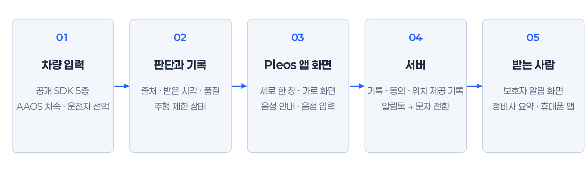
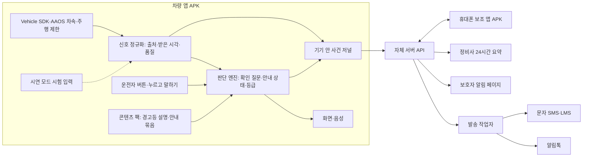
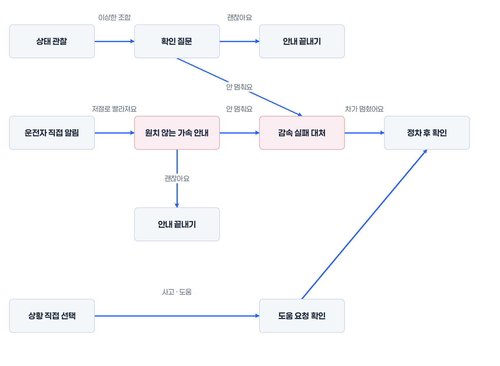
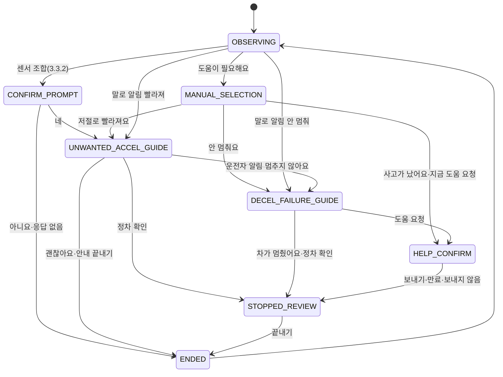
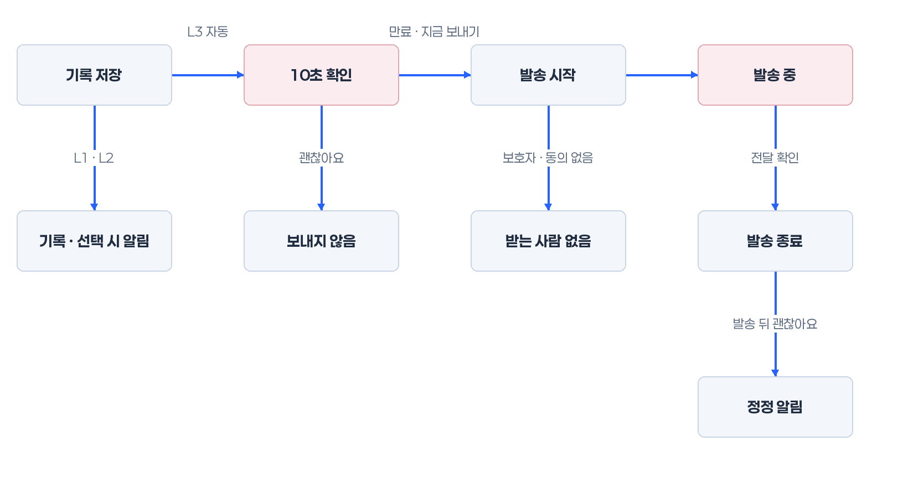
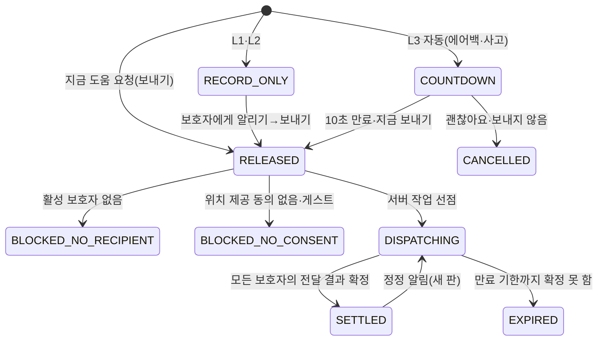
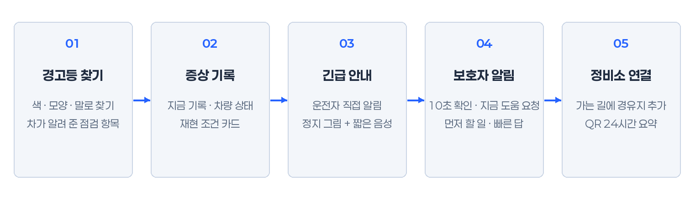

# 플레오스 가드 PRD 및 기술 명세

- 문서 버전: **4.0 / 2026-11-12 / Asia/Seoul**.
- 대상: **Pleos 탑재 차량 전용 앱**입니다. 차량 앱이 주제품이고, 안드로이드 휴대폰 앱은 같은 차량을 돕는 보조 앱입니다.
- 문서 상태: 개발 착수용 제품 요구사항과 인터페이스 설계입니다. 앱과 서버는 아직 구현하지 않았습니다. 센서 수신, 메시지 발송, 화면 사용성, 안전 효과도 시험하지 않았습니다.
- 이전 판: [PRD v3](integrated-vehicle-care-2026-11-12-prd-v3.md), [PRD v2](integrated-vehicle-care-2026-11-12-prd-v2.md), [통합 기획 v1](integrated-vehicle-care-2026-11-12-plan-v1.md). 바뀐 점은 [부록 A](#부록-a-v3--v4-변경-요약)에 있습니다.
- 개발 계약: [API](../specs/vehicle-care/api.openapi.json), [DB](../specs/vehicle-care/database.sql), [개발용 판정 설정 rules-lab](../specs/vehicle-care/rules-lab.json), [UI 토큰](../specs/vehicle-care/ui-tokens.json), [인수 시나리오](../specs/vehicle-care/acceptance-scenarios.json). 5.2절의 고정 이름을 계약과 똑같이 씁니다.
- 화면 상세: [화면 설계 v4](ux-v4-section.md)(작성 중). 시안은 [세로](../../output/submission/assets/v4/portrait/)와 [가로](../../output/submission/assets/v4/landscape/) 폴더, 도표는 [도표](../../output/submission/assets/v4/diagrams/) 폴더에 있습니다.
- SDK 근거: [SDK 종합 리뷰](pleos-sdk-review.md), [안전 기능 상세](../sdk/vehicle-safety-capabilities.md). 두 문서에 남은 "경고등 단발 조회 가능", "핸들 회전각" 서술은 아직 정정 전입니다. 신호 판단은 이 문서 2.3절을 따릅니다.
- [PRD v2 확인 기록](integrated-vehicle-care-prd-2026-11-12-evidence.json)은 v2 시점 기록입니다. v4를 검증한 자료가 아닙니다.

### 이 문서를 읽는 법

**기능 등급.** 공모전 공지 8은 "문서에서 지원되지 않는 기능은 사용할 수 없고, 필요하면 기획서에 향후 계획으로 적으라"고 안내합니다. 그래서 모든 기능에 등급을 붙입니다.

| 표시 | 뜻 | 공모전 문서에서의 위치 |
| --- | --- | --- |
| [시연] | 공개 SDK와 Pleos 문서 경로로 지금 만들고 에뮬레이터에서 보여 줄 수 있습니다. | 개발 범위 |
| [설계] | 공개 SDK로 가능하지만 자체 서버나 휴대폰 앱 같은 추가 구현이 필요합니다. | 개발 범위(서버·휴대폰 포함) |
| [향후] | 공개 문서에 없는 API·권한·장치가 필요합니다. | 향후 계획으로만 씁니다. |

[시연: Virtual Console]은 에뮬레이터의 차량 상태 도구(Virtual Console)로 실제 SDK 값을 바꿔 보여 줄 수 있다는 뜻입니다. [시연: 시험 입력]은 기능은 만들지만 에뮬레이터에 그 신호 카드가 없어 앱 안 시험 입력으로 보여 준다는 뜻입니다.

**근거 표시.** 수치와 사실 옆에 지위를 적습니다.

- (공식): Pleos·Android·현대자동차·발송사의 공개 원문으로 확인한 사실이나 수치입니다.
- (자체): 이 앱이 정한 설계값입니다. 공식 기준이 아닙니다.
- (실험값): rules-lab의 개발 시작값입니다. 제조사 기준이나 사고·고장 판정 기준이 아닙니다.
- (가정): 사업·시험 계획을 위한 가정입니다. 실적이 아닙니다.
- (확인 필요): 원문이나 실제 기기로 다시 확인해야 합니다.

## 1. 서비스 개요 및 공모전 차별화 포인트

### 1.1 한 줄 정의

**보이는 경고등을 찾아 이해하고, 순간 증상을 그때의 차량 상태와 함께 기록하며, 위급할 때 음성으로 안내하고 보호자에게 위치를 알리는 Pleos 차량 앱입니다.**

앱은 경고등 상태를 차에서 읽지 않습니다. 일반 앱에 그 권한이 없기 때문입니다(2.3절). 운전자가 본 표시를 색·모양·켜짐 상태로 찾습니다. 앱은 차를 제어하지 않고, 고장 원인을 판정하지 않으며, 119에 자동 신고하지 않습니다.

### 1.2 기능 구성

네 가지 핵심 기능(F1~F4)과 두 가지 연결 기능(F5·F6), 시연 기능(F0)으로 나눕니다. 화면과 문서는 아래 이름만 씁니다.

| ID | 이름 | 하위 기능(등급) | 사용자가 끝내는 일 |
| --- | --- | --- | --- |
| F1 | 경고등 찾기 | 색→모양→켜짐·깜박임 찾기 [시연], 문구·말로 찾기 [시연], 경고등 설명(정차 후 상세) [시연], 차가 알려 준 점검 항목(N1) [시연: 일부 시험 입력], 출발 전 점검 카드(N7) [시연], 주 1회 경고등 익히기 카드(N12) [시연] | 본 표시의 뜻과 지금 할 일을 압니다. |
| F2 | 증상 기록 | 지금 기록(버튼·말, N3) [시연], 차량 상태 스냅샷 시간표 [시연], 증상 재현 조건 카드(N2) [시연], 정비 노트와 재발 확인(N6) [시연] | 정비소에서 "언제, 어떤 상태에서" 났는지 보여 줍니다. |
| F3 | 긴급 안내 | 원치 않는 가속 안내 [시연], 감속 실패 대처 안내 [시연], 상황 직접 선택 [시연], 비상 절차 미리 익히기(N8) [시연] | 위급한 순간에 설명서 문장 하나를 음성으로 듣고, 정차 뒤 다음 일을 고릅니다. |
| F4 | 보호자 알림 | 발송 전 확인 10초 [설계], 지금 도움 요청 [설계], 사고 순간 차량 스냅샷(N4) [시연: 일부 시험 입력], 위치 제공 알림·공유 중지(N10) [설계], 보호자 연습 알림·빠른 답(N11) [설계] | 등록한 보호자가 상황·위치·할 일을 받습니다. |
| F5 | 정비소 연결 | 가는 길에 정비소 들르기(N5) [시연, 내비 탑재 조건], 정비 자료 공유 링크 [설계] | 가던 길을 지키며 정비소에 들르고, 정비사에게 기록을 보여 줍니다. |
| F6 | 휴대폰 보조 앱 | 별도 APK·QR 연결 [설계], 사진으로 경고등 찾기(정차 후, 인식 엔진은 [향후]) [설계], 보호자 발송 상태 이어 보기(조건부) [설계] | 차 화면 밖에서 준비·사진·상태 확인을 돕습니다. |
| F0 | 시연 모드 | 시험 입력 재생기, 모의 서버·모의 발송기, [시험 입력] 표시 [시연] | 심사위원이 실제 SDK 값과 시험 입력을 구별해 봅니다. |

N1~N12는 이번 판에서 새로 넣은 기능의 번호입니다. 모두 공개 SDK 근거가 있습니다.

### 1.3 사용자와 사용 장면

아래 장면은 설계를 위한 가정입니다. 실제 사용자 조사 결과가 아닙니다.

| 사람 | 장면 | 앱이 하는 일 |
| --- | --- | --- |
| 첫 차를 산 초보 운전자 | 출근길 계기판에 주황색 표시가 켜졌지만 이름을 모릅니다. | 주행 중에는 "안전한 곳에 세운 뒤 보세요" 한 줄과 음성만 냅니다. 색을 누르면 본 시각을 남깁니다. 정차 뒤 색→모양→켜짐을 세 번 눌러 뜻과 할 일을 봅니다. |
| 간헐 소음을 겪는 운전자 | 브레이크를 밟을 때만 앞에서 소리가 납니다. 정비소에서는 소리가 나지 않습니다. | "지금 기록"을 세 번 남기면 "3번 모두 브레이크를 밟는 중"처럼 공통 조건 카드를 만듭니다. |
| 혼자 운전하는 고령 부모와 자녀 보호자 | 부모가 접촉 사고를 냈지만 당황해 전화를 걸지 못합니다. | "사고"를 고르면 발송 전 확인 10초 뒤 자녀에게 상황·위치·탑승 상태와 할 일을 보냅니다. 부모 화면에는 누구에게 언제 보냈는지 남습니다. |
| 가족이 함께 쓰는 차 | 아버지 차를 대학생 자녀가 몰고 나갑니다. | 정차 중 "이번 운전자"를 고르게 합니다. 기록과 보호자는 운전자별로 나눕니다. 게스트 운전자의 위치는 자동으로 보내지 않습니다. |
| 정비사 | 운전자의 설명이 막연합니다. | 차 화면 요약이나 24시간 읽기 전용 링크로 시간표와 재현 조건 카드를 봅니다. |
| 보호자 | 처음 받는 링크는 의심합니다. | 등록할 때 받은 [연습] 알림으로 발신 이름을 익힙니다. 실제 알림은 첫 줄에서 할 일을 봅니다. |

사용 맥락은 셋입니다. 정차 중에는 찾기·설명·설정·정비 정리를 씁니다. 주행 중에는 버튼 한 번과 짧은 음성만 씁니다. 사고나 위급 상황 뒤에는 정차 확인, 보호자 알림, 정비 연결로 이어 갑니다.

### 1.4 하지 않는 것

- 차를 제어하지 않습니다. 제동, 가속 차단, 비상등 켜기를 하지 않습니다.
- 고장 원인과 부상 정도를 판정하지 않습니다. 위험 등급은 "추정 대응 우선순위"입니다.
- 119나 블루링크 센터에 자동 신고하지 않습니다. 화면과 메시지에 "필요하면 119에 직접 신고하세요"를 씁니다.
- 경고등 상태를 차에서 읽지 않습니다.
- 원본 녹음·영상·차량 카메라·블랙박스를 쓰지 않습니다([향후]).
- 늘 듣는 음성 인식을 하지 않습니다. 버튼을 누른 뒤나 앱이 물은 뒤에만 짧게 듣습니다.
- 외부 음성 인식 서비스와 LLM(대규모 언어 모델)을 쓰지 않습니다. 긴급 조작 문장을 새로 만들지 않습니다.
- 보호자가 운전자 승인 없이 차량 마이크나 카메라를 켜는 기능을 넣지 않습니다.
- 운전 기록을 광고·마케팅에 쓰지 않습니다.

### 1.5 기존 기능과의 관계

| 기존 기능 | 그 기능이 하는 일(공식) | 플레오스 가드와의 관계 |
| --- | --- | --- |
| 블루링크 에어백 전개 통보·SOS | 에어백이 펼쳐지면 위치·고객 정보를 블루링크 센터로 보내고 상담원을 연결합니다. 에어백이 펼쳐지지 않는 사고나 전원이 끊긴 경우는 대상이 아니거나 제공되지 않을 수 있습니다. | 대체하지 않고 보완합니다. 에어백이 펼쳐지지 않은 사고도 운전자가 고르면 가족 보호자에게 알립니다. |
| 페달 오조작 안전 보조(PMSA) | 장애물이 가까운 정차 상황에서 가속 페달을 세게 밟으면 차가 구동력을 줄이고 제동하며 경고음을 냅니다. 디 올 뉴 아반떼 기본 사양입니다. | 차가 먼저 작동합니다. 앱은 차를 제어하지 않고 차량 경고를 대신하지 않습니다. 정차 출발 직후와 저속 구간에서는 자동 질문을 띄우지 않습니다. |
| 시스템 출발 전 안내(Pre-drive guide) | 문·안전벨트·브레이크 등을 순서대로 그림으로 안내합니다. | 같은 순서를 반복하지 않습니다. 점검 항목, 정비 일정, 보호자 준비만 보여 줍니다. |
| 시스템 주행 정보 화면(Driving view) | 차량 상태를 3D로 보여 줍니다. | 앱 화면이 이 영역을 가리거나 따라 하지 않습니다. 앱은 이상과 기록만 보여 줍니다. |
| 119 | 구조 기관입니다. | 앱은 신고하지 않습니다. 보호자 메시지에 119 신고 방법을 적습니다. |

출처: [블루링크 설명서](https://ownersmanual.hyundai.com/ivi/STD_GEN5/AVNT/KOR/Korean/009_BlueLink_5.html), [현대자동차그룹 PMSA 설명](https://www.hyundaimotorgroup.com/ko/tag/pedal-misapplication-safety-assist), [아반떼 기본 사양 보도](https://biz.newdaily.co.kr/site/data/html/2026/08/05/2026080500107.html), [Pleos 용어집](https://document.pleos.ai/docs/connect/guide/glossary).

### 1.6 공모전 평가항목과 보여 줄 증거

공식 1차 평가항목은 차량특화성·창의성·기술 활용성·사업성입니다. 이 문서는 수상이나 마켓 입점을 보장하지 않습니다. [공식 심사 안내](https://appdevchallenge.auto-hmg.io/guide/judging-awards)

| 평가 관점 | 이 앱의 내용 | 보여 줄 증거 |
| --- | --- | --- |
| 차량특화성 | 브레이크·앞바퀴 조향각·방향지시등·도어·좌석·에어백·주행거리를 기록과 묶습니다. 주행·정차 상태에 따라 화면의 깊이가 바뀝니다. | Virtual Console로 바꾼 값이 기록에 붙는 시연(6.9절) |
| 창의성 | 원본 녹음 대신 "그때 차가 무엇을 하고 있었나"를 남깁니다. 재현 조건 카드와 정비 뒤 재발 확인으로 한 기록을 끝까지 잇습니다. | 재현 조건 카드, 정비 노트 흐름 |
| 기술 활용성 | Vehicle·TextToSpeech·SpeechToText·FusedLocation·NaviHelper 5종 SDK와 AAOS 차속·주행 제한을 역할에 맞게 씁니다. 권한 없음·결측·시험 입력도 화면에 그대로 보입니다. | 차량 연결 확인 표, 2.3절 신호 표 |
| 사업성 | 사고가 없어도 여는 이유(출발 전 점검, 경고등 익히기, 정비 노트)와 가정을 밝힌 MAU 산식이 있습니다. | 1.7절 |

### 1.7 사업성 가정

**타깃.** (1) Pleos Connect 기본 탑재 차량의 첫 차·초보 운전자, (2) 혼자 운전하는 가족을 둔 보호자, (3) 간헐 고장을 겪는 운전자, (4) 가족이 함께 쓰는 차입니다.

**시장 근거(공식).** 현대자동차그룹은 2030년까지 약 2천만 대에 Pleos Connect를 적용할 계획입니다([뉴스룸 2026-04-30](https://www.hyundaimotorgroup.com/ko/news/hyundai-motor-group-redefines-in-vehicle-experience-with-pleos-connect-next-generation-infotainment-system)). 디 올 뉴 아반떼는 전 트림에 기본 적용됩니다([보도 2026-08-05](https://biz.newdaily.co.kr/site/data/html/2026/08/05/2026080500107.html)). 2025년 국내 판매는 아반떼 7만 9,335대, 그랜저 7만 1,775대입니다([뉴스룸 2026-01-05](https://www.hyundaimotorgroup.com/ko/news/hyundai-motor-company-sales-4138180-units-2025)).

**예상 MAU(가정).** 설치율과 월 활성률은 사용자 확정 전 가정입니다(6.13절).

| 단계 | 산식 | 결과 |
| --- | --- | --- |
| 1단계(국내) | 연간 신차 약 15만 대(아반떼+그랜저 판매 규모를 대리값으로 사용) × 설치율 5% × 월 활성 40% | 약 3,000명 |
| 확대 단계 | 2030년 약 2천만 대 × 설치율 1% × 월 활성 30% | 약 6만 명 |

**Retention 가설(가정).** 설치 7일 뒤 35%, 30일 뒤 20%, 3개월 뒤 15%입니다. 측정은 App Market 입점 뒤에 합니다. 다시 여는 이유는 출발 전 점검 카드, 주 1회 경고등 익히기, 정비 노트와 500km 재발 확인, 보호자 연습 알림입니다.

**초기 이용 시험(가정).** 운전자 20명과 정비사 5명, 4주를 목표로 합니다. 이 숫자는 MAU가 아니라 시험 규모입니다. 경고등 찾기 성공률과 걸린 시간, 기록 재열람 비율, 재현 조건 카드가 만들어진 비율, 재발 확인 응답률을 잽니다. 위험한 오해도 잽니다. 예를 들어 "지금 도움 요청"을 119 연결로 오해한 비율, "지금 보내기"와 "괜찮아요 · 보내지 않음" 혼동, 연습 중 실제 발송 건수(목표 0건)입니다. 사고 예방률이나 구조 성공률은 이 시험으로 계산하지 않습니다.

**수익 모델 후보(검토 방향, 계약 아님).** 기본 무료, 가족 보호자 플랜, 정비소 제휴(정비 자료 전달), 법인·렌터카 차량 관리입니다.

**확대 단계.** 국내 Pleos 차종(아반떼·그랜저 등) → 보호자 플랜과 정비소 제휴 → 권한이 열리면 경고등 자동 연동 같은 [향후] 기능과 법인 차량 순서입니다.

### 1.8 향후 계획 목록(공지 8)

아래 기능은 모두 [향후]입니다. 지금 만들지 않고 기획서에 향후 계획으로만 적습니다. 남은 설계 메모는 3.8절에 있습니다.

| 기능 | 막힌 이유(공식 확인) | 지금의 대체 |
| --- | --- | --- |
| 경고등 상태 읽기 | `Safety.getTelltalesInfo` 등 4개 API가 모두 `PRIVATE_CAR_SAFETY`(signature\|privileged) 권한을 요구합니다. | 색·모양·상태로 찾기, 같은 원인의 공개 신호(N1) |
| 원본 녹음·영상·차량 카메라·블랙박스 | 공개 API가 없습니다. 음성 인식은 문장만 돌려줍니다. | 차량 상태 시간표, 말로 남긴 문장 |
| 진동 분석(가속도·자이로·휠 신호), 충격 센서 | 공개 경로가 없습니다. | 재현 조건 카드, 느낀 곳 문진 |
| 가속 페달 값, 기어, 주차 브레이크, 시동 상태, 비상등, 현재 타이어 공기압 | 공개 API가 없거나 숨김(@hide)·PRIVATE입니다. | 주행 제한 상태, 사용자 체크 |
| 차량 전원이 끊긴 뒤 차량 신호 이어받기 | 시동이 꺼지면(Suspend) 일반 앱은 소리를 낼 수 없습니다. 서드파티용 차량-휴대폰 연동 SDK가 없습니다. | 서버가 발송 정책을 이어 가고 휴대폰은 상태를 보여 줍니다. |
| 사진 인식 엔진, 통신이 없을 때 문자 작성 화면 미리 채우기 | 차량 카메라가 없고 Pleos 밖 기능입니다. | 휴대폰 사진 첨부 |
| 정비소 제휴 예약 API, Pleos 프로필 연동, Gleo 질문, Fleet·Vehicle Data API | 계약·승인이 필요합니다. | 앱 안 정비소 목록, 이번 운전자 선택 |

### 1.9 출시 전 조건

| 조건 | 통과 증거 | 통과 전 제품 표시 |
| --- | --- | --- |
| 대상 차량 프로필 | 디 올 뉴 아반떼 등 대상 차량의 취급설명서 판과 사양 확정 | 아반떼 그림은 시각 기준입니다. 안내 묶음은 `DRAFT_DEMO`입니다. |
| 신호 지원·권한 | 대상 차량의 기능×영역별 지원과 권한 결과 | `NOT_SUPPORTED`·`PERMISSION_DENIED`를 화면에 표시합니다. |
| 안내 문장과 그림 | 대상 차량 설명서의 절·판·검토자·검토일 | 검토 전 묶음은 시연 모드에서만 "검토 전 예시"로 보입니다. |
| 주행 중 사용 | DO(주행 중 사용 최적화) 선언, 주행 제한별 화면 시험, Pleos 기술 문의 답변 | 주행 중 기능을 기록과 음성으로 줄입니다. |
| 알림톡·문자 | 비즈니스 채널, 승인 템플릿, 발신번호 등록, 계약, 결과 조회 시험 | 모의 발송기만 씁니다. 실제 발송 버튼은 없습니다. |
| 위치정보·개인정보 | 위치기반서비스 사업 신고 대상 검토, 위치정보 이용약관·처리방침, 운전자 동의·제공 기록·통보 시험 | 실제 보호자 위치 전송을 끄고 시험 표시를 붙입니다. |
| 앱 이름 | "Pleos" 상표 사용 검토 | 이름은 유지합니다(사용자 결정). 위험만 기록합니다. |

## 2. 시스템 아키텍처 및 데이터 파이프라인

### 2.1 전체 구조와 원칙



흐름은 다섯 단계입니다. 차량 입력(공개 SDK 5종, AAOS 차속, 운전자 선택) → 판단과 기록(출처·받은 시각·품질, 주행 제한 상태) → Pleos 앱 화면(세로 한 창·가로 화면, 음성 안내·음성 입력) → 서버(기록·동의·위치 제공 기록, 알림톡→문자 전환) → 받는 사람(보호자 알림 화면, 정비사 요약, 휴대폰 앱)입니다.



- **판단의 권위는 차량입니다.** 안내 상태, 화면, 음성은 차량 앱이 정하고 서버 응답을 기다리지 않습니다. 서버는 같은 rules-lab 판(`rule_profile_id`)으로 위험 등급을 다시 계산해 발송 정책에만 씁니다. 두 값이 다르면 높은 등급을 쓰고 시간표에 불일치를 남깁니다.
- **기기 안 저널을 먼저 씁니다.** 사건, 행동, 안내 출력은 차량 안 저널에 먼저 기록합니다. 서버 전송은 저널을 뒤따릅니다. 인터넷이 없어도 경고등 찾기·긴급 안내·기록은 같은 화면으로 동작합니다.
- **콘텐츠 팩은 APK에 넣어 배포합니다.** 서버는 서명과 해시가 맞는 갱신만 내려 줍니다.
- **신호 수신을 막지 않습니다.** 화면 갱신, 저장, 네트워크, 발송은 신호 수신 스레드와 분리합니다.
- **차량과 휴대폰은 직접 연결하지 않습니다.** 서버를 거칩니다(2.7절).

### 2.2 모듈

아래 경로는 앞으로 만들 구조입니다. 지금 저장소에 구현돼 있다는 뜻이 아닙니다. 공모전 기준(API 28 이상, Pleos AVD 2.1.0)과 SDK 의존성을 첫 빌드에서 함께 확인합니다.

| 경로(제안) | 책임 | 인터페이스 |
| --- | --- | --- |
| `apps/pleos-ivi` | Kotlin·Compose 차량 앱. 화면·음성·SDK 연결 | `UiState`, 사용자 명령 |
| `apps/android-companion` | 휴대폰 보조 앱. Pleos SDK를 넣지 않은 별도 APK | QR 연결, 사진, 상태 보기 |
| `modules/vehicle-adapter` | SDK·AAOS 신호별 구현, 기능×영역 지원 확인 | `capabilities()`, `observe(signal)`, `read(signal)` |
| `modules/event-engine` | 순수 Kotlin 판단: 품질, 확인 질문, 안내 상태, 등급, 재현 조건 | `reduce(state, input, nowElapsedMs)` |
| `modules/content-pack` | 경고등 설명·안내 묶음 읽기와 서명 확인 | `bundle(guideId, profileId)` |
| `modules/incident-journal` | Room 저널, 전송 대기열, 암호화 | `append`, `pin`, `syncPending` |
| `modules/demo` | 시연 모드: 시나리오 재생기, 모의 서버, 모의 발송기 | 실제와 같은 어댑터·API 인터페이스 |
| `services/api` | TypeScript HTTP API. 소유권·사건·동의·위치 제공 기록 | OpenAPI `/v1` |
| `services/notification-worker` | PostgreSQL 작업 큐와 발송사 어댑터 | 기한·취소 경쟁, 문자 전환 |

v3의 `modules/signal-analysis`(진동 분석)는 [향후]로 옮겼습니다.

### 2.3 입력 신호(공개 경로만)

앱은 원시 CAN이나 VHAL(차량 하드웨어와 운영체제 사이 계층)에 직접 붙지 않습니다. 공개 SDK와 Pleos 문서가 안내하는 AAOS 경로만 씁니다. [Pleos 하드웨어 정책](https://document.pleos.ai/docs/pleos-only/vehicle-app-planning-guide/platform-api-architecture), [차종별 가용성](https://document.pleos.ai/docs/pleos-only/vehicle-app-planning-guide/api-compatibility-availability), [AOSP VHAL](https://source.android.com/docs/automotive/vhal/vhal-interface)

"주기형"은 값이 일정한 간격으로 오는 신호입니다. "변화 알림형"은 값이 바뀔 때만 오는 신호입니다.

| 신호 | API(권한, 보호 수준) | 갱신 방식 | 쓰는 기능 | 에뮬레이터 |
| --- | --- | --- | --- | --- |
| 차속 | AAOS `CarPropertyManager` `PERF_VEHICLE_SPEED`(m/s, `android.car.permission.CAR_SPEED`). Pleos FAQ 안내 경로 | 주기형, 측정 시각 있음 | 확인 질문, 스냅샷, 재현 조건 | 카드 없음 → [시연: 시험 입력] |
| 브레이크 밟음 | `Brake.getCurrentBrakePedalStatus`, `registerBrakePedalStatus`(`CAR_DRIVE`, normal). 참·거짓·null | 변화 알림형, 측정 시각 없음 | 확인 질문, 미리 익히기, 스냅샷 | [시연: Virtual Console] Brake Pedal 0~100% |
| 앞바퀴 조향각 | `SteeringWheel.getCurrentSteeringWheelAngle`, `registerSteeringWheelAngle`(`CAR_DRIVE`, normal). 도, 왼쪽 음수. 핸들 회전각이 아닙니다. | 변화 알림형 | 쏠림 기록, 재현 조건 | [시연: Virtual Console] Steering Angle |
| 주행거리 | `Odometer.getCurrentDistanceDriven`(km), `registerDistanceDriven`(`CAR_DRIVE`) | 변화 알림형 | 스냅샷, 재발 확인 | [시연: Virtual Console] Odometer |
| 방향지시등 | `TurnSignal.getCurrentTurnSignalState`, `registerTurnSignalState`(`CAR_LIGHTS`) | 변화 알림형 | 재현 조건 | [시연: Virtual Console] Turn Signal |
| 도어 | `Door.getCurrentDoorPosition`, `registerDoorPosition`(`CAR_DOORS`, 후드·트렁크 포함) | 변화 알림형 | 점검 항목, 사고 스냅샷, 이번 운전자 | [시연: Virtual Console] Door Position·Trunk |
| 좌석 점유·안전벨트 | `Seat.getCurrentSeatOccupancy`, `getCurrentSeatBeltBuckledState`(`CAR_SEATS`, normal), `Safety.hasSeatBeltNotBuckledWarning`(`CAR_SAFETY`, normal) | 변화 알림형 | 사고 스냅샷, 점검 항목 | 좌석 점유 [시연: Virtual Console], 안전벨트 [시연: 시험 입력] |
| 에어백 전개 | `Safety.hasSeatAirbagBeenDeployed`, `registerSeatAirbagDeployed`(`CAR_SAFETY`, normal). 좌석 영역별 | 변화 알림형 | F4 L3 사건 | [시연: 시험 입력] |
| 엔진오일·브레이크액·워셔액·출력 저하 | `Safety.getEngineOilLevelState`, `getBrakeFluidLevelState`, `hasLowWasherFluidWarning`, `hasPowerDownWarningIndicator`(`CAR_SAFETY`, normal) | 변화 알림형 | 점검 항목(N1) | [시연: 시험 입력] |
| 연료·배터리 % | `Fuel.getFuelPercent`, `EvBattery.getEvBatteryStateOfCharge`(`CAR_ENERGY`) | 변화 알림형 | 스냅샷, 출발 전 점검 | 배터리 SOC [시연: Virtual Console], 연료는 AVD 값 확인 |
| 주행 제한 상태 | AAOS `CarUxRestrictionsManager` | 알림형 | 주행 중 화면 규칙, 정차 확인 | adb `driving_regulation on/off` |
| 위치 | FusedLocation `registerFusedLocationCallback`, `getLastKnownLocation`(`pleos.car.permission.FUSED_LOCATION`, dangerous, 실행 중 허용). 위도·경도·`confidence`·`timestampMillis` | 콜백 | 보호자 알림, 기록 | 에뮬레이터 위치 설정(확인 필요) |
| 음성 출력·입력 | TextToSpeech·SpeechToText 3.3.1, 기기 안 모드(ON_DEVICE), `TTS_SERVICE`·`STT_SERVICE` | 요청형 | 안내, 말로 기록·찾기, 짧은 대답 | 소리 출력, 마이크(Extended Controls) |
| 경로·경유지·주소 | NaviHelper 3.0.5 `requestRoute`, `requestRouteWithWaypoints`, `addWaypoint`, `requestTrip`, `getCurrentLocationInfo`, `requestNavigationScreen` | 요청형 | 정비소 들르기, 주소 | 에뮬레이터 내비 동작 확인 필요 |
| 경고등 상태 | `Safety.getTelltalesInfo` 등 4개(`PRIVATE_CAR_SAFETY`, signature\|privileged) | — | 쓰지 않습니다. | [향후] |
| 원본 녹음·카메라·블랙박스·IMU·충격·가속 페달·기어·주차 브레이크·현재 타이어 공기압·시동·비상등 | 공개 경로 없음, 또는 숨김·PRIVATE | — | 쓰지 않습니다. | [향후] |

- 차속: Vehicle SDK 2.3.2에서 차속 리스너가 삭제됐습니다. Pleos FAQ는 AAOS `PERF_VEHICLE_SPEED`를 안내합니다(공식). 공모전 공지의 SDK 5종 밖 Android 경로이므로 허용 여부를 Pleos 기술 문의 항목에 둡니다(6.13절). [Pleos FAQ](https://document.pleos.ai/docs/pleos-only/vehicle-app-developer-guide/vehicle-app-faq), [Google 차량 속성](https://developer.android.com/reference/android/car/VehiclePropertyIds)
- 에어백: 앱이 켜질 때 이미 참인 값은 새 사고로 보지 않습니다. 새로 참이 된 변화만 사건으로 만듭니다. `hasSeatAirbagEnabled`(에어백 사용 가능 상태)는 이름과 설명(참 = 문제)이 어긋나므로 설명서 대조 전에는 점검 후보로만 씁니다.
- 좌석 점유: SDK가 값 1을 참으로 바꿉니다. 에뮬레이터의 Empty/Occupied 의미를 시연 전에 맞춰 봅니다.
- 경고등 찾기의 도감 항목은 공개 열거형 `TelltaleType`의 상수 이름(예: `TPMS`, `ENGINE`, `ABS`, `AIRBAG`, `POWER_DOWN`)을 키로 참조합니다. 상수를 참조하는 것은 상태를 읽는 것이 아니며 권한이 필요하지 않습니다.
- Android에 정의된 다른 속성(`ENGINE_RPM`, `WHEEL_TICK` 등)은 대상 Pleos 차량의 제공 증거가 아닙니다. 쓰지 않습니다.

### 2.4 권한 선언

쓰는 API의 최소 권한만 선언합니다. Sample App의 권한 목록을 통째로 복사하지 않습니다.

- 선언: `pleos.car.permission.CAR_DRIVE`, `CAR_SAFETY`, `CAR_SEATS`, `CAR_DOORS`, `CAR_LIGHTS`, `CAR_ENERGY`, `CAR_INFO`(차량 등록 때 VIN 해시), `TTS_SERVICE`, `STT_SERVICE`, `FUSED_LOCATION`(실행 중 허용 요청), `NAVI_ROUTE`, `NAVI_ROUTE_SEARCH`, `NAVI_CUSTOM_MAP`(검색 화면을 열 때), AAOS `android.car.permission.CAR_SPEED`(확인 필요).
- 선언하지 않음: `PRIVATE_*`, `CONTROL_*`, 숨김 API의 권한.

### 2.5 SDK 연결·스레드·오류 규칙

공개 SDK 소스로 확인한 동작(공식)과 앱 규칙(자체)입니다.

| SDK 동작(공식) | 앱 규칙(자체) |
| --- | --- |
| `Vehicle.initialize()`에는 연결 완료 콜백이 없습니다. 연결 중 호출은 대기열에 쌓이고 대기 시간 제한이 없습니다. | 앱 단위 서비스에서 한 번 연결하고 마지막에 `release`합니다. 모든 get·지원 확인 호출에 3,000ms 시간 제한을 둡니다. 넘으면 `UNAVAILABLE`입니다. |
| 권한이 없으면 get·set·지원 확인은 `onFailed(SecurityException)`로 옵니다. register·unregister는 호출 즉시 `SecurityException`을 던집니다. TTS·STT·FusedLocation도 권한이 없으면 바로 `SecurityException`을 던집니다. | 모든 호출부를 try/catch로 감싸 `PERMISSION_DENIED`로 바꿉니다. 앱을 끝내지 않고 화면에 "권한 없음"을 표시합니다. |
| 결과·이벤트 콜백은 메인 스레드가 아닌 Binder 스레드에서 옵니다. | 메인 스레드 상태 흐름(`StateFlow`)으로 넘긴 뒤 화면에 씁니다. |
| 리스너 등록·해제의 열쇠는 (속성, 영역, 리스너 객체)입니다. 첫 리스너는 초기값을 받는다는 보장이 없습니다. | (신호, 영역)마다 리스너 객체 하나를 둡니다. 등록 직후 get으로 초기값을 한 번 읽습니다. |
| AVD에서 기능은 지원이어도 특정 영역이 미지원일 수 있습니다. | 지원 여부를 기능×영역 단위로 저장합니다. |
| NaviHelper의 인자 없는 `initialize()`는 실패를 알리지 않습니다. FusedLocation `isSupported`는 서비스 패키지가 있는지만 봅니다. | NaviHelper는 `initialize(onConnected, onFailed)`만 씁니다. FusedLocation은 첫 위치 콜백 또는 3초 시간 제한으로 연결을 판단합니다. |

서비스 연결이 끊기면 영향을 받는 신호만 `UNAVAILABLE`로 바꿉니다. 인터넷 끊김과 구분합니다.

### 2.6 실행 정책

운전 중에는 내비게이션이 앞에 있는 경우가 많습니다. 그래서 앱이 뒤에 있을 때 계속할 작업을 정해 둡니다.

| 작업 | 앱이 앞에 있음 | 앱이 뒤에 있음(주행) | 정차 중 | 시동 꺼짐(Suspend) |
| --- | --- | --- | --- | --- |
| 브레이크·에어백·도어·좌석 구독, 사건 저장 | 유지 | 유지(서비스 형태 허용은 확인 필요) | 유지 | 저장 뒤 중지 |
| 차속 구독 | 유지 | 유지 | 유지 | 중지 |
| 음성 인식 | 누를 때·물은 뒤만 | 같음 | 같음 | 중지 |
| 음성 안내 | 허용 | 허용. 화면을 강제로 앞으로 가져오지 않음 | 허용 | 즉시 멈추고 오디오 포커스 반납 |
| 서버 상태 확인 | 진행 중 사건만: 2초 간격 60초, 그 뒤 10초 간격(rules-lab `performance.server_poll_*`) | 같음 | 같음 | 중지 |
| 화면 움직임 | 주행 중 없음 | 중지 | 허용 | 중지 |

차량에는 구글 서비스(GMS)가 없어 푸시 알림(FCM)을 가정하지 않습니다. 앱이 뒤에 있을 때 긴급 안내가 시작되면 음성 1회와 시스템 알림 1개를 냅니다. [화면 모델](https://document.pleos.ai/docs/pleos-only/vehicle-app-planning-guide/app-structure-screen-model)

### 2.7 차량과 휴대폰의 연결

- **두 APK입니다.** FusedLocation AAR이 `android.hardware.type.automotive`를 필수로 넣기 때문에 차량 APK는 휴대폰에 설치되지 않습니다(공식). 공통 순수 Kotlin 모듈만 나눠 씁니다.
- **정차 중 QR 한 번으로 연결합니다.** 차량 화면이 일회용 QR(5분 만료, 자체)을 보여 줍니다. 휴대폰 앱이 읽어 서버에 등록합니다(`POST /v1/pairing/qr`, `POST /v1/pairing/confirm`). 블루투스 직접 연결은 가정하지 않습니다. 에뮬레이터의 블루투스 동글 연동도 종료됐습니다. QR 화면은 주행 제한 `NO_SETUP`에 걸리므로 정차 중에만 엽니다.
- **출발 준비를 두 기기가 나눕니다.** `POST /v1/trips`가 만든 `trip_id`를 차량과 휴대폰이 함께 씁니다.

| 상황 | 휴대폰이 아는 것 | 휴대폰이 하는 일 |
| --- | --- | --- |
| 차량이 온라인 | 서버를 거친 사건 번호, 발송 상태, 남은 확인 시간 | 알림 표시, 운전자 본인의 "지금 보내기·괜찮아요 · 보내지 않음", 상태 보기 |
| 사건을 서버에 보낸 뒤 차량 전원이 꺼짐 | 마지막 사건과 남은 확인 시간 | 서버가 `release_at`대로 발송을 이어 갑니다. 휴대폰은 상태를 보여 줍니다. |
| 사건을 보내기 전 차량이 꺼짐, 또는 차량이 오프라인 | 모릅니다. | 차량 사건을 지어내지 않습니다. 문자 작성 화면 미리 채우기는 [향후]입니다. |
| 휴대폰도 꺼짐 | — | 무정전 동작을 약속하지 않습니다. |

같은 차량·같은 `trip_id`에 열린 알림이 있으면 서버는 새 사건을 관련 사건으로 묶습니다. 보호자에게 두 번 보내지 않습니다(5.9절).

## 3. 기능 명세

기능마다 등급, 사용자 이야기, 입력 신호, 처리 규칙, 화면, 실패·결측 처리를 적습니다. 화면의 시각 상세는 [화면 설계 v4](ux-v4-section.md)를 따릅니다.

### 3.1 F1 경고등 찾기

**사용자 이야기.** "계기판에 처음 보는 표시가 켜졌습니다. 이름을 몰라도 색과 모양으로 찾아 뜻과 할 일을 알고 싶습니다."

#### 3.1.1 색 → 모양 → 켜짐·깜박임 찾기 [시연]

- 첫 화면에서 계통 이름을 묻지 않습니다. ① 색 `WarningColor`(`RED`·`AMBER`·`GREEN`·`BLUE`·`WHITE`), ② 모양(실제 경고등 모양 격자), ③ 켜짐·깜박임 `BlinkPattern`(`STEADY`·`BLINKING`·`EITHER`)을 차례로 누르면 후보를 최대 3개 보여 줍니다(rules-lab `warning_lookup`).
- 모양 격자는 실제 계기판 경고등 모양입니다. 권리를 확인한 설명서 그림이나 국제 표준 기호를 본뜬 자체 그림을 씁니다. 일반 메뉴 아이콘과 섞지 않습니다.
- 후보는 "계기판과 같은가요?"에 답해야 확정됩니다.
- 주행 중에는 주행 제한(`LIMIT_CONTENT`·`LIMIT_STRING_LENGTH`)으로 상세 설명이 막힙니다. 운행 판단 띠와 짧은 음성, "안전한 곳에 세운 뒤 보세요" 한 줄만 냅니다. 색 버튼을 누르면 본 시각·위치·차량 스냅샷을 "본 시각 메모"로 남기고, 정차 뒤 그 메모에서 모양 고르기로 이어 갑니다. 색만으로 운행 가능 여부를 판정하지 않습니다.

#### 3.1.2 문구·말로 찾기 [시연]

- 정차 중에는 계기판 문구(예: "워셔액 부족")를 입력해 찾습니다.
- 버튼을 누르고 "주황색 타이어 모양"처럼 말하면, SpeechToText 결과 문자열로 도감 색인(색 이름, 모양 이름, 문구, 별칭)을 찾습니다. 인식 결과를 화면에 한 줄로 보여 주고 후보를 고르게 합니다.

#### 3.1.3 경고등 설명 [시연]

- 도감 범위는 지원 차량 설명서의 경고등·표시등·계기판 문구 전체입니다. 전수 대조 결과 `expected_count`, `imported_count`, `reviewed_count`, `coverage_checked_at`을 보관합니다. 검토하지 않은 항목을 "수록 완료"로 표시하지 않습니다.
- 경고등 설명은 `guide_kind = WARNING`인 안내 묶음(`guide_bundles`)입니다. 항목마다 `telltale_type`(공개 열거형 `TelltaleType`의 상수 이름), `warning_color`, `warning_shape_key`, `blink_pattern`, `mobility_action`을 둡니다. 대응 상수가 없는 계기판 문구는 `telltale_type`을 비워 둡니다. `guide_id`는 `G_` 규칙을 따릅니다(예: `G_WARN_TPMS`).
- 화면 순서: 운행 판단 띠 → 공식 의미 → 지금 할 일 → 관련 증상 → 출처(설명서 절·판·확인일) → [정비소 들르기][이 경고 기록하기].
- 운행 판단 `mobility_action`은 `STOP_SAFE`(안전하게 정차), `SLOW_CHECK`(천천히 이동해 점검), `CAUTION`(주의), `UNKNOWN`(근거 없음)입니다. 공식 근거가 없으면 "계속 운행 가능"으로 채우지 않고 `UNKNOWN`입니다. 방향지시등·전조등 같은 정상 작동 표시등이 고장처럼 보이지 않도록 `NORMAL_OPERATION`(정상 작동 표시) 값을 추가할 것을 제안합니다(계약 반영 필요, 5.12절).
- 제품에는 `availability = VERIFIED`인 설명만 보입니다. 시연 모드에서는 `DRAFT_DEMO`를 "검토 전 예시" 표시와 함께 보여 줍니다. 이 차의 자료가 없으면 `UNAVAILABLE`입니다.
- 공식 설명서가 정한 점등 의미와 조건만 씁니다. 경고등 하나로 고장 부품이나 원인을 확정하지 않습니다. 경고등이 켜졌다고 사고나 에어백 전개로 바꾸지 않습니다.
- 여러 안내가 겹치면 운행 중단이 필요한 검토된 조건을 먼저 보여 줍니다. 서로 반대되는 조작을 차례로 읽지 않습니다.
- 차량 계기판의 경고·안내와 앱 안내가 다르면 "차량 안내를 따르세요"를 표시합니다.

아래는 자료 구조의 예시입니다. 쏘나타 하이브리드 설명서([DN8HEV/2026 경고등 예시](https://ownersmanual.hyundai.com/full_webhelp/DN8HEV/2026/ko_KR/warning_indicator_lights.html))로 형식을 잡았고, 실제 배포 자료는 대상 차량 설명서로 다시 검토합니다.

| telltale_type | 정리할 공식 의미 | 운행 판단 | 주의 |
| --- | --- | --- | --- |
| `ENGINE` | 엔진·배출가스 제어 계통 경고 | 켜짐·깜박임별 설명서 안내 | 깜박임과 출력 저하를 나눕니다. |
| `TPMS` | 타이어 공기압 낮음 또는 감시 장치 이상 | 설명서 값 | 앱은 현재 공기압을 읽지 못합니다. "타이어 상태"라고 쓰지 않습니다. |
| `PARKING_BRAKE` | 주차 브레이크·브레이크액 계통 표시 | 정차 중 체결과 주행 중 이상을 나눕니다. | 브레이크액 공개 신호(3.1.4)와 연결합니다. |
| `ABS` | ABS 단독, 또는 브레이크 표시와 함께 켜짐 | 단독·동반 각각 | |
| `AIRBAG` | 에어백 계통 경고 | 설명서 값 | 에어백 전개 신호와 다른 항목입니다. |
| `TURN_SIGNAL_LEFT` | 왼쪽 방향지시등 작동 | `NORMAL_OPERATION`(제안) | 정상 작동 표시등입니다. |

#### 3.1.4 차가 알려 준 점검 항목(N1) [시연: 도어는 Virtual Console, 나머지는 시험 입력]

경고등 상태는 못 읽지만, 같은 원인을 가진 일반 권한 신호는 읽을 수 있습니다.

| 공개 신호 | 연결할 도감 후보 | 비고 |
| --- | --- | --- |
| 도어·후드·트렁크 열림 | `DOOR_OPEN`, `TRUNK_OPEN` | |
| 안전벨트 미체결 경고 | `SEAT_BELT` | |
| 출력 저하 경고 | `POWER_DOWN` | |
| 엔진오일 수준 낮음 | `ENGINE_OIL_PRESSURE`(관련 후보) | 오일 압력과 양은 다릅니다. |
| 브레이크액 수준 낮음 | `PARKING_BRAKE`(관련 후보) | 설명서 대조 필요 |
| 워셔액 부족 | 계기판 문구 항목 | 대응 상수가 없어 `telltale_type`을 비움 |
| 연료·배터리 낮음 | `LOW_FUEL`, `LOW_EV_BATTERY` | |
| 에어백 사용 가능 상태 이상 | `AIRBAG` | 설명서 대조 전에는 후보만 |

- 값이 바뀌면 ① 경고등 찾기를 열 때 해당 후보를 맨 앞에 두고, ② 점검 기록(`incident_trigger = VEHICLE_MAINTENANCE_SIGNAL`, `L1_RECORD`)을 남깁니다. ③ 주행 중에는 미리 검토한 짧은 음성 한 번만 냅니다. 항목별로 주행 중 음성을 낼지는 설명서 검토 뒤 정합니다. ④ 정차 뒤 설명과 정비소 들르기로 잇습니다.
- 문구는 "경고등이 켜졌습니다"가 아니라 "차가 ○○ 신호를 보냈습니다. 계기판에 같은 표시가 있나요?"로 씁니다.
- 이 차가 지원하지 않는 신호는 "이 차에서 확인 불가"로 표시합니다.

#### 3.1.5 출발 전 점검 카드(N7) [시연]

- 언제: 정차(주행 제한 해제) 상태에서 운전석 문이 닫히거나 운전석 점유가 바뀐 뒤, 하루 한 번 보여 줍니다. 끌 수 있습니다.
- 내용(4줄): 점검 항목 요약 / 끝나지 않은 기록과 정비 일정 / 보호자 준비(번호 인증·연습 알림) / 휴대폰 연결 상태. 음성 한 문장으로 요약합니다.
- 시스템 출발 전 안내의 순서(문·벨트·브레이크·기어)는 반복하지 않습니다.

#### 3.1.6 주 1회 경고등 익히기 카드(N12) [시연]

정차 중 홈에 내 차 경고등 하나를 보여 줍니다. 뜻을 고르고 "계속 가도 되나요?"에 답하면 설명을 보여 줍니다. 푸시 알림을 보내지 않고, 앱을 열면 보이게 합니다.

#### 3.1.7 실패·결측

| 경우 | 동작 |
| --- | --- |
| 이 차의 설명 자료가 없음(`UNAVAILABLE`) | "이 차의 설명서 자료가 아직 없습니다"와 정비소 들르기를 보여 줍니다. |
| 후보를 찾지 못함 | "비슷한 표시를 찾지 못했습니다. 문구로 찾거나 휴대폰으로 찍어 보세요." |
| 음성 인식 실패·한국어 엔진 없음 | 버튼으로 찾기만 남깁니다. |
| 인터넷 없음 | APK에 넣은 콘텐츠 팩으로 동작합니다. |

### 3.2 F2 증상 기록

**사용자 이야기.** "브레이크를 밟을 때만 소리가 납니다. 정비소에서는 소리가 나지 않아 설명하기 어렵습니다."

#### 3.2.1 지금 기록(버튼·말, N3) [시연]

- 홈의 큰 "지금 기록" 버튼을 한 번 누르면 기록을 만듭니다(`source = USER_SELECTION`). 앞 30초와 뒤 60초의 차량 상태를 고정하고 "기록했습니다"라고 말합니다.
- 말로 기록: 주행 중 홈의 "말로 기록" 버튼(정차 중에는 기록 화면의 "말로 메모")을 누른 뒤 "앞에서 끽 소리"처럼 짧게 말합니다. SpeechToText 기기 안 모드의 결과 문자열만 저장합니다. 닫힌 낱말 사전(부위: 앞·뒤·왼쪽·오른쪽·핸들·페달·바닥 / 현상: 끽·덜컹·웅웅·딸깍·떨림·냄새)으로 증상·부위 후보에 연결합니다. 애매하면 정차 뒤 고르게 합니다. 화면에 "녹음 원본은 남지 않습니다"를 표시합니다.
- 듣기는 버튼을 누른 뒤 한 번, 최대 8초입니다(자체). 음성 안내가 재생되는 동안에는 듣지 않습니다.
- 주행 중 화면에는 멈춘 빨간 점과 "기록 중"만 둡니다. 파형과 초 단위 타이머는 쓰지 않습니다.

#### 3.2.2 차량 상태 스냅샷 시간표 [시연]

- 앱은 출발 때부터 공개 신호의 변화를 최근 30초만 메모리에 둡니다. 기록을 누르면 앞 30초와 뒤 60초를 기록에 고정합니다(rules-lab `recording.signal_ring_buffer_before_s`, `signal_ring_buffer_after_s`).
- 순간 값은 `vehicle_snapshot` 형식(5.3절)으로 남깁니다. 값마다 `quality`와 `received_at`이 있습니다.
- 정차 뒤 화면은 소리 파형 대신 "신호 띠"(차속, 브레이크, 조향 방향, 방향지시등)를 보여 줍니다. 화면에는 고정한 구간 가운데 기록 시점 앞뒤 일부(시안: 앞 20초·뒤 10초)를 먼저 보여 줍니다. 조향은 부호로 "왼쪽·오른쪽"만 씁니다.
- 값마다 출처 배지(차량 SDK / 시험 입력 / 사용자 선택)를 붙입니다.
- 정차 뒤 보완 문진: 소리 모양(끽·덜컹·웅웅·딸깍·쉭·드르륵), 느낀 곳(핸들·브레이크 페달·좌석·바닥·차 밖), 언제(출발·브레이크·회전, 신호로 미리 채움)를 고릅니다.

#### 3.2.3 증상·부위와 최소 위험 등급 [시연]

수동 증상은 9개입니다(5.2절 `symptom`). 주행 중에는 큰 카드 5개만, 정차 중에는 9개 모두 보여 줍니다.

| symptom | 화면 이름 | 주행 중 카드 | 최소 등급 | 대표 안내 묶음 |
| --- | --- | --- | --- | --- |
| `VIBRATION` | 떨림 | 예 | `L2_CHECK` | `G_VIBRATION_STOP` |
| `PULLING` | 쏠림 | 아니요 | `L2_CHECK` | `G_PULLING_STOP` |
| `NOISE` | 소음 | 아니요 | `L1_RECORD` | `G_NOISE_CHECK` |
| `BURNING_SMELL` | 냄새 | 예 | `L2_CHECK` | `G_SMELL_STOP` |
| `PEDAL_PROBLEM` | 페달 이상 | 아니요 | `L2_CHECK` | `G_PEDAL_CHECK` |
| `TIRE_DAMAGE` | 타이어 | 예 | `L2_CHECK` | `G_TIRE_STOP` |
| `COLLISION` | 사고 | 예 | `L3_URGENT` | `G_COLLISION` |
| `POWER_LOSS` | 출력 저하 | 아니요 | `L2_CHECK` | `G_POWER_LOSS` |
| `UNKNOWN` | 잘 모르겠음 | 예 | `L1_RECORD` | `G_UNKNOWN_CHECK` |

- `PEDAL_PROBLEM`은 "평소와 다르다"는 기록용 증상입니다. 차가 멈추지 않거나 저절로 빨라지는 긴급 상황은 상황 선택 맨 위 긴급 줄("안 멈춰요", "저절로 빨라져요")로 갑니다. 페달 이상을 고르거나 "페달", "브레이크"라고 말하면 두 긴급 선택지를 다시 보여 줍니다(rules-lab `pedal_problem_emergency_choices`: 안 멈춤 → `DECEL_FAILURE_GUIDE`, 빨라짐 → `UNWANTED_ACCEL_GUIDE`). 그래서 v3의 `STOPPING_FAILED`·`UNWANTED_ACCEL`은 증상 값이 아니라 안내 상태(3.3.3절)입니다.
- `POWER_LOSS`(힘이 떨어지거나 시동이 꺼짐)는 한 곳에만 있습니다.
- 정차 중에는 최대 3개를 고를 수 있습니다. 최종 등급은 고른 증상의 최소 등급과 차량 신호 등급(새 에어백 전개 = `L3_URGENT`) 가운데 높은 값입니다.
- 대표 안내는 하나만 읽습니다. 순서는 `COLLISION` → `BURNING_SMELL` → `TIRE_DAMAGE`·`PULLING`·`VIBRATION` → `POWER_LOSS` → `PEDAL_PROBLEM` → `NOISE` → `UNKNOWN`입니다. 나머지는 함께 고른 증상으로 남깁니다.

부위(`body_area`)를 고르면 아래 증상과 경고등 후보를 먼저 보여 줍니다(rules-lab `body_area_symptom_map`, `body_area_warning_links`). 좌우는 운전석 기준입니다. 운전석 위치가 달라도 그림을 좌우 반전하지 않습니다. 이 표는 초안이며 사용자 검토가 필요합니다. 차량·서버·화면은 같은 판을 씁니다.

| body_area | 보여 줄 증상 | 함께 보여 줄 경고등 후보 |
| --- | --- | --- |
| `FRONT` | `NOISE`, `BURNING_SMELL`, `COLLISION`, `POWER_LOSS`, `UNKNOWN` | `ENGINE` |
| `FRONT_LEFT_TIRE`, `FRONT_RIGHT_TIRE` | `VIBRATION`, `PULLING`, `TIRE_DAMAGE`, `NOISE`, `UNKNOWN` | `TPMS` |
| `REAR_LEFT_TIRE`, `REAR_RIGHT_TIRE` | `VIBRATION`, `TIRE_DAMAGE`, `NOISE`, `UNKNOWN` | `TPMS` |
| `CABIN` | `PEDAL_PROBLEM`, `BURNING_SMELL`, `VIBRATION`, `NOISE`, `POWER_LOSS`, `UNKNOWN` | — (경고등 찾기 전체로 이동) |
| `REAR` | `NOISE`, `COLLISION`, `UNKNOWN` | — |
| `UNDERBODY` | `NOISE`, `VIBRATION`, `BURNING_SMELL`, `UNKNOWN` | — |
| `UNKNOWN` | 9개 모두 | — |

#### 3.2.4 증상 재현 조건 카드(N2) [시연]

- 조건: 같은 증상이 3번 이상 기록되면 만듭니다(rules-lab `symptom_patterns.minimum_occurrences`).
- 계산은 단순 규칙입니다. LLM을 쓰지 않습니다. 기록마다 조건을 범주로 바꿉니다. 속도 구간(20km/h 단위, rules-lab `speed_bucket_kmh`), 브레이크 밟음(예·아니요·모름), 조향 방향(왼쪽·직진·오른쪽, 기준 ±5°, 자체), 방향지시등, 주행거리 범위입니다. 같은 범주가 3번 이상이고 해당 기록의 3분의 2 이상이면 공통 조건으로 보여 줍니다(자체). 속도는 관측한 최소~최대 구간으로 씁니다(예: "시속 60~80km").
- 출력 예: "3번 중 3번 브레이크를 밟는 중", "모두 왼쪽으로 도는 중". 원인은 쓰지 않습니다.
- 품질이 `OK`가 아닌 값은 세지 않습니다. 시연 모드에서는 `TEST_INPUT` 값도 세고 카드에 [시험 입력]을 붙입니다.
- 차량이 같은 규칙으로 계산하므로 오프라인에서도 보입니다. 서버 사본은 `GET /v1/symptom-patterns`입니다.

#### 3.2.5 정비 노트와 재발 확인(N6) [시연]

- 정차 중 기록에 정비 결과를 남깁니다. 정비 날짜, 정비소(선택), 한 일(고르기와 짧은 메모), 그때 주행거리(Odometer 자동)입니다. `POST /v1/maintenance-notes`.
- 정비 뒤 500km를 넘긴 첫 정차 때 "정비 뒤 같은 증상이 있었나요?"라고 묻습니다(rules-lab `maintenance.recheck_distance_km`). 답은 `POST /v1/maintenance-notes/{noteId}/recheck`입니다. "예"면 같은 기록을 다시 열고 정비사 공유 요약을 준비합니다. "아니요"면 "해결 확인"으로 닫습니다. "나중에"도 고를 수 있습니다.
- 주행거리를 읽을 수 없는 차는 14일 뒤에 묻습니다(자체).
- 정비 주기는 앱이 정하지 않습니다.

#### 3.2.6 실패·결측

| 경우 | 동작 |
| --- | --- |
| 일부 신호 결측 | 그 칸만 "확인 불가"로 두고 기록은 계속합니다. 값 `null`을 0이나 거짓으로 바꾸지 않습니다. |
| 저장 공간 부족 | 고정하지 않은 최근 캐시부터 지웁니다. 기록으로 고정한 자료는 지우지 않습니다. 그래도 부족하면 "기록을 저장하지 못했습니다"를 보여 줍니다. |
| 음성 인식 실패 | 버튼 기록은 유지하고 "말 메모를 받지 못했습니다"를 표시합니다. |
| 시연 모드 밖의 시험 입력 | 저장하지 않습니다. |

### 3.3 F3 긴급 안내

**사용자 이야기.** "브레이크를 밟는데 차가 멈추지 않는 것 같습니다. 화면을 볼 여유가 없으니 할 일을 한 문장으로 듣고 싶습니다."

#### 3.3.1 원칙

1. 안내는 **운전자의 직접 알림으로만 시작**합니다. 홈의 "도움이 필요해요" → 상황 선택 맨 위 긴급 줄("안 멈춰요", "저절로 빨라져요"), 또는 누르고 말하기("안 멈춰", "빨라져")입니다.
2. 센서 조합은 **확인 질문 "차가 멈추지 않나요?"만** 띄웁니다. 브레이크 밟음과 감속 미관측만으로 비상 제동(전자식 파킹 브레이크) 안내에 들어가지 않습니다. 정상 제동 중에 비상 제동을 지시하면 위험하기 때문입니다.
3. 안내 문장은 **대상 차량 취급설명서의 비상 절차 문장을 그대로** 읽습니다. 앱이 새 조작 순서를 만들지 않습니다.
4. 주행 중 화면은 **상황 1줄, 행동 문장 1개, 정지 그림 1장, 음성**입니다. 움직이는 그림, 단계 목록, 발 동작 그림을 쓰지 않습니다. [Pleos 디자인 원칙](https://document.pleos.ai/docs/connect/guide/docs-design/Introduction/intro)은 운전 중 애니메이션과 손발 동작 유도를 금지합니다.
5. 앱은 차를 제어하지 않습니다. PMSA 같은 차량 장치가 먼저 작동합니다.
6. 잘못 시작했으면 언제나 오른쪽 버튼("괜찮아요 · 안내 끝내기" 등)으로 나갑니다. 기록은 남깁니다.

#### 3.3.2 확인 질문 조건(실험값)

- 급가속 후보(이동 속력 1.0m/s 이상, 가속도 2.5m/s² 이상이 700ms 이상)만으로는 화면·음성을 내지 않고 기록만 합니다(rules-lab `candidate_output_without_prompt = NONE`). 고속도로 합류 같은 정상 가속도 이 값을 넘을 수 있습니다.
- 확인 질문은 다음이 모두 맞을 때만 띄웁니다. 주행 중(이동 속력 1.0m/s 이상), 브레이크 밟음이 참인 상태에서 1,000ms 동안 속력 감소 0.5m/s 미만, 차속 품질 `OK`(시연 모드는 `TEST_INPUT`)입니다. 브레이크 값은 이 계산 동안 1초 간격 get 조회로 다시 확인합니다(rules-lab `guidance.confirm_prompt_conditions`, `reconfirm_get_interval_ms_during_guidance`).
- 정차 출발 직후와 저속 구간에서는 질문을 띄우지 않고 기록만 합니다. PMSA가 작동하는 구간이기 때문입니다. 구간 값은 대상 차량의 PMSA 조건을 확인한 뒤 rules-lab에서 정합니다.
- 차속이 없으면(에뮬레이터 기본 상태) 자동 질문 조건이 꺼지고 직접 알림만 동작합니다. 화면을 상황 선택으로 자동 전환하지 않습니다. 상단 상태 칩만 "속도 확인 불가"로 바꿉니다.
- 질문은 화면 한 줄, 음성 1회, 왼쪽 [네], 오른쪽 [아니요]입니다. 8초 동안 응답이 없으면 질문을 닫고 기록만 남깁니다(자체).

#### 3.3.3 안내 상태 `guidance_state`





- 도표의 "감속 안 됨"은 운전자가 "멈추지 않아요"를 알린 경우입니다. 센서만으로 이 전이를 일으키지 않습니다. 안내 중 센서 조합이 맞으면 "브레이크를 밟아도 안 멈추나요?"를 다시 묻습니다.
- 도표는 직접 알림을 한 줄로 줄여 그렸습니다. 직접 알림 가운데 "저절로 빨라져요"는 원치 않는 가속 안내로, "안 멈춰요"는 감속 실패 대처로 바로 갑니다([화면 설계 v4](ux-v4-section.md) 4.9절). 확인 질문에 "네"라고 답하면 원치 않는 가속 안내(첫 단계)부터 시작하고, 운전자가 "멈추지 않아요"를 한 번 더 알려야 감속 실패 대처로 갑니다. 센서에서 시작한 경로가 비상 제동 안내까지 곧바로 이어지지 않게 하기 위해서입니다.
- "정차 확인"은 주행 제한 해제, 시험 입력 차속 0이 3초 유지, 또는 운전자의 "차가 멈췄어요"입니다.
- 새 에어백 전개 신호는 어느 상태에서든 `HELP_CONFIRM`(발송 확인 10초)으로 갑니다.
- 일반 증상(떨림 등)을 고르면 대표 안내 묶음의 한 단계를 `MANUAL_SELECTION` 안에서 음성으로 들려주고, 정차하면 `STOPPED_REVIEW`로 갑니다.
- 신호가 결측돼도 안내 상태를 바꾸지 않습니다. 자동 질문 조건만 꺼지고, 신호가 다시 `OK`가 되면 다시 켜집니다.

| guidance_state | 화면 | 왼쪽 버튼(더 많은 도움) | 오른쪽 버튼(끝내기·보내지 않기) | 음성 |
| --- | --- | --- | --- | --- |
| `OBSERVING` | 홈 | — | — | — |
| `CONFIRM_PROMPT` | 확인 질문 띠 | 네 | 아니요 | "차가 멈추지 않나요?" 1회 |
| `UNWANTED_ACCEL_GUIDE` | 긴급 안내 | 멈추지 않아요 → 감속 실패 대처 | 괜찮아요 · 안내 끝내기 → `ENDED` | 설명서 문장 1개 |
| `DECEL_FAILURE_GUIDE` | 감속 실패 대처 | 도움 요청 → 받는 사람 확인 | 차가 멈췄어요 · 안내 끝내기 → `STOPPED_REVIEW` | 설명서 비상 제동 문장 |
| `MANUAL_SELECTION` | 상황 선택 | 고른 증상 기록(일반 화면 규칙) | 지금 도움 요청(일반 화면 규칙) | 고른 증상의 안내 1단계 |
| `HELP_CONFIRM` | 발송 확인(10초) / 받는 사람 확인 | 지금 보내기 / 보내기 | 괜찮아요 · 보내지 않음 / 보내지 않기 | 시작 1회, 3초 남았을 때 1회 |
| `STOPPED_REVIEW` | 정차 후 확인 | 보호자에게 알리기 | 괜찮아요 · 끝내기 | 차분한 안내 1회(무엇을 보냈는지, 119는 직접 신고) |
| `ENDED` | "안내를 끝냈습니다. 기록은 남겨 둡니다." | — | — | — |

상황 선택은 긴급 흐름이 아닌 일반 화면이라 "왼쪽 = 주 행동, 오른쪽 = 보조·도움" 규칙을 따릅니다.

#### 3.3.4 안내 묶음 `guide_bundles`

- 테이블: `guide_bundles(guide_id, version, vehicle_profile_id, availability, source_manual_ref, steps_json, tts_lines_json)`에 계약이 `guide_kind`(`WARNING`·`EMERGENCY`·`SYMPTOM`), `title`, 경고등 항목 필드, `content_sha256`, 검토자·검토일을 더했습니다. 단계마다 `step_id`, 행동 문장(3줄 이하), 정지 그림, 정차용 설명 애니메이션(선택), 주행 중 움직임 여부가 있습니다.
- 상태별 묶음: `UNWANTED_ACCEL_GUIDE` → `G_UNWANTED_ACCEL`, `DECEL_FAILURE_GUIDE` → `G_DECEL_FAILURE`, `STOPPED_REVIEW` → `G_STOP_SAFE`, `HELP_CONFIRM` → `G_HELP_REQUEST`(rules-lab `guide_id_by_state`).
- 화면과 음성은 `guide_id + version + step_id`를 함께 씁니다.
- 제품에서는 `VERIFIED`만 재생합니다. `DRAFT_DEMO`는 시연 모드에서만 "검토 전 예시"와 함께 씁니다. 묶음이 없거나 `UNAVAILABLE`이면 검토된 일반 문장 `G_STOP_SAFE`("안전한 곳에 세우고, 필요하면 119에 신고하세요")만 씁니다.
- 출처 표시: 정차 중 화면 아래에 "출처: ○○ 취급설명서 ○절(판·확인일)"을 둡니다. 주행 중에는 숨깁니다.
- 콘텐츠 팩으로 APK에 넣고 `GET /v1/guide-bundles/{guide_id}`로 갱신합니다. 서명·해시 확인 전에는 활성화하지 않습니다.

예시(시연용 초안). 문장은 현대 공식 취급설명서 CE1/2024 비상 제동 절에서 옮겼고, 대상 차량 설명서로 다시 확인해야 합니다. [CE1/2024 비상 제동](https://ownersmanual.hyundai.com/full_webhelp/CE1/2024/ko_KR/iddb9b77f2061.html)

```json
{
  "guide_id": "G_DECEL_FAILURE",
  "version": 1,
  "vehicle_profile_id": "avante-target-pending",
  "guide_kind": "EMERGENCY",
  "availability": "DRAFT_DEMO",
  "source_manual_ref": "CE1/2024 취급설명서 비상 제동 절(예시, 대상 차량 확인 전)",
  "title": "감속 실패 대처",
  "telltale_type": null,
  "steps": [
    {"step_id": "epb_pull", "ordinal": 1, "text_lines": ["전자식 파킹 브레이크로 비상 제동"],
     "still_image_asset_id": "epb-switch-still-v1", "parked_animation_asset_id": "epb-practice-v1",
     "motion_while_driving": false, "tts_line_ids": ["epb_pull_1"]}
  ],
  "tts_lines": [
    {"line_id": "epb_pull_1", "preroll_silence_ms": 180,
     "audio_usage_candidates": ["USAGE_ASSISTANCE_NAVIGATION_GUIDANCE", "USAGE_ALARM"],
     "text": "주행 중 브레이크 페달에 문제가 생길 경우 전자식 파킹 브레이크 스위치를 당겨 비상 제동을 할 수 있습니다."}
  ],
  "content_sha256": "(콘텐츠 해시)"
}
```

#### 3.3.5 주행 중 긴급 화면 규칙

- 구성: 상황 띠 1줄, 행동 문장 1개(2줄 이하, 한글 20자 안팎 목표, 자체), 정지 그림 1장, 음성 자막 1줄과 출처, 버튼 2개.
- 공간이 부족할 때 지키는 순서: 행동 문장 > 음성 > 버튼 > 그림. 그림부터 뺍니다.
- 발 이동 사진, 화살표, 실사 발 그림을 쓰지 않습니다. 페달 그림과 설명 애니메이션은 미리 익히기 화면(3.3.7)에만 둡니다.
- **같은 자리는 같은 뜻입니다.** 긴급 흐름에서 왼쪽(빨강)은 늘 "더 많은 도움", 오른쪽(중립색)은 늘 "끝내기·보내지 않기"입니다. 화면이 바뀌어도 손가락이 닿는 자리의 뜻이 바뀌지 않아, 잘못 눌러도 위험이 커지지 않습니다. 왼쪽 버튼도 바로 보내지 않습니다. 보내는 일은 발송 확인·받는 사람 확인 화면의 왼쪽 버튼에서만 일어납니다.
- 상태가 바뀐 직후 0.5~0.7초는 터치를 받지 않습니다(자체 시험값). 새 상황은 화면보다 음성으로 먼저 알립니다.
- 긴급 화면은 앱 창 안에서만 바꿉니다. 시스템 전체 화면 팝업을 쓰지 않고 주행 정보 화면을 가리지 않습니다.
- 앱이 뒤에 있으면 화면을 강제로 앞으로 가져오지 않습니다. 음성 1회와 시스템 알림 1개를 냅니다.
- 첫 음성·화면은 직접 알림 뒤 1초 안을 목표로 합니다(자체). 판단, 음성 시작, 실제 화면 표시를 따로 잽니다.

#### 3.3.6 상황 직접 선택 [시연]

- 홈의 "도움이 필요해요"로 엽니다. 이 버튼만으로는 아무것도 보내지 않습니다.
- 맨 위에 긴급 줄(안 멈춰요 · 저절로 빨라져요 · 사고가 났어요)을 따로 둡니다. "안 멈춰요"는 감속 실패 대처, "저절로 빨라져요"는 원치 않는 가속 안내, "사고가 났어요"(`COLLISION`)는 F4 발송 확인(10초)으로 갑니다.
- 주행 중: 긴급 줄과 큰 카드(떨림·냄새·타이어·잘 모르겠음)를 보여 줍니다. 긴급 줄의 "사고가 났어요"와 합쳐 5.2절의 주행 중 5개(`VIBRATION`·`BURNING_SMELL`·`TIRE_DAMAGE`·`COLLISION`·`UNKNOWN`)가 모두 보입니다. 한 번 누르면 바로 처리합니다. 여러 개 고르기, 제출 버튼, 페이지 넘김이 없습니다.
- 정차 중: 9개 모두, 최대 3개를 고르고 왼쪽 "고른 증상 기록"을 누릅니다. 오른쪽은 "지금 도움 요청"(받는 사람 확인)입니다.
- 누르고 말하기로도 고릅니다(떨림·소리·냄새·타이어·사고·안 멈춰·빨라져).
- 신호가 결측돼도 이 화면을 자동으로 띄우지 않습니다. 사용자가 열 때만 보입니다.
- 일반 증상은 대표 안내 1단계 음성과 기록(`L1_RECORD`·`L2_CHECK`)이며, "보호자에게 알릴까요?"를 묻기만 하고 자동으로 보내지 않습니다.
- 메뉴 깊이는 홈 → 상황 선택 → 안내로 3단계 이하입니다.

#### 3.3.7 비상 절차 미리 익히기(N8) [시연]

- 정차(주행 제한 해제)를 확인했을 때만 엽니다. 주행으로 바뀌면 바로 닫고 홈으로 갑니다.
- 내용: 사용자가 승인한 상세 페달 그림과 설명 애니메이션(이 화면에서만), 설명서의 비상 제동 문장과 경고("주행 중 전자식 파킹 브레이크 스위치를 작동하면 매우 위험한 상황이 발생할 수 있으므로 반드시 비상 시에만 사용하십시오", CE1 예시), PMSA가 하는 일, 비상등 위치입니다. 앱은 비상등 상태를 읽지 못하므로 사용자가 직접 체크합니다.
- 연습: 앱이 "브레이크를 밟아 보세요"라고 말하면 `Brake.registerBrakePedalStatus`로 참을 받고 "브레이크 입력을 확인했습니다"라고 답합니다. 밟는 힘은 알 수 없습니다(참·거짓만).
- 한 달에 한 번 홈 카드로 다시 권합니다(자체).
- 에뮬레이터: Virtual Console의 Gear P와 Brake Pedal 0~100%로 보여 줍니다.

#### 3.3.8 PMSA·블루링크·119와의 관계

- PMSA 구간(정차 출발·저속)에서는 자동 질문과 음성을 내지 않고 기록만 합니다. 기록에는 "차량 안전 보조 작동 여부: 앱에서 확인 불가"를 남깁니다.
- 블루링크를 대체하지 않습니다. "지금 도움 요청"은 보호자에게 보내는 기능이며 전화기 아이콘을 쓰지 않습니다(4.7절).
- 정차 후 확인 화면과 보호자 메시지에 "이 앱은 119나 블루링크 센터에 자동으로 신고하지 않습니다. 필요하면 119에 직접 신고하세요"를 둡니다.
- 사고 뒤 큰 소리로 도움을 반복 요청하는 음성은 쓰지 않습니다. 정차를 확인하면 차분한 안내 1회만 냅니다.

#### 3.3.9 실패·결측

| 경우 | 동작 |
| --- | --- |
| 음성 엔진 초기화 실패·한국어 없음(`UNAVAILABLE_LANGUAGE`, `ON_DEVICE_ENGINE_ERROR`) | 화면 안내만 합니다. 기록에 "음성 실패"를 남깁니다. |
| 오디오 포커스 거절·통화 중 | 화면으로만 알립니다. 통화 중에는 말하지 않습니다. |
| Gleo 호출 | 즉시 멈춥니다. Gleo가 끝나면 현재 단계를 처음부터 다시 말합니다. |
| 안내 묶음 없음 | `G_STOP_SAFE` 일반 문장만 씁니다. |
| 브레이크 값이 `null`이거나 오래됨 | 자동 질문 조건이 꺼집니다. 직접 알림 경로는 유지합니다. `null`을 거짓으로 바꾸지 않습니다. |
| 주행 상태를 알 수 없음 | 주행 중으로 봅니다(6.1절). 긴급 음성과 도움 요청은 막지 않습니다. |
| 시동 꺼짐 | 즉시 멈추고 상태를 저장합니다. |

### 3.4 F4 보호자 알림

**사용자 이야기.** 운전자: "사고가 났을 때 당황해도 가족이 내 위치와 상황을 알았으면 합니다. 다만 잘못 보내지는 않았으면 합니다." 보호자: "알림을 받으면 무엇부터 해야 하는지 바로 알고 싶습니다."

#### 3.4.1 적용 범위

| 계기 | 위험 등급 | 발송 방식 |
| --- | --- | --- |
| 새 에어백 전개 신호 | `L3_URGENT` | 발송 전 확인 10초 뒤 자동 발송. 그 사이 "괜찮아요 · 보내지 않음"과 "지금 보내기" 가능 |
| "사고"(`COLLISION`) 선택 | `L3_URGENT` | 같음 |
| "지금 도움 요청" | `L3_URGENT` | 받는 사람이 보이는 확인 화면에서 "보내기"를 누르면 즉시 발송 |
| 떨림·소음·냄새 같은 수동 증상, 긴급 안내 뒤 정차 | `L1_RECORD`·`L2_CHECK` | 자동 발송 없음. 기록과 "보호자에게 알리기" 선택지만 |
| 점검 항목(N1) | `L1_RECORD` | 발송 없음 |

- 등록한 보호자가 없으면 기록을 저장하고 정책을 `BLOCKED_NO_RECIPIENT`로 둡니다. 화면은 "등록한 보호자가 없습니다. 필요하면 119에 신고하거나 차량의 SOS 버튼(블루링크 가입 차량)을 쓰세요"입니다.
- 운전자의 위치 제공 동의가 없거나 게스트 운전이면 `BLOCKED_NO_CONSENT`입니다. "지금 도움 요청" 때는 그 자리에서 동의를 받아 보냅니다.
- 주행 중 고른 수동 증상에는 카운트다운을 띄우지 않습니다. `driver_response = NOT_REQUESTED`이며 정차 뒤 "보호자에게 알릴까요?"를 묻습니다.
- 에어백 전개 때도 발송 전 확인 10초를 둘지는 사용자 결정으로 남깁니다. 지금은 유지합니다(rules-lab `airbag_confirmation_policy`, 6.13절).

#### 3.4.2 위험 등급 `severity`

- `L1_RECORD`(기록): 기록만 하고 보내지 않습니다.
- `L2_CHECK`(확인 필요): 사용자가 고르면 보호자에게 알립니다. 자동 발송은 없습니다.
- `L3_URGENT`(긴급 도움): 발송 전 확인 10초 뒤 자동 발송(에어백 전개, 사고 선택), 또는 받는 사람 확인 뒤 즉시 발송(지금 도움 요청)입니다.
- 긴급 안내(원치 않는 가속·감속 실패) 기록은 `L2_CHECK`입니다. 정차 후 확인에서 보호자 알림을 고를 수 있습니다.
- 등급은 추정 대응 우선순위입니다. 부상이나 손상 정도가 아닙니다. 보호자 메시지에는 등급 코드를 쓰지 않습니다.
- 자료가 사라져도 진행 중 사건의 등급을 낮추지 않습니다. 수정·정정은 새 판(revision)으로 남깁니다.
- v3의 점수식(충격 G, 급감속 점수)은 공개 신호가 없거나 검증 전이므로 v4 판정에 쓰지 않습니다. 급감속은 참고 관측으로만 기록합니다(3.8.4절).

#### 3.4.3 발송 전 확인 10초

- 화면: 이유 한 줄("에어백 전개 신호를 받았습니다" 또는 "사고를 고르셨습니다"), 받는 사람 이름, 보낼 내용(상황, 위치 측정 시각, 차량 스냅샷), 남은 초(숫자만, 움직이는 고리 없음), "119 자동 신고가 아닙니다" 안내, 왼쪽 "지금 보내기"(`SEND_NOW`), 오른쪽 "괜찮아요 · 보내지 않음"(`CANCEL`, 중립색).
- 음성: 시작할 때 1회, 3초 남았을 때 1회입니다. 매초 소리를 내지 않습니다.
- 응답이 없으면 10초 뒤 발송합니다. 운전자 응답은 "10초 동안 화면 응답 없음"으로 표시합니다. 의식 상태로 해석하지 않습니다.
- "괜찮아요 · 보내지 않음" 뒤에는 "보내지 않았습니다"를 보여 줍니다. 기록이 열려 있는 동안 정차 화면에 "다시 보내기"를 남깁니다.
- 서버가 `release_at`을 보관합니다. 앱 종료, 창 크기 변경, 재시작 뒤에도 같은 `release_at`을 씁니다. 재연결할 때 10초를 새로 시작하지 않습니다.
- 시각 계산(v3 유지): 요청에 `countdown_started_at`, `elapsed_ms_at_submit`, `clock_confidence`를 넣습니다. `r = max(0, 10000 − elapsed_ms_at_submit)`입니다. 시계 오차가 500ms 안으로 확인되면(`SYNCHRONIZED`) `release_at = min(server_received_at + r, countdown_started_at + 10초)`입니다. 같은 부팅의 경과 시간만 확인되면(`MONOTONIC_ONLY`) `server_received_at + r`입니다. 둘 다 확인되지 않으면(`UNKNOWN`) 이미 지난 확인 시간을 새로 주지 않고 "확인 시간 불명"(`timing_uncertain = true`)으로 바로 해제합니다. 시계 오차는 서버 응답의 시각과 왕복 시간으로 잽니다(자체).
- 늦게 도착한 취소: 화면은 서버 확정 전까지 "취소 요청 중"입니다. 취소 시각(동기화한 시계)이 `release_at` 전이고 발송사에 아직 제출하지 않았으면 취소를 인정합니다. 이미 제출했으면 "이미 보냈습니다 · 정정 보내기"로 바꿉니다.
- 등급이 올라가도 마감 시각을 뒤로 미루지 않습니다. 오프라인에서 취소하면 첫 동기화 때 취소 행동을 같은 트랜잭션으로 보냅니다.

#### 3.4.4 지금 도움 요청

- 진입: 상황 선택의 오른쪽 버튼, 감속 실패 대처의 왼쪽 "도움 요청", 정차 후 확인, 보호자 탭입니다. 홈에는 "도움이 필요해요"(상황 선택을 엶)만 두고 이 기능을 직접 두지 않습니다.
- 받는 사람 확인 화면: 보호자 이름 목록, 보낼 내용 요약(상황, 위치 측정 시각), "보호자에게 보냅니다(119 신고 아님)" 안내, 왼쪽 "보내기", 오른쪽 "보내지 않기"입니다. 발송 확인과 같은 배치에서 타이머만 뺍니다. "보내기"는 `REQUEST_HELP` 행동이며 정책은 바로 `RELEASED`가 됩니다.

#### 3.4.5 알림 상태와 행동



정책(`policy_state`)과 보호자별 전달(`delivery_state`)을 나눕니다.



- `SETTLED`는 `outcome`을 가집니다. `ALL_CONFIRMED`(모두 전달 확인), `PARTIAL`(일부), `NONE_CONFIRMED`(아무도 확인 못 함)입니다.
- `EXPIRED`는 rules-lab `notification.notification_expiry_ms`(현재 24시간)까지 `SETTLED`에 이르지 못한 경우입니다.
- `delivery_state`는 보호자×`transport_group`(`KAKAO`·`TEXT`)마다 있습니다. `PENDING` → `ACCEPTED` 또는 `SUBMISSION_UNKNOWN` → `DELIVERED`·`DELIVERY_UNCONFIRMED`·`FAILED`입니다. 선점 전에 취소되면 `CANCELLED`입니다. 열람은 상태가 아니라 `opened_at`입니다.

| 버튼(화면) | `action` | 정책 변화 | `driver_response` |
| --- | --- | --- | --- |
| 지금 보내기(발송 확인) | `SEND_NOW` | `COUNTDOWN` → `RELEASED` | `RESPONDED_HELP` |
| 괜찮아요 · 보내지 않음(발송 확인) | `CANCEL` | `COUNTDOWN` → `CANCELLED` | `RESPONDED_SAFE` |
| 괜찮아요(발송 뒤, 정차 후 확인·보호자 알림 상태) | `RESPOND_SAFE` | 정정 알림 새 판을 자동 생성 | `RESPONDED_SAFE` |
| 정정 보내기(내용 고르기) | `SEND_CORRECTION` | `SETTLED` → `DISPATCHING`(새 판) | 유지 |
| 보내기(받는 사람 확인) | `REQUEST_HELP` | → `RELEASED` | `RESPONDED_HELP` |
| 괜찮아요 · 안내 끝내기(긴급 안내), 차가 멈췄어요 · 안내 끝내기(감속 실패 대처) | `END_GUIDANCE` | 정책 변화 없음 | 변화 없음 |
| 10초 응답 없음 | 없음 | `COUNTDOWN` → `RELEASED` | `NO_RESPONSE` |
| 주행 중 수동 증상 | 없음 | `RECORD_ONLY` | `NOT_REQUESTED` |

정정 알림의 내용은 `POST /v1/incidents/{id}/corrections`로 보냅니다. 행동 기록에는 `RESPOND_SAFE` 또는 `SEND_CORRECTION`이 남습니다.

#### 3.4.6 알림톡 우선·문자 전환(서버 담당)

- 전환 주체는 자체 서버 하나입니다. 발송사의 자동 대체는 끕니다.
- **알림톡 전달 확인 기한**은 최초 발송사 제출을 시작한 시각부터 rules-lab `notification.kakao_delivery_confirmation_deadline_ms`(현재 10,000ms, 옛 이름 `delivery_unknown_fallback_after_ms`)입니다. 이 기한까지 전달을 확인하지 못하면 `DELIVERY_UNCONFIRMED`로 두고 문자 작업을 만듭니다. "발송 전 확인 10초"와는 다른 값이며 따로 바뀔 수 있습니다. 결과는 제출 뒤 2·5·10초에 조회하고 HTTP 요청 제한은 3초입니다(rules-lab).
- 응답이 사라지면 `SUBMISSION_UNKNOWN`으로 두고 같은 기한을 유지합니다. 요청 ID가 없으면 그룹 키로 결과를 찾습니다. 재시도가 기한을 뒤로 미루지 않습니다.
- 실패가 확인되면 1초 안에 문자 작업을 만듭니다(목표). 같은 채널 재시도는 접수되지 않았음이 확실한 일시 오류(예: 429·503)에만 합니다. 처음을 포함해 최대 3번, 1초·3초 뒤입니다(rules-lab `max_channel_attempts`, `backoff_ms`). 접수 여부를 모르면 재발송하지 않고 결과부터 조회합니다.
- 문자는 EUC-KR 90바이트 이하면 SMS, 넘으면 LMS(제목 40바이트, 본문 2,000바이트)입니다. SMS와 LMS는 `TEXT` 한 그룹입니다.
- 일반 알림톡 경로를 씁니다. 인증 문구용 `/auth/messages`는 사고 안내에 쓰지 않습니다. 연동 후보는 NHN Cloud 알림톡 v2.3·SMS v3.0입니다. 발송사 키는 서버 비밀 저장소에만 두고 차량·휴대폰에 넣지 않습니다. [카카오 알림톡 안내](https://kakaobusiness.gitbook.io/main/ad/infotalk), [NHN 알림톡 API](https://docs.nhncloud.com/ko/Notification/KakaoTalk%20Bizmessage/ko/alimtalk-api-guide/), [NHN 문자 API](https://docs.nhncloud.com/ko/Notification/SMS/ko/api-guide/)
- 발송사의 처리 완료 상태를 "읽음"으로 쓰지 않습니다. 열람은 인증된 보호자 페이지의 `opened_at`만 씁니다. 메신저 링크 미리보기의 접근은 열람이 아닙니다.
- 알림톡이 늦게 도착하면 두 채널이 모두 도착할 수 있습니다. 같은 사건 번호로 구분합니다. 종단 간 정확히 한 번 전달을 보장하지 않습니다.
- 공모전 시연은 모의 발송기를 씁니다. 실제 발송은 출시 조건입니다(1.9절).

```http
POST https://kakaotalk-bizmessage.api.nhncloudservice.com/alimtalk/v2.3/appkeys/{appkey}/messages
X-Secret-Key: {server_secret}
X-NC-API-IDEMPOTENCY-KEY: {delivery_id}
```

```json
{
  "senderKey": "${REGISTERED_SENDER_KEY}",
  "templateCode": "CARE_EVENT_V1",
  "senderGroupingKey": "incident-example-r1",
  "recipientList": [{
    "recipientNo": "01000000000",
    "recipientGroupingKey": "delivery-example-kakao",
    "templateParameter": {
      "test_label": " [시험]",
      "driver_label": "아버지",
      "situation": "에어백 전개 신호를 받았습니다",
      "guardian_todo": "먼저 전화해 보세요. 받지 않고 사고가 의심되면 119에 이 위치를 알려 주세요.",
      "occurred_at": "2026-11-12 21:00 KST",
      "driver_response": "10초 동안 화면 응답 없음",
      "occupant_summary": "운전석·동승석 탑승(추정)",
      "address": "주소 확인 중",
      "position_time": "21:00 KST",
      "location_source": "차량 위치",
      "map_url": "https://care.example.invalid/s/example"
    },
    "resendParameter": {"isResend": false}
  }]
}
```

이 응답은 접수 결과입니다. 단건 결과 조회로 실제 전달을 확인합니다. 전화번호·URL·값은 가상 예시입니다.

#### 3.4.7 메시지 템플릿(심사 제출 초안)

승인 완료본이 아닙니다. 위치가 없으면 위치 변수를 "위치 확인 중"으로 채우고 변수를 지우지 않습니다.

```text
[플레오스 가드]#{test_label}
#{driver_label} 님 차에서 #{situation}(추정)
먼저 할 일: #{guardian_todo}
발생: #{occurred_at}
운전자 응답: #{driver_response}
탑승: #{occupant_summary}
위치: #{address} · #{position_time} 측정(#{location_source})
상황·위치 확인: #{map_url}

이 알림은 119에 자동 신고되지 않습니다.
```

- `test_label`: 시험이면 " [시험]", 연습이면 " [연습]", 실제면 빈 값입니다.
- `guardian_todo`: `L3_URGENT`는 "먼저 전화해 보세요. 받지 않고 사고가 의심되면 119에 이 위치를 알려 주세요."입니다. 운전 중일 수 있는 `L2_CHECK`는 "운전 중일 수 있으니 전화보다 상황 페이지를 먼저 확인해 주세요."입니다.
- `driver_response` 문구: "괜찮다고 응답", "도움 요청", "10초 동안 화면 응답 없음", "운전 중이라 묻지 않음"입니다. "사용자 응답 없음"이나 의식에 관한 말을 쓰지 않습니다.
- 등급 코드(L1·L2·L3)와 "오차 반경"을 쓰지 않습니다. 좌표 숫자는 기본적으로 본문에 넣지 않고 알림 페이지에서 보여 줍니다. 메시지는 회수할 수 없기 때문입니다. 본문에 좌표를 넣을지는 미결정입니다(6.13절).
- 짧은 SMS: `[플레오스 가드]#{test_label} #{situation} 확인: #{map_url}`. 치환 뒤 90바이트를 넘으면 LMS로 바꿉니다. 주소를 잘라 완전한 정보처럼 보내지 않습니다.
- 정정 `CARE_UPDATE_V1`: `[플레오스 가드]#{test_label} #{occurred_at} 알림 정정: #{update_reason}. 확인: #{map_url}`. 예: "운전자가 괜찮다고 알렸습니다."
- 연습 `CARE_PRACTICE_V1`: `[플레오스 가드] [연습] #{driver_label} 님이 보호자로 등록했습니다. 실제 알림은 이 이름으로 옵니다. 확인: #{map_url}`.

#### 3.4.8 보호자 경험(N11) [설계]

- **초대·동의:** 누가 등록했는지, 어떤 때 알림이 오는지, 연습 알림 미리 보기, 동의·거절을 보여 줍니다. 번호 인증은 `POST /v1/guardians/{id}/verify`입니다.
- **연습 알림:** 등록 직후 한 번 보냅니다(`POST /v1/guardians/{id}/practice-alert`). 발신 이름과 모양을 익히고 실제 수신을 확인합니다. 보호자당 하루 1번까지이며 위치를 넣지 않습니다.
- **알림 페이지:** 맨 위 "먼저 할 일", 상황(추정), 지도와 위치 측정 시각·출처, 운전자 응답, 사고 순간 차량 스냅샷, 빠른 답 버튼 "확인했어요"·"전화할게요"(`SEEN`·`WILL_CALL`), 끝난 알림과 정정 표시입니다. 빠른 답은 `POST /v1/guardian-replies`입니다.
- **빠른 답 전달:** 정차 중에는 차 화면의 보호자 알림 상태에 한 줄로 보이고 짧은 음성 1회("보호자가 확인했어요")를 냅니다. 주행 중에는 화면 한 줄만 바꾸고 소리를 내지 않습니다.
- **인증:** 링크 토큰은 URL 경로나 쿼리가 아니라 조각(`#`)에 둡니다. Pleos 보안 가이드는 토큰을 URL 경로·쿼리에 넣지 말라고 합니다. 등록 때 번호 인증을 마친 브라우저에서는 바로 열리고, 다른 기기에서는 번호 인증을 요구합니다. 인증 번호는 6자리·5분 유효이며 5번 틀리면 15분 잠급니다(rules-lab `guardian_otp`).
- 보호자는 다른 보호자의 전달 상태를 볼 수 없습니다. 차량 마이크·카메라를 켤 수 없습니다.
- 에뮬레이터 시연은 모의 서버와 PC 브라우저로 합니다.

#### 3.4.9 보호자 알림 상태 화면(차량)

- 보호자마다 한 줄입니다. 이름, 가장 앞선 상태 하나(접수됨 · 전달됨 · 열람함 · 문자로 다시 보냄 · 보내지 못함), 위치 측정 시각, 빠른 답입니다. 한 사람에게 두 상태를 함께 보이지 않습니다.
- 버튼은 왼쪽 "기록 보기", 오른쪽 "공유 중지"입니다. 위치 공유 중이면 "보호자 2명에게 위치 공유 중 · 남은 시간"을 함께 보여 줍니다.
- 주행 중에는 보호자별 상태 한 줄만 보입니다. 지도와 차량 스냅샷은 정차 뒤에 보입니다.

#### 3.4.10 사고 순간 차량 스냅샷(N4) [시연: 좌석·도어는 Virtual Console, 에어백·벨트는 시험 입력]

- 계기: 새 에어백 전개, `COLLISION` 선택, `REQUEST_HELP`입니다.
- 내용: 좌석별 에어백 전개·점유·안전벨트, 도어 열림, 그 뒤 문이 열린 시각, 위치와 측정 시각, 값마다 `quality`입니다.
- 표현 예: "운전석·동승석 탑승(추정), 운전석 에어백 전개 신호, 21:02 운전석 문 열림 관측". 부상 여부를 판단하지 않습니다. 문이 열렸다고 알림을 자동 취소하거나 "괜찮음"으로 바꾸지 않습니다.
- 보호자 알림 페이지와 정비 공유 요약에 붙입니다.

#### 3.4.11 위치 제공 동의·기록·알림(N10) [설계]

- **운전자 동의:** 항목별로 받고 철회할 수 있습니다(`POST·GET /v1/consents`). 항목은 `TERMS`, `PRIVACY_POLICY`, `LOCATION_COLLECT`, `LOCATION_SHARE_GUARDIAN`, `SPEECH_TEXT_STORE`, `PHONE_PAIRING`, `MAINTENANCE_SHARE`입니다. 보호자의 수신 동의와 따로 둡니다.
- **보낼 때마다 알림:** 운전자 화면의 시간표와 휴대폰에 "21:00 보호자 2명(엄마, 형)에게 위치를 보냈습니다"를 남기고 짧은 음성 1회를 냅니다.
- **제공 기록:** 받는 사람, 시각, 목적, 채널을 남깁니다(`GET /v1/location-disclosures`). 좌표를 지운 뒤에도 기록은 보관합니다. 보관 기간은 법 확인 뒤 정합니다.
- **공유 중지:** 사건 뒤 위치 갱신은 운전자의 "안전함·공유 중지" 또는 정한 시간(1시간, rules-lab `post_incident_location_stream_max_ms`) 가운데 먼저 오는 때 멈춥니다.
- **동의 철회:** 열린 공유 링크를 바로 무효로 하고, 대기 중 발송을 취소합니다. 그 뒤 사건은 `BLOCKED_NO_CONSENT`입니다.
- 위치 필드는 5.3절을 따릅니다. 미터 정확도는 없습니다.
- 법적 요건(위치기반서비스 사업 신고, 이용약관·처리방침, 제3자 제공 때 매회 통보)은 출시 전 요건입니다(6.7절).

#### 3.4.12 공유 차량과 이번 운전자 [설계]

- 정차 중 운전석 점유나 문 열림·닫힘 뒤 "이번 운전자: (최근 운전자) / 다른 가족 / 게스트" 칩을 한 번 보여 줍니다. 운전자는 `driver_profiles`에 둡니다.
- 기록과 보호자 목록은 운전자별입니다. `driver_mode`는 `OWNER`, `REGISTERED_DRIVER`, `GUEST`, `UNKNOWN`입니다.
- 게스트와 미상은 자동 위치 발송을 끕니다(`BLOCKED_NO_CONSENT`). "지금 도움 요청" 때 그 자리에서 동의를 받습니다.
- 기록 공개 범위의 기본값은 "운전한 사람만"입니다.
- Pleos 프로필을 읽는 공개 SDK가 없으므로 프로필 연동은 [향후]입니다.
- 가족 차량 인계 노트 [설계]: 차를 넘길 때 끝나지 않은 기록, 점검 항목, 주행거리 기준 정비 이력만 넘깁니다. 음성 문장, 위치, 보호자 정보는 넘기지 않습니다. 1차 개발 범위 밖이며 다음 판에서 판단합니다.

#### 3.4.13 실패·결측

| 경우 | 동작 |
| --- | --- |
| 인터넷 없음 | 기기 안 저널에 둡니다. "인터넷이 끊겨 보호자 알림을 보내지 못했습니다. 연결되면 바로 보냅니다." 남은 확인 시간은 경과 시간으로 유지합니다. |
| 위치 없음 | 위치 없음으로 먼저 보냅니다. 주소나 새 위치를 기다리지 않습니다. |
| 보호자 없음·인증 전 | `BLOCKED_NO_RECIPIENT`, 119·SOS 안내 |
| 알림톡 채널·템플릿 불가 | 문자 자격이 있으면 문자로 보냅니다. |
| 결과 조회 실패 | 실패로 단정하지 않고 `DELIVERY_UNCONFIRMED`로 둡니다. |
| 발송 뒤 취소 | 회수했다고 표시하지 않습니다. "정정 보내기"를 줍니다. |
| 두 기기가 같은 사고를 보고 | 관련 사건으로 묶고 메시지는 한 세트만 보냅니다. |
| 시험 모드 | 모든 메시지와 페이지에 [시험]을 붙입니다. |

### 3.5 F5 정비소 연결

**사용자 이야기.** "점검이 필요하다는데, 지금 가는 길을 바꾸지 않고 가까운 정비소에 들르고 싶습니다."

#### 3.5.1 가는 길에 정비소 들르기(N5) [시연, 내비 탑재 조건]

- NaviHelper에는 검색 결과를 앱이 받는 API가 없습니다(공식). 그래서 공개된 현대 서비스망(하이테크센터·블루핸즈) 정보를 정리해 앱 안 자료로 넣고 출처와 확인일을 표시합니다. [현대 서비스 네트워크](https://www.hyundai.com/kr/ko/service-membership/service-network/service-reservation-search)
- 순서: ① 현재 위치(FusedLocation 또는 NaviHelper `getCurrentLocationInfo`)로 거리순 2~3곳을 고릅니다. ② 후보마다 `requestTrip` → `onTripInfo`(거리 m, 도착 예상 초)로 하나씩 물어 비교합니다. 응답에 요청 식별자가 없어 차례로 처리합니다. ③ 내비 안내 중이면(`getRouteStateInfo`) `addWaypoint`로 경유지를 넣어 가던 목적지를 지킵니다. 안내 중이 아니면 `requestRoute`로 목적지를 정합니다. 여러 경유지는 `requestRouteWithWaypoints`입니다. ④ 목록이 없거나 실패하면 `requestNavigationScreen`(장소 검색, 예: "블루핸즈")으로 내비 검색 화면만 엽니다.
- `RouteInfo`의 `poiId`·`poiSubId`·`address`는 비어 있을 수 없으므로 앱 자료에 채워 둡니다.
- 주행 중에는 후보 목록을 한 번 누르는 것만 허용합니다(왼쪽 "경유지로 추가", 오른쪽 "취소"). 지도는 움직이지 않습니다.
- 위치가 없으면 지역을 직접 고르게 합니다. 길안내를 열었다고 예약 완료로 표시하지 않습니다.
- 도착 감지(`onWayPointArrived`) 뒤 정비사 요약을 여는 동작은 에뮬레이터 확인 뒤 정합니다. 제휴 예약 API는 [향후]입니다.

#### 3.5.2 정비 자료 공유 링크 [설계]

- 정차 중 차 화면에 정비사용 요약(시간표, 재현 조건 카드, 문진, 정비 노트)을 보여 줍니다. QR로 24시간 읽기 전용 링크도 만듭니다(`POST /v1/incidents/{id}/share-links`, 열기는 `POST /v1/share-links/{linkId}/view`). 링크 토큰은 URL 조각에 둡니다.
- 보호자 공유와 다른 권한을 씁니다. 위치와 음성 문장은 기본으로 빼고, 링크는 철회할 수 있습니다.

#### 3.5.3 비상 제동 뒤 점검 권유 [시연]

감속 실패 대처 안내를 받은 기록은 정차 뒤 설명서 문장 그대로 점검을 권하고 정비소 들르기로 잇습니다. 대상 차량 설명서 확인 전에는 예시입니다.

#### 3.5.4 실패·결측

내비가 없거나 연결에 실패하면 주소와 전화번호만 보여 주고 "내비 연결 불가"를 표시합니다.

### 3.6 F6 휴대폰 보조 앱 [설계]

- Pleos SDK를 넣지 않은 별도 APK입니다. 연결은 2.7절을 따릅니다.
- 하는 일: QR 연결, 출발 준비 상태, 보호자 등록과 번호 인증, 사건 알림 받기(휴대폰 푸시), 보호자 발송 상태 보기와 운전자 본인의 "지금 보내기·괜찮아요 · 보내지 않음"입니다. 남은 시간은 서버 기준입니다.
- 사진으로 경고등 찾기: 정차 뒤 계기판을 찍어 기록에 붙이고, 차 화면에서 색→모양으로 고를 때 옆에 보여 줍니다. 사진 업로드는 5.7절의 분할 업로드를 씁니다. 자동 인식 엔진은 [향후]입니다.
- 하지 않는 일: 차량 신호를 지어내지 않습니다. 휴대폰 위치는 `location_source = PHONE`으로 따로 표시합니다. 휴대폰 마이크로 녹음하지 않습니다.
- Pleos 에뮬레이터 밖이므로 별도 Android 에뮬레이터나 시연 영상으로 보여 줍니다.

### 3.7 F0 시연 모드(N9) [시연]

- **시험 입력 재생기:** JSON 각본으로 차속·에어백·안전벨트·오일처럼 Virtual Console에 카드가 없는 신호를 실제와 같은 어댑터에 넣습니다. `source = TEST_INPUT`, `quality = TEST_INPUT`이고 화면에 [시험 입력] 배지를 붙입니다.
- **모의 서버:** OpenAPI 계약을 그대로 구현한 앱 안 모의 백엔드입니다. 실제 서버는 같은 계약으로 바꿔 끼웁니다.
- **모의 발송기:** 알림톡 성공·실패·응답 유실·전달 미확인을 정해진 순서로 재현합니다. 보호자 화면은 PC 브라우저나 같은 에뮬레이터 화면으로 보여 줍니다.
- 정차 중 설정에서 켭니다. 켜져 있으면 화면 위에 "시연 모드" 띠가 있고 실제 보호자에게 보내지 않습니다.
- 출처 배지는 세 종류입니다. 차량 SDK, 시험 입력, 사용자 선택입니다.

### 3.8 [향후] 기능과 향후 연동 설계 메모

아래는 공개 문서에 경로가 없어 지금 만들지 않습니다. 권한이나 장치가 열리면 쓸 설계 메모만 남깁니다.

#### 3.8.1 경고등 상태 읽기

- 연동하면 도감 키(`TelltaleType`), 상태(`TelltaleState`), 색(`TelltaleColor`)을 그대로 씁니다. 사용자가 고른 표시와 차가 준 표시를 출처로 구분합니다.
- 경고 표시 시각과 증상 기록 구간이 겹치거나 ±5초 이내면 `CO_OBSERVED` 관계로 붙입니다. 인과관계가 아닙니다.
- 고장 코드(DTC)는 `ACTIVE`·`PENDING`·`HISTORICAL`·`UNKNOWN`을 나누고 제조사가 검토한 매핑만 씁니다. 과거 코드를 현재 증상의 원인으로 표시하지 않습니다. `diagnostic_mappings` 테이블은 이 경우를 위해 남깁니다.

#### 3.8.2 원본 녹음·영상·블랙박스

- 기록 결과는 `수집됨 / 미지원 / 허용 안 됨 / 시작 전 / 중간 끊김 / 저장 실패`로 나눕니다. 원본은 바꾸지 않고 설명·특징값은 따로 저장합니다.
- 예상 용량(가정): 16kHz·16bit 모노 소리 90초는 2,880,000바이트, 4Mbps 영상 90초는 채널당 45,000,000바이트입니다.
- 현대 공식 설명서 예시는 마이현대에서 녹화 영상을 받는 소비자 기능을 안내합니다([ME/2025 빌트인 캠 예시](https://ownersmanual.hyundai.com/full_webhelp/ME/2025/ko_KR/id23C63000W3M.html)). 제3자 앱의 실시간 API는 확인되지 않았습니다. FLEETA 클라우드 API는 별도 후보입니다([개발자](https://fleeta.io/pages/developers), [API](https://developers.fleeta.io/), [Wi-Fi 개요](https://developers.fleeta.io/docs/wifi)). 첫 통지 전에 영상 때문에 Wi-Fi로 바꾸지 않습니다.
- 동승자 대화(통신비밀보호법 쟁점), 건강 정보(민감정보), 이동형 영상정보처리기기 요건은 법률 검토가 필요합니다. 원본은 기본으로 끄고 항목별 동의를 받습니다.
- 음성 인식의 `sendAudio`를 원본 소리 추출 API로 쓰지 않습니다.

#### 3.8.3 진동 분석

- 전제: 차체에 고정·보정된 승인 IMU(가속도·자이로 측정 장치), 실제 수집 주기 160Hz 이상, 앨리어싱 방지 근거(제조사 문서나 실험 측정)가 있어야 합니다. 휴대폰 IMU로 대신하지 않습니다. [Android 움직임 센서](https://developer.android.com/develop/sensors-and-location/sensors/sensors_motion)
- 창: 200Hz에서 512샘플 Hann 창, 128샘플 이동(2.56초 창, 0.64초 간격, 0.390625Hz 간격)입니다. 축별로 주파수 성분을 구한 뒤 에너지를 합칩니다.
- 대역 하한: 1~5Hz 0.08g RMS, 5~20Hz 0.06g, 20~80Hz 0.04g(200Hz 이상일 때만)입니다. 기준은 `max(하한, 3 × 정상 기준선 p95)`이고, 기준선은 속도 10km/h 구간마다 정상 60초 이상으로 만듭니다.
- 지속 진동은 최근 유효 창 5개 가운데 **3개 이상**이 기준을 넘을 때입니다. v3의 "3개 초과"를 바로잡았습니다.
- 공백 기준은 하나입니다. 10ms 이하만 보간하고, 10ms를 넘는 공백이 있으면 그 창을 무효로 합니다.
- 충격 판정은 50ms RMS 포락선 하나만 씁니다. v3 의사코드는 충격 구간과 겹치는 창을 먼저 제외해 `ISOLATED_IMPACT_RETURNED`에 도달할 수 없었습니다. 충격 추적(샘플 흐름)과 지속 진동 투표(창 단위)를 나눠 해결합니다.

```text
X_a[k] = FFT(w[n] * x_a[n]),  P_a[k] = c_k * |X_a[k]|^2 / (N * sum(w[n]^2))
RMS_band = sqrt(sum_axes(sum_{k in band}(P_a[k])))

on_sample_block(block):                  # 충격 추적
  env = envelope_rms_50ms(block)
  tracker.update(env)                    # IDLE → IN_PULSE(env > 0.6g) → RETURN_WATCH(1,500ms)
  if tracker.pulse_closed and tracker.pulse_ms < 250:
    add_exclusion(pulse_start, pulse_end + 1500ms)   # 겹치면 합침
  if tracker.watch_done:
    emit(returned ? ISOLATED_IMPACT_RETURNED : REPEATED_IMPACT_PATTERN)

on_window(window):                       # 지속 진동 투표
  if fs < 160 or coverage < 0.95 or max_gap_ms > 10: reset_votes(); return INVALID_WINDOW
  if intersects(window, exclusions): return VOTE_SKIPPED   # 충격 판정과 무관
  if not rms_gate_exceeded(window): vote(false); return     # 값싼 검사 뒤에만 FFT
  rms = axis_fft_band_rms(window, bands_where(high_hz <= 0.4 * fs))
  vote(rms > max(floor, 3 * baseline.p95))
  if votes_in_last_valid_windows(5) >= 3: emit(SUSTAINED_VIBRATION_PATTERN)
```

- 주파수 대조(원인 확정 아님): 엔진 회전 `rpm/60`, 4행정 점화 `rpm/60 × 기통 수/2`, 바퀴 `|v|/(2πr)`이고 허용 범위는 `max(기준의 15%, FFT 2칸)`입니다. `WHEEL_TICK` 속도는 `Δtick × tick당 μm / 1,000,000 / Δt`입니다. 전기차에 엔진식을 대입하지 않습니다.
- 성능: 주행 중 CPU 5% 예산 안에서 값싼 RMS 검사를 넘은 창만 FFT를 하고, 센서 일괄 전달로 깨우는 횟수를 줄입니다.

#### 3.8.4 충격·급감속 점수

v3 점수식은 검증 뒤 쓸 후보로 남깁니다. 새 에어백 100, 직접 도움 요청 100, 충돌 보고 60, 운행 불가 보고 40, 동적 충격 3.0g 이상 40(IMU), 급감속 −7.0m/s² 200ms 이상 또는 1초에 8m/s 감소는 합쳐서 최대 20(속도 한 계열), 응답 없음 20(충돌 근거가 있을 때만)입니다. 80점 이상이고 독립 계열 2개 이상이면 L3, 40점 이상이면 L2였습니다(실험값). 지금은 급감속을 참고 관측으로만 기록하고, 화면에 "차량 자동 제동일 수 있음"을 함께 적습니다.

#### 3.8.5 그 밖의 향후 항목

- 가속 페달 값, 기어(AAOS `GEAR_SELECTION` 허용 확인), 주차 브레이크, 시동 상태, 비상등, 현재 타이어 공기압.
- 차량 전원이 끊긴 뒤 차량 신호 이어받기, 통신이 없을 때 문자 작성 화면 미리 채우기(휴대폰 표준 문자 작성 인텐트).
- 사진 인식 엔진: 후보 최대 3개, 점수 0.85 미만이거나 1·2위 차이 0.15 미만이면 "확인 필요"(실험값, 진단 확률 아님).
- 정비소 제휴 예약, Pleos 프로필 연동, Gleo 질문(공모전에서는 승인 신청 불가), 보호자 주간 안부, 내비 주의 지점(`onCautionPointInfo`)으로 도로 탓과 차 탓 구분, Fleet·Vehicle Data API.
- 살아 있는 내 차 상태 표시: 시스템 주행 정보 화면과 겹치므로 사고·증상 화면에서 관련 상태만 보여 주는 수준으로 줄였습니다.
- 스티어링 휠 버튼이나 호출어로 앱을 깨우는 기능(미확인).

## 4. Pleos 화면 맞춤 UI/UX 설계

화면별 시각 상세와 시안 설명은 [화면 설계 v4](ux-v4-section.md)에 있습니다. 이 장은 기능·규칙·수치의 기준입니다.

### 4.1 시각 체계와 진입 화면

- 앱 이름은 **플레오스 가드**입니다. 로고는 차량을 감싸는 보호 형태와 확인 표시를 합친 심볼입니다.
- 진입 화면은 실제 홈을 뒤에, 큰 앱 이름을 가운데에, 디 올 뉴 아반떼를 앞에 둡니다. PLEOS·GUARD 글자는 외곽선만 보입니다([진입 시안](../../output/submission/assets/pleos-guard-launch-outline.png)). 콜드 스타트 때 한 번만 짧게 보여 줍니다(실행 10초 안). 웜 스타트, 긴급 복귀, 주행 제한 중에는 연출 없이 바로 화면을 엽니다.
- 아반떼 그림은 시각 기준입니다. 대상 차량 프로필이 확정되기 전에는 지원 차량이라는 뜻이 아닙니다. 새 시안에는 차량 번호판이 보이지 않게 합니다.
- 글꼴은 Pretendard 1.3.9(SIL OFL)입니다. 본문 400, 제목 600, 긴급 핵심 문구 700입니다. 아이콘은 Lucide 계열을 쓰고 이모지를 쓰지 않습니다.

### 4.2 세로 한 창 기본, 가로 확장

Pleos는 `screenOrientation`을 정하지 않으면 세로 한 창으로 실행합니다. 모든 앱은 가로·세로 두 배치를 갖춰야 하고, 레터박스 없이 기능 패리티(두 배치의 기능이 같음)를 지켜야 합니다(공식). [화면 모델](https://document.pleos.ai/docs/pleos-only/vehicle-app-planning-guide/app-structure-screen-model), [레이아웃](https://document.pleos.ai/docs/connect/guide/docs-design/getting-started/layout), [심사 기능·성능](https://document.pleos.ai/docs/pleos-only/distribute/app-review-guide/review-functionality-performance-stability)

| 영역 | 세로 한 창(기본) | 가로 화면(확장) |
| --- | --- | --- |
| 메뉴 | 위쪽 탭 4개(경고등 찾기 · 증상 기록 · 보호자 알림 · 정비소). 홈은 로고 | 왼쪽 도크 5개(홈 · 경고등 · 기록 · 보호자 · 정비소) |
| 차 그림 | 가운데. 주행 중에는 숨김 | 가운데. 주행 중에는 숨김 |
| 맥락 정보 | 차 그림 아래 카드(점검 항목, 고른 부위의 증상) | 오른쪽 패널(지금 상태, 고른 부위의 증상) |
| 상태 표시 | 탭 아래 칩 한 줄(정차 중 · 휴대폰 연결됨 · 보호자 준비) | 오른쪽 패널이나 머리줄 칩 |
| 주 버튼 | 아래 고정 2개 | 아래 고정 2개 |
| 경고등 | 찾기와 설명을 두 화면으로 나눔 | 한 화면의 왼쪽(찾기)과 오른쪽(후보·설명) |
| 긴급 화면 | 띠 → 행동 문장 → 정지 그림 → 자막 → 버튼 2개(위에서 아래로) | 띠 → 왼쪽 문장·자막, 오른쪽 같은 단계의 정지 그림 → 버튼 2개 |

두 배치의 버튼 이름, 버튼 수, 왼쪽·오른쪽의 뜻, 들어가는 화면은 같습니다. 일반 화면의 아래 두 버튼은 "왼쪽 = 이 화면의 주 행동, 오른쪽 = 보조 행동 또는 도움"이고, 긴급 흐름은 3.3.5절 규칙을 따릅니다.

- 세로 기준 시안은 840×1212px입니다(자체, 마켓 스크린샷 규격을 단서로 삼음). 가로 시안 1280×720dp는 예시입니다. 실제 창 크기는 에뮬레이터 FormFactorConsole로 확인합니다. [폼 팩터 시험](https://document.pleos.ai/docs/pleos-only/app-test-guide/form-factor-test-guide)
- 영역 좌표는 `ui-tokens.json`의 `layouts`를 따르며 예시입니다. 가로 정차 중 상황 선택 카드 9개는 349×132dp(자체)이고, v3의 296×144dp와 12열 그리드는 폐기했습니다. 주행 중에는 페이지를 넘기지 않게 합니다.
- 창 크기나 방향이 바뀌어도 고른 부위, 진행 중 안내, 남은 확인 시간을 유지합니다. 버튼과 기능이 바뀌지 않습니다.
- 조수석 창에서 실행됐는지 앱이 알 수 있는지는 확인 필요입니다. 그래서 음성을 기본 전달 경로로 둡니다.

### 4.3 주행 중 규칙

- 주행 여부는 앱이 계산하지 않고 플랫폼의 `CarUxRestrictions`를 따릅니다. 알 수 없으면 주행 중으로 봅니다(6.1절). [주행 제한 정책](https://document.pleos.ai/docs/pleos-only/vehicle-app-planning-guide/driving-restiction-policy), [주행 제한 개발 가이드](https://document.pleos.ai/docs/pleos-only/vehicle-app-developer-guide/driving-restriction-development-guide)

| 제한 플래그(공식) | 막는 것 |
| --- | --- |
| `NO_SETUP`(64) | 보호자 등록, 설정, 로그인, QR 연결, 동의 |
| `NO_VIDEO`(16) | 움직이는 그림, 설명 애니메이션, 영상 |
| `LIMIT_CONTENT`(32), `LIMIT_STRING_LENGTH`(4) | 경고등 상세 설명, 긴 문장, 기록 상세 |
| `NO_KEYBOARD`(8), `NO_FILTERING`(2) | 문구 입력 검색. 말로 찾기만 남깁니다. |

- 주행 중 홈은 상태 한 줄, 큰 버튼 3개(지금 기록, 말로 기록, 도움이 필요해요), "정차 후에 열립니다" 한 줄입니다. 차 그림, 부위 선택, 점검 카드, 지도, 차량 스냅샷, 시간표, 탭 이동을 숨깁니다.
- 움직임이 없습니다. 애니메이션, 자동 스크롤, 움직이는 파형, 카운트다운 고리를 쓰지 않습니다.
- 글 묶음은 3줄 이하이고, 긴급 화면의 행동 문장은 하나입니다. 메뉴 깊이는 3단계 이하입니다.
- 자료가 결측돼도 화면을 자동으로 바꾸지 않습니다. 긴급 화면의 규칙은 3.3.5절입니다.
- 주행 정보 화면을 가리거나 앱의 속도 숫자로 대신하지 않습니다.
- CCP(회전 조작기) Back 키는 `moveTaskToBack(true)`로 앱을 숨깁니다. 긴급 화면에서 Back이 사건 취소가 되지 않게 합니다. CCP를 지원하지 않으면 `com.hmg.rotary.ROTARY_SUPPORTED=false`를 선언합니다.
- 주행 중 쓰는 화면(홈·기록·긴급 안내·발송 확인)에 DO 선언을 계획합니다. 선언 문법(`distractionOptimized` 메타데이터)은 AAOS 일반 지식이며 Pleos 원문으로 확인이 필요합니다.

### 4.4 수치: Pleos 공식과 자체 설계

| 항목 | 값 | 지위 |
| --- | --- | --- |
| 글자·배경 대비 | 4.5:1 이상 | Pleos 공식(디자인 원칙) |
| 기본 글자 높이 / 보조 글자 높이 | 5mm 이상 / 3mm 이상 | Pleos 공식(디자인 원칙) |
| 최소 글자 | 12sp | Pleos 공식(권장) |
| 주행 중 텍스트 | 3줄 이하 | Pleos 공식 |
| 입력 응답(터치 효과까지) | 0.25초 이하 | Pleos 공식(디자인 원칙·심사) |
| 버튼 반응 | 2초 이내, 넘으면 진행 표시 | Pleos 심사 |
| 실행·콘텐츠 로드 | 10초 이내 | Pleos 심사 |
| 주행 중 CPU / RAM | 5% 미만 / 400MB 이하 | Pleos 성능 가이드·심사 |
| 정차 중 CPU | 25% 이하 | Pleos 성능 가이드 |
| 주요 버튼 | 80dp | 자체 |
| 주요 행동 간격 | 24dp | 자체 |
| 앱 본문 글자 | 22sp 이상 | 자체 |
| 세로 기준 시안 / 가로 시안 | 840×1212px / 1280×720dp(예시) | 자체 |
| 긴급 상태 전환 뒤 입력 보호 | 시작값 500ms(0.5~0.7초에서 시험) | 자체 시험값 |
| 중복 탭 병합 | 300ms | 자체 |
| 주행 중 긴급 문장 | 한 문장, 한글 20자 안팎 | 자체 목표 |
| 주행 중 메뉴 깊이 | 3단계 이하 | 자체(Pleos 내비 앱 기준 참고) |

- 물리 글자 높이는 `높이(px) = mm × ppi ÷ 25.4`로 확인합니다. 패널 ppi는 공개 원문에 없어 실제 창에서 잽니다(확인 필요).
- 80dp·24dp는 Pleos 기준이 아니라 자체 값입니다. v3의 64dp 표기는 없앴습니다.

### 4.5 색과 대비

| 역할 | 값 | 대비(표면 #121C2B 기준) |
| --- | --- | --- |
| 기본 배경 / 표면 | #090E16 / #121C2B | — |
| 주 글자 / 보조 글자 | #F7FAFF / #B8C5D8 | 보조 9.80:1 |
| 기록 | #5EEAD4 | 11.57:1 |
| 경고·점검 | #FFC857 | 11.13:1 |
| 긴급 행동 | #FF5B6B | 5.67:1 |
| 위치·보호자 | #9FA4FF | 7.52:1 |
| 긴급 배경 / 긴급 띠 | #1B0B12 / #702132 | 띠 위 흰 글자 10.28:1 |

- **대비 수정:** 긴급 띠 #702132 위의 #FF5B6B 글자·아이콘은 3.56:1이라 기준 미달이어서 뺐습니다(`forbidden_pairs`). 띠 위 제목·아이콘은 #F7FAFF(10.28:1)이고, 강조가 필요하면 `emergency_band_accent` #FFB3BA(6.36:1)를 씁니다. 빨간 긴급 버튼(#FF5B6B) 위 글자·아이콘은 #090E16(6.41:1)입니다. 시안 전체의 조합별 측정값은 [화면 설계 v4](ux-v4-section.md) 4.7절에 있습니다.
- 상태는 색만으로 전하지 않고 아이콘과 문구를 함께 씁니다. 전달 완료 표시가 구조 기관 접수처럼 보이지 않게 합니다.
- 고령 운전자를 위해 설정에 "글자 크게 보기"를 둡니다(자체).

### 4.6 입력 규칙

- 손을 뗄 때 확정하고, 누른 채 영역 밖으로 나가면 취소합니다. 누르면 95%로 줄어드는 효과를 줍니다(공식 디자인 가이드).
- 300ms 안의 중복 탭은 한 번으로 합칩니다(자체).
- 긴급 상태가 바뀐 직후 0.5~0.7초는 터치를 무시합니다(자체 시험값, 시작값 500ms).
- 음성 입력은 누르고 말하기입니다. 듣는 동안 "듣는 중"을 화면 위에 표시합니다.

### 4.7 아이콘

- 아이콘 하나에 뜻 하나입니다. 긴급 상단과 "안 멈춰요"는 팔각형 경고 하나, 보호자는 사람 둘, 위치·경유지는 지도 핀, 보내기 아이콘은 보호자에게 보낼 때만, 정비사에게 보여 주기는 QR입니다. 전체 대응표는 [화면 설계 v4](ux-v4-section.md) 4.8절입니다.
- "도움이 필요해요"와 "지금 도움 요청"에는 구명환 모양을 쓰고 전화기 아이콘을 쓰지 않습니다. 앱은 전화를 걸지 않고, 차량 앱은 전화·문자 기능이 제한될 수 있습니다.
- 경고등 찾기 격자는 실제 경고등 모양입니다(3.1.1절). 시안의 경고등 기호 8개는 일반 기호의 뜻만 살려 새로 그렸고, 제조사 원본 그림을 복제하지 않았습니다.

### 4.8 화면 목록과 ID

화면 ID는 화면 코드, `ui-tokens.json`의 `screens`, rules-lab, 인수 시나리오에 같이 씁니다. v3의 P0~P9와 C01~C08, 옛 `screens` 10개 이름(`parts`, `manual`, `stopping` 등)은 쓰지 않습니다(옛 이름 대응은 ui-tokens `legacy_screen_map`). 시안 파일은 실제 v4 폴더 기준입니다.

| ID | 화면 이름 | 기능 | 세로 시안(`portrait/`) | 가로 시안(`landscape/`) | 주행 중 |
| --- | --- | --- | --- | --- | --- |
| `home` | 홈(정차 중 · 부위 선택 · 주행 중) | 공통 | p-home, p-parts, p-home-driving | ui-home, ui-parts, ui-home-driving | 주행 중 홈으로 바뀝니다(상태 한 줄, 큰 버튼 3개). |
| `warning_find` | 경고등 찾기 | F1 | p-warning-find | ui-warning(왼쪽) | 3번 누르기·말로 찾기. 문구 입력은 정차 중 |
| `warning_detail` | 경고등 설명 | F1 | p-warning-result | ui-warning(오른쪽) | 운행 판단 띠와 짧은 음성. 상세는 정차 후 |
| `check_items` | 점검 항목 | F1 | p-check | ui-check | 짧은 음성 1회. 목록은 정차 중 |
| `predrive_check` | 출발 전 점검 | F1 | p-check(같은 시안) | ui-check(같은 시안) | 정차 중만 |
| `record_now` | 지금 기록(차량 상태 시간표) | F2 | p-record | ui-record | 버튼 한 번과 "기록했습니다" 음성 |
| `pattern` | 재현 조건 | F2 | p-pattern | ui-history | 정차 중만 |
| `maintenance_note` | 정비 노트 · 재발 확인 | F2 | — | — | 정차 중만 |
| `symptom_select` | 상황 선택 | F2·F3 | p-manual | ui-manual | 긴급 줄과 큰 카드(3.3.6절) |
| `emergency_guidance` | 긴급 안내(원치 않는 가속) | F3 | p-emergency | ui-guidance | 정지 그림과 음성 |
| `decel_failure` | 감속 실패 대처 | F3 | p-stopping | ui-stopping | 정지 그림과 음성 |
| `practice` | 비상 절차 미리 익히기 | F3 | p-practice | ui-practice | 열리지 않음 |
| `countdown` | 발송 확인(10초) | F4 | p-countdown | ui-countdown | 숫자와 음성 |
| `guardian_status` | 보호자 알림 상태 | F4 | p-guardian | ui-guardian | 보호자별 상태 한 줄 |
| `service_stop` | 정비소 들르기 | F5 | p-service | ui-service | 후보 한 번 누르기 |
| `settings_consent` | 설정·동의 | 공통 | — | — | 정차 중만 |
| `phone_pairing` | 휴대폰 연결 | F6 | — | — | 정차 중만 |
| `demo_mode` | 시연 모드 | F0 | — | — | 정차 중만 |

- 받는 사람 확인(`help_confirm`), 정차 후 확인(`stopped_review`), 기록 목록(`history`)은 이 문서가 더하는 화면 ID 제안입니다(5.12절). 받는 사람 확인은 발송 확인과 같은 배치에서 타이머만 뺍니다.
- 시안이 없는 화면(위 세 화면, 정비 노트, 설정·동의, 휴대폰 연결, 시연 모드, 첫 실행 준비, 오류·빈 상태, 보호자 웹 페이지, 휴대폰 앱 화면)은 흐름도(4.10절)에만 있고 시안은 설계 예정입니다.
- 시안 파일과 ID의 대응이 [화면 설계 v4](ux-v4-section.md)나 ui-tokens에서 바뀌면 이 표를 함께 고칩니다.

### 4.9 공통 컴포넌트

| 이름 | 규칙 |
| --- | --- |
| `StatusChip` | 지금 상태(정차·주행, 휴대폰 연결, 보호자 준비, 신호 확인 불가)를 한 줄로 보여 줍니다. 결측은 0이 아니라 "확인 불가"입니다. |
| `SourceBadge` | 값마다 차량 SDK / 시험 입력 / 사용자 선택을 표시합니다. |
| `ActionSlot` | 화면 아래 두 버튼입니다. 긴급 흐름에서는 왼쪽이 "더 많은 도움", 오른쪽이 "끝내기·보내지 않기"이며 뜻이 바뀌지 않습니다. |
| `StopStepCard` | 정지 그림과 행동 문장 하나입니다. `guide_id`·`version`·`step_id`·`vehicle_profile_id`가 반드시 있어야 합니다. |
| `CountdownPanel` | 남은 초와 이유, 받는 사람입니다. 화면을 다시 만들어도 다시 시작하지 않습니다. |
| `RecipientRow` | 보호자 한 사람에 상태 하나와 열람 시각, 빠른 답입니다. |
| `SignalStrip` | 기록 시간표의 신호 띠입니다. 정차 중에만 보입니다. |
| `PatternCard` | 재현 조건 카드입니다. 원인을 쓰지 않습니다. |
| `GuideSourceLine` | 안내 출처(설명서 절·판·확인일)입니다. 주행 중 숨깁니다. |

### 4.10 메뉴 흐름



```text
[진입] 콜드 스타트 한 번. 진행 중 긴급이 있으면 바로 그 화면
  └ 첫 실행(정차 중): 환영 → 차량 확인 → 이번 운전자 → 위치·음성 동의 → 휴대폰 연결(QR)
                    → 보호자 등록·번호 인증(휴대폰) → 연습 알림 → 홈
[홈(정차 중)] 상태 칩 · 차 부위 · 점검 카드 · 주 1회 익히기 · [지금 기록][도움이 필요해요]
  ├ 부위 점 → 홈 · 부위 선택 → 증상 → 지금 기록 / 경고등 찾기
  ├ 점검 카드 → 점검 항목 · 출발 전 점검 → 정비소 들르기
  ├ [경고등 찾기] 색 → 모양 → 켜짐·깜박임 (또는 말로·문구로) → 경고등 설명
  │          → 정비소 들르기 → 경유지로 추가 | 정차 후 자세히 | 휴대폰 사진 보기
  ├ [증상 기록] 기록 목록(빈 상태 문구) → 시간표 → 재현 조건 → 정비소에 보여 주기(QR)
  │          → 정비 노트 → 500km 뒤 재발 확인
  ├ [보호자 알림] 보호자 알림 상태 | 보호자 목록·인증 | 연습 알림 | 빠른 답 | 위치 제공 기록
  ├ [정비소] 정비소 들르기 | 정비 노트
  └ [설정] 보호자 관리, 이번 운전자, 동의·철회, 보관 기간, 10초 확인 설명, 글자 크게,
           휴대폰 연결, 비상 절차 미리 익히기(정차 중), 시연 모드, 라이선스
[홈(주행 중)] [지금 기록] [말로 기록] [도움이 필요해요]
[도움이 필요해요] → 상황 선택
  ├ 저절로 빨라져요 → 긴급 안내 → (멈추지 않아요) 감속 실패 대처
  ├ 안 멈춰요 → 감속 실패 대처 → (차가 멈췄어요 · 안내 끝내기) 정차 후 확인
  │                            → (도움 요청) 받는 사람 확인
  ├ 사고가 났어요 → 발송 확인(10초)
  ├ 일반 증상 → 기록 + "보호자에게 알릴까요?" (자동 발송 없음)
  └ 지금 도움 요청 → 받는 사람 확인 → 보내기 → 보호자 알림 상태
                    (보호자가 없으면 119·블루링크 SOS 이용 방법만 안내)
[긴급 안내] (괜찮아요 · 안내 끝내기) → "안내를 끝냈습니다. 기록은 남겨 둡니다" → 홈
[정차 후 확인] 보호자에게 알리기(받는 사람 확인) / 괜찮아요 · 끝내기 / 기록 보기 / 정비소 들르기
[에어백 전개 신호] → 발송 확인(10초) → 괜찮아요 · 보내지 않음 → "보내지 않았습니다"(다시 보내기)
                                    → 지금 보내기·만료 → 보호자 알림 상태 → 공유 중지
                                    → (발송 뒤 괜찮아요) 정정 알림
[센서 조합] 화면 전환 없이 "차가 멈추지 않나요?" 질문만
[오류 공통] 인터넷 없음 / 서버 오류 / 발송 실패 / 보호자 없음 / 저장 공간 부족 / 권한 없음
           → 한 줄 문구 + 다음 행동 하나
[보호자 웹] 초대·동의 → 연습 알림 → (위기 때) 알림 페이지: 먼저 할 일 → 지도 → 빠른 답 → 끝난 알림
[휴대폰 앱] QR 연결 → 대기 → 사건 상태·남은 시간 → 계기판 사진
```

### 4.11 용어 사전

| 쓰지 않을 말 | 쓸 말 |
| --- | --- |
| 경고등 도감, 이상 찾기 | 경고등 찾기 |
| 상황선택, 수동 상황 선택, 직접 상황 선택, 부위 모름·증상 선택 | 상황 선택(화면), 도움이 필요해요(홈 버튼) |
| 긴급 제동 가이드, 비상 제동 안내 | 감속 실패 대처 안내 |
| 응급 | 긴급 도움 |
| 사건(화면 문구) | 기록. API·DB에서만 incident |
| 괜찮습니다(발송 확인 화면) | 괜찮아요 · 보내지 않음 |
| 지금 즉시 발송 | 지금 보내기 |
| 정비 설명 수신자 | 정비사 |
| 사용자 응답 없음 | 10초 동안 화면 응답 없음 |
| 오차 반경, 정확도 | 측정 시각과 위치 출처 |
| 핸들 각도 | 앞바퀴 조향각(화면: 바퀴 방향) |
| 타이어 상태 | 타이어 경고 뜻 보기 |
| 10초(뜻을 밝히지 않음) | 발송 전 확인 10초 / 알림톡 전달 확인 기한 |

### 4.12 검증 기준

- 아이콘과 화면 구성만으로 경고등·기록·긴급·보호자를 구별하는지 시험합니다.
- 경고등 찾기 성공률과 시간, 첫 행동을 찾는 시간, 잘못 누름, "지금 도움 요청"을 119 연결로 오해한 비율, "지금 보내기"와 "괜찮아요 · 보내지 않음" 혼동, 결측 상태 이해를 잽니다. 주행 중 화면 시선 시간은 운전 시뮬레이터로 잽니다.
- 지금은 시안과 문서 검토 단계입니다. 실제 운전 사용성이나 사고 감소 효과를 입증하지 않았습니다.

근거: [Google 상호작용 원칙](https://developers.google.com/cars/design/design-foundations/interaction-principles), [Google 시각 원칙](https://developers.google.com/cars/design/design-foundations/visual-principles), [Pleos 주행 안전](https://document.pleos.ai/docs/pleos-only/vehicle-app-planning-guide/driver-distraction-guideline).

## 5. 데이터베이스 스키마 및 상태 관리 구조

### 5.1 저장 구조

- **차량:** Room(안드로이드 기기 안 DB)의 사건 저널(사건, 행동, 안내 출력, 전송 대기열). Android Keystore 키로 암호화하고 `allowBackup=false`로 둡니다. 콘텐츠 팩은 APK에 넣습니다.
- **휴대폰:** 연결 정보와 사건 상태 사본, 사진.
- **서버:** PostgreSQL과 객체 저장소. 사진 같은 큰 파일은 DB에 넣지 않고 객체 키·해시·권한만 저장합니다.
- **판(버전):** 판정 설정 `rule_profile_id`, 콘텐츠 팩 판, 안내 묶음 `guide_id + version`을 기록마다 남깁니다.

### 5.2 열거형 고정표

아래 이름은 PRD와 계약 파일이 똑같이 씁니다.

| 이름 | 값 |
| --- | --- |
| `severity` | `L1_RECORD`, `L2_CHECK`, `L3_URGENT` |
| `availability`(기능·안내 묶음·신호 공통) | `VERIFIED`(검토 완료), `DRAFT_DEMO`(시연용 초안), `UNAVAILABLE`(이 차에서 확인 불가), `FUTURE`(공개 SDK 밖, 향후) |
| `source` | `VEHICLE_SDK`, `AAOS_PROPERTY`, `FUSED_LOCATION`, `NAVI_HELPER`, `STT`, `USER_SELECTION`, `PHONE`, `TEST_INPUT` |
| `quality` | `OK`, `STALE`, `UNAVAILABLE`, `PERMISSION_DENIED`, `NOT_SUPPORTED`, `TEST_INPUT` |
| `policy_state` | `RECORD_ONLY`, `COUNTDOWN`, `RELEASED`, `DISPATCHING`, `SETTLED`(+`outcome`: `ALL_CONFIRMED`·`PARTIAL`·`NONE_CONFIRMED`), `CANCELLED`, `BLOCKED_NO_RECIPIENT`, `BLOCKED_NO_CONSENT`, `EXPIRED` |
| `delivery_state` | `PENDING`, `ACCEPTED`, `SUBMISSION_UNKNOWN`, `DELIVERED`, `DELIVERY_UNCONFIRMED`, `FAILED`, `CANCELLED`(+`transport_group`: `KAKAO`·`TEXT`). 열람은 `opened_at` |
| `action` | `SEND_NOW`, `CANCEL`, `RESPOND_SAFE`, `SEND_CORRECTION`, `REQUEST_HELP`, `END_GUIDANCE` |
| `guidance_state` | `OBSERVING`, `CONFIRM_PROMPT`, `UNWANTED_ACCEL_GUIDE`, `DECEL_FAILURE_GUIDE`, `MANUAL_SELECTION`, `HELP_CONFIRM`, `STOPPED_REVIEW`, `ENDED` |
| `symptom` | `VIBRATION`, `PULLING`, `NOISE`, `BURNING_SMELL`, `PEDAL_PROBLEM`, `TIRE_DAMAGE`, `COLLISION`, `POWER_LOSS`, `UNKNOWN`. 주행 중 5개: `VIBRATION`·`BURNING_SMELL`·`TIRE_DAMAGE`·`COLLISION`·`UNKNOWN` |
| `body_area` | `FRONT`, `FRONT_LEFT_TIRE`, `FRONT_RIGHT_TIRE`, `REAR_LEFT_TIRE`, `REAR_RIGHT_TIRE`, `CABIN`, `REAR`, `UNDERBODY`, `UNKNOWN` |
| `guide_id` | 문자열 `G_[A-Z_]+`(예: `G_UNWANTED_ACCEL`, `G_DECEL_FAILURE`, `G_STOP_SAFE`), `version` 정수, `step_id` 문자열 |

위 표 밖에서 계약이 정한 주요 열거형은 다음과 같습니다. 이 문서도 같은 이름을 씁니다.

| 이름 | 값 |
| --- | --- |
| `incident_trigger`(v3의 `kind` 대체) | `USER_RECORD`, `USER_SYMPTOM`, `WARNING_LOOKUP`, `VEHICLE_MAINTENANCE_SIGNAL`, `USER_EMERGENCY_GUIDANCE`, `USER_COLLISION`, `AIRBAG_DEPLOYED`, `USER_HELP_REQUEST` |
| `driver_response` | `NOT_REQUESTED`, `RESPONDED_SAFE`, `RESPONDED_HELP`, `NO_RESPONSE`, `UNKNOWN` |
| `driver_mode` | `OWNER`, `REGISTERED_DRIVER`, `GUEST`, `UNKNOWN` |
| `freshness_basis` | `SOURCE_TIMESTAMP`, `ARRIVAL_ONLY`, `POLLED_STATE` |
| `clock_confidence` | `SYNCHRONIZED`, `MONOTONIC_ONLY`, `UNKNOWN` |
| `mobility_action` | `STOP_SAFE`, `SLOW_CHECK`, `CAUTION`, `UNKNOWN`(`NORMAL_OPERATION` 추가 제안) |
| `location_source` | `VEHICLE`, `PHONE` |
| 신호 코드 `code` | `VEHICLE_SPEED`, `BRAKE_PEDAL`, `STEERING_ANGLE`, `TURN_SIGNAL`, `DOOR_POSITION`, `SEAT_OCCUPANCY`, `SEATBELT_UNBUCKLED`, `AIRBAG_DEPLOYED`, `ODOMETER`, `FUEL_PERCENT`, `EV_SOC`, `ENGINE_OIL_LEVEL`, `BRAKE_FLUID_LEVEL`, `WASHER_FLUID_LOW`, `POWER_DOWN_WARNING`, `LOCATION`, `UX_RESTRICTION`, `WARNING_USER_SELECTED`, `STT_TEXT` |

발송 범위는 `incident_trigger`로 정합니다. `AIRBAG_DEPLOYED`·`USER_COLLISION`만 `COUNTDOWN`, `USER_HELP_REQUEST`는 받는 사람 확인 뒤 `RELEASED`, 나머지는 `RECORD_ONLY`입니다.

### 5.3 위치와 차량 스냅샷

**위치.** FusedLocation에는 미터 정확도가 없고 의미가 공개되지 않은 `confidence`만 있습니다(공식). `accuracy_m`는 없앴습니다.

```json
{
  "client_location_id": "00000000-0000-4000-8000-000000000501",
  "latitude": 37.5665,
  "longitude": 126.978,
  "measured_at": "2026-11-12T11:59:59Z",
  "received_at": "2026-11-12T12:00:00Z",
  "location_confidence": 0.82,
  "location_source": "VEHICLE",
  "quality": "OK"
}
```

- `location_confidence`는 원값 그대로 저장합니다. 미터로 바꾸거나 화면·메시지에 "정확도"로 표시하지 않습니다.
- `measured_at`은 SDK `timestampMillis`를 바꾼 값입니다. 기준 시계(epoch인지 부팅 기준인지)가 문서에 없으므로 화면에는 받은 시각도 함께 둡니다(확인 필요).
- 휴대폰 위치는 `location_source = PHONE`입니다. 좌표가 없으면 `latitude`·`longitude`를 함께 `null`로 둡니다. 좌표는 지도·주소 변환 때 경도·위도 순서를 확인합니다.
- 주소는 내비 탑재 차량이면 NaviHelper `getCurrentLocationInfo`의 주소를 먼저 쓰고, 없으면 서버가 카카오 로컬 좌표→주소 변환을 씁니다(`x` = 경도, `y` = 위도). 좌표를 외부 서비스에 보내는 처리 위탁 고지는 확인 필요입니다. [카카오 로컬](https://developers.kakao.com/docs/ko/local/dev-guide)

**차량 스냅샷 `vehicle_snapshot`.** 값마다 `value`, `quality`, `received_at`, `source`가 있습니다. 좌석·도어 값은 영역마다 한 항목입니다.

```json
{
  "captured_at": "2026-11-12T12:00:00Z",
  "speed_mps":          {"value": 16.7, "quality": "TEST_INPUT", "received_at": "2026-11-12T12:00:00Z", "source": "TEST_INPUT"},
  "brake_pressed":      {"value": true, "quality": "OK", "received_at": "2026-11-12T11:59:59.800Z", "source": "VEHICLE_SDK"},
  "steering_angle_deg": {"value": -4.0, "quality": "OK", "received_at": "2026-11-12T11:59:58Z", "source": "VEHICLE_SDK"},
  "turn_signal":        {"value": "OFF", "quality": "OK", "received_at": "2026-11-12T11:59:40Z", "source": "VEHICLE_SDK"},
  "doors_open":         [{"area": "ROW_1_LEFT", "value": false, "quality": "OK", "received_at": "2026-11-12T11:50:00Z", "source": "VEHICLE_SDK"}],
  "seat_occupied":      [{"area": "ROW_1_LEFT", "value": true, "quality": "OK", "received_at": "2026-11-12T11:50:00Z", "source": "VEHICLE_SDK"},
                         {"area": "ROW_1_RIGHT", "value": true, "quality": "OK", "received_at": "2026-11-12T11:50:00Z", "source": "VEHICLE_SDK"}],
  "seatbelt_unbuckled": [{"area": "ROW_1_LEFT", "value": false, "quality": "TEST_INPUT", "received_at": "2026-11-12T11:50:00Z", "source": "TEST_INPUT"}],
  "airbag_deployed":    [{"area": "ROW_1_LEFT", "value": true, "quality": "TEST_INPUT", "received_at": "2026-11-12T12:00:00Z", "source": "TEST_INPUT"}],
  "odometer_km":        {"value": 32140, "quality": "OK", "received_at": "2026-11-12T11:59:00Z", "source": "VEHICLE_SDK"},
  "fuel_or_soc_pct":    {"kind": "FUEL", "value": 46, "quality": "OK", "received_at": "2026-11-12T11:55:00Z", "source": "VEHICLE_SDK"},
  "maintenance_flags": {
    "engine_oil":         {"value": "NORMAL", "quality": "TEST_INPUT", "received_at": "2026-11-12T11:50:00Z", "source": "TEST_INPUT"},
    "brake_fluid":        {"value": "NORMAL", "quality": "TEST_INPUT", "received_at": "2026-11-12T11:50:00Z", "source": "TEST_INPUT"},
    "washer_fluid_low":   {"value": false, "quality": "TEST_INPUT", "received_at": "2026-11-12T11:50:00Z", "source": "TEST_INPUT"},
    "power_down_warning": {"value": false, "quality": "TEST_INPUT", "received_at": "2026-11-12T11:50:00Z", "source": "TEST_INPUT"}
  }
}
```

- 좌석·도어 영역 이름은 SDK의 `SeatValue`·`DoorValue`(예: `ROW_1_LEFT`, `HOOD`, `REAR`)를 씁니다. 오일 상태는 SDK `OilLevelState`(`LOW`, `HIGH`, `NORMAL`, `ERROR`, `CRITICALLY_LOW`)입니다.
- `brake_pressed`의 `null`은 거짓이 아닙니다. `airbag_deployed`는 등록 직후 첫 값을 기준값으로 보고 새로 참이 된 것만 전개로 봅니다.

### 5.4 신호 수신 레코드(관측 한 건)

```json
{
  "sequence": 240,
  "code": "BRAKE_PEDAL",
  "area": null,
  "source": "VEHICLE_SDK",
  "quality": "OK",
  "measured_at": null,
  "received_at": "2026-11-12T12:00:00Z",
  "freshness_basis": "ARRIVAL_ONLY",
  "unit": null,
  "value": true
}
```

- `measured_at`은 SDK가 측정 시각을 줄 때만 채웁니다(AAOS 차속의 `CarPropertyValue`). Vehicle SDK 값은 `null`이고 `freshness_basis`는 `ARRIVAL_ONLY`(콜백) 또는 `POLLED_STATE`(get 조회 성공)입니다.
- 원본 녹음이나 IMU 값은 받지 않습니다. 다른 부팅이나 다른 기기의 시계를 오차 기록 없이 서로 빼지 않습니다.

### 5.5 사건 생성 요청 예시

모든 `/v1`은 이 앱이 개발할 API입니다. Pleos나 카카오가 주는 엔드포인트가 아닙니다. 상세 필수값과 오류는 [OpenAPI](../specs/vehicle-care/api.openapi.json)를 따릅니다.

```http
POST /v1/incidents
Authorization: Bearer {device_session_token}
Idempotency-Key: {client_incident_id}
Content-Type: application/json
```

```json
{
  "client_incident_id": "00000000-0000-4000-8000-000000000101",
  "vehicle_id": "00000000-0000-4000-8000-000000000201",
  "device_id": "00000000-0000-4000-8000-000000000301",
  "trip_id": "00000000-0000-4000-8000-000000000401",
  "driver_profile_id": "00000000-0000-4000-8000-000000000601",
  "driver_mode": "OWNER",
  "occurred_at": "2026-11-12T12:00:00Z",
  "incident_trigger": "AIRBAG_DEPLOYED",
  "rule_profile_id": "pleos-care-lab-20261112-r2",
  "severity": "L3_URGENT",
  "severity_reasons": ["NEW_AIRBAG_DEPLOYMENT"],
  "vehicle_snapshot": {"...": "5.3절 형식"},
  "observations": [
    {"sequence": 0, "code": "AIRBAG_DEPLOYED", "area": "ROW_1_LEFT", "source": "TEST_INPUT", "quality": "TEST_INPUT",
     "measured_at": null, "received_at": "2026-11-12T12:00:00Z", "freshness_basis": "ARRIVAL_ONLY", "unit": null, "value": true}
  ],
  "manual_report": null,
  "location": {"...": "5.3절 위치 형식"},
  "driver_response": "NOT_REQUESTED",
  "notification": {
    "guardian_ids": [], "requested_state": "COUNTDOWN", "countdown_remaining_ms": 10000,
    "countdown_started_at": "2026-11-12T12:00:00Z", "elapsed_ms_at_submit": 0,
    "clock_confidence": "SYNCHRONIZED", "clock_domain": "ivi-boot-example", "clock_error_bound_ms": 100,
    "cancel_action_id": null, "recipients_shown_at": null
  },
  "test_mode": true
}
```

```json
{
  "incident_id": "00000000-0000-4000-8000-000000000101",
  "version": 1,
  "accepted_at": "2026-11-12T12:00:00.150Z",
  "severity": "L3_URGENT",
  "notification_state": "COUNTDOWN",
  "notification_outcome": null,
  "notification_revision": 1,
  "release_at": "2026-11-12T12:00:10Z",
  "timing_uncertain": false,
  "test_mode": true,
  "related_incident_id": null
}
```

- 수동 보고 `manual_report`는 `symptoms[]`(1~3개), `body_area`, `input_source`(`USER_SELECTION`·`STT`), `memo_text`(말로 남긴 문장), `selected_while_driving`, `reported_stopped`, `request_help`, `selected_at`을 담습니다. 주행 중 고른 증상은 주행 중 5개만 허용합니다.
- "지금 도움 요청"은 `requested_state = RELEASED`이며 받는 사람을 보여 준 시각 `recipients_shown_at`과 보호자 ID가 반드시 있어야 합니다.
- 근거가 없으면 `severity`는 `null`입니다. 기본값 `L1_RECORD`로 채우지 않습니다.
- 보호자 ID를 비우면 서버가 운전자의 등록 정책에서 대상을 정합니다. 활성 대상이 없어도 사건은 저장하고 `BLOCKED_NO_RECIPIENT`로 표시합니다.
- 추가 관측·안내 이력은 `POST /v1/incidents/{id}/observations`로 묶어 보냅니다. 같은 요청 ID로 다른 내용을 보내면 `409`입니다.

| 응답 | 뜻과 기기 처리 |
| --- | --- |
| 202 | 서버 접수입니다. 보호자 수신 완료가 아닙니다. |
| 200 | 같은 요청의 기존 결과, 또는 조회·행동 결과입니다. |
| 400·422 | 형식·단위·범위 오류입니다. 문제 항목을 표시하고 원래 기록은 유지합니다. |
| 401·403 | 인증·소유권 오류입니다. 다시 인증하고, 새 임의 수신자에게 보내지 않습니다. |
| 409 | 버전·취소·발송 경쟁입니다. 최신 상태를 다시 받습니다. |
| 429·503·시간 초과 | 기기 대기열을 유지하고 같은 ID로 재시도합니다. 이미 보냈다고 추정하지 않습니다. |

### 5.6 테이블

| 테이블 | 주요 필드 | 제약·비고 |
| --- | --- | --- |
| `app_users` | UUID, 생성·삭제 시각 | 계정 주체 |
| `vehicle_profiles` | 모델·연식·동력·사양·Pleos 탑재 검토 | 검토 전 프로필을 실제 지원으로 켜지 않습니다. |
| `vehicles` | UUID, owner_id, VIN 해시, 번호 암호문 | `POST /v1/vehicles`로 등록합니다. |
| `devices` | UUID, 소유자, 차량, IVI·PHONE, 연결·해제 시각 | 해제하면 차량 기록 삭제 명령을 보냅니다. |
| `guardians` | UUID, 등록한 운전자, 번호 암호문·해시, 인증·동의·철회 시각, 키 판 | 전화번호 원문을 발송 로그에 반복 저장하지 않습니다. |
| `guide_bundles` | `guide_id`, `version`, `vehicle_profile_id`, `guide_kind`, `availability`, `source_manual_ref`, `steps_json`, `tts_lines_json`, 경고등 항목 필드, `content_sha256`, 검토자·검토일 | 경고등 설명·긴급 안내·증상 안내를 함께 둡니다. `VERIFIED`는 검토자·검토일이 있어야 합니다. |
| `rule_profiles` | 판정 설정 식별값 | 실험 설정과 운영 승인을 나눕니다. |
| `diagnostic_mappings` | 차량별 고장 코드 매핑 | [향후]용입니다. |
| `incidents` | UUID, client ID, 소유자·차량, `trip_id`, `driver_profile_id`, `driver_mode`, `incident_trigger`, `severity`, 응답, `vehicle_snapshot`, version, 관련 사건 | client ID는 소유자 범위에서 고유합니다. |
| `observations` | 사건, sequence, `code`, 영역, `source`, `quality`, `measured_at`, `received_at`, `freshness_basis`, 값 | 결측과 출처도 보관합니다. Vehicle SDK 값은 `measured_at`이 없습니다. |
| `observation_batches`, `guidance_events` | 배치 ID·요청 해시, 실제 음성·화면 출력과 단계 | 중복과 내용 변경을 구분합니다. |
| `manual_reports` | 사건, `symptoms[]`, `body_area`, 입력 출처, 말 메모, 고른 시각, 주행 중 여부 | 센서 관측과 따로 둡니다. |
| `incident_actions` | client_action_id, 기기, `action`, 기대·결과 version | 같은 행동 재전송을 막습니다. |
| `incident_locations` | 사건, 5.3절 위치 필드, 주소 상태 | 위도·경도는 함께 있거나 함께 없습니다. |
| `evidence_assets` | 사건, 채널, 객체 키, 바이트, SHA-256 | 해시 확인 전 보관 완료로 표시하지 않습니다. |
| `upload_sessions`, `upload_chunks` | 업로드 허가·기한·offset, 조각 위치·길이·해시 | 재개와 충돌을 처리합니다. |
| `notification_policies` | 사건, 차량, `trip_id`, `policy_state`, `outcome`, `release_at`, version | 취소·발송 선점의 권위 행입니다. |
| `deliveries` | 사건, 보호자, `transport_group`, 실제 채널, revision, `delivery_state`, `opened_at` | (사건, 보호자, 그룹, revision) 고유입니다. |
| `outbox_jobs` | dedupe_key, 종류, 실행 시각, 선점 기한 | DB 트랜잭션으로 만듭니다. |
| `share_grants` | 해시한 토큰, 받는 보호자, 사건, 만료·철회 | 보호자 공유 전용입니다. 정비사 공유는 `share_links`로 나눕니다. |

v4에서 새로 생긴 테이블(계약 DDL과 같은 이름): `driver_profiles`(이번 운전자), `device_pairings`(QR 연결), `trips`(출발 준비), `guardian_verifications`(번호 인증), `consents`(운전자 동의), `share_links`(정비사 24시간 링크), `guardian_replies`(빠른 답), `location_disclosures`(위치 제공 기록), `maintenance_notes`(정비 노트). 재현 조건 카드는 기록에서 계산하므로 테이블을 두지 않습니다.

외래키만으로 권한이 끝나지 않습니다. 모든 차량·사건·보호자 조회에서 소유·공유 권한을 검사합니다. 전화번호 복호화는 발송 작업에만 허용하고 접근 이력을 남깁니다.

### 5.7 API

| 구분 | 경로 | 용도 |
| --- | --- | --- |
| 유지 | `POST /v1/incidents`, `GET /v1/incidents/{id}` | 사건 생성·조회 |
| 유지 | `POST /v1/incidents/{id}/actions` | 운전자 행동(5.2절 `action`) |
| 유지 | `POST /v1/incidents/{id}/observations`, `/manual-reports`, `/locations`, `GET …/locations/latest`, `GET …/timeline` | 관측·수동 보고·위치·시간표 |
| 유지 | `POST /v1/incidents/{id}/assets`, `…/assets/{assetId}/complete`, `HEAD·PATCH /v1/uploads/{uploadId}`, `POST /v1/uploads/{uploadId}/renew` | 증거 분할 업로드 |
| 유지 | `GET /v1/incidents/{id}/deliveries` | 전달 상태(소유자만) |
| 유지 | `GET /v1/shares/{shareId}`, `POST /v1/shares/{shareId}/ack`, 첨부 다운로드 | 보호자 공유 열람 |
| 유지 | `PUT /v1/vehicles/{vehicleId}/capabilities`, `GET /v1/vehicles/{vehicleId}/warning-guides` | 지원 상태 보고, 도감 목록(시연 모드는 `DRAFT_DEMO` 포함) |
| 추가 | `POST /v1/vehicles` | 차량 등록·VIN 해시 |
| 추가 | `GET /v1/incidents` | 기록 목록 |
| 추가 | `POST /v1/trips` | 출발 준비, 두 기기 공유 |
| 추가 | `POST /v1/pairing/qr`, `POST /v1/pairing/confirm` | 휴대폰 연결 |
| 추가 | `POST /v1/guardians`, `POST /v1/guardians/{id}/verify`, `POST /v1/guardians/{id}/practice-alert` | 보호자 등록·인증·연습 알림 |
| 추가 | `POST /v1/consents`, `GET /v1/consents` | 운전자 위치 제공 동의 등 |
| 추가 | `GET /v1/location-disclosures` | 위치 제공 기록 |
| 추가 | `POST /v1/incidents/{id}/share-links`, `POST /v1/share-links/{linkId}/view` | 정비사 24시간 요약 만들기·열기 |
| 추가 | `POST /v1/incidents/{id}/corrections` | 정정 알림 |
| 추가 | `POST /v1/guardian-replies` | 보호자 빠른 답 |
| 추가 | `GET /v1/guide-bundles/{guide_id}` | 안내 묶음 갱신 |
| 추가 | `POST /v1/maintenance-notes`, `POST /v1/maintenance-notes/{noteId}/recheck` | 정비 노트, 500km 재발 확인 답 |
| 추가 | `GET /v1/symptom-patterns` | 재현 조건 카드 |

- 보호자 목록 `GET /v1/vehicles/{vehicleId}/guardians`와 보호자 수신 동의 `PUT /v1/guardians/{id}/consent`는 유지합니다. 보호자 등록은 `POST /v1/guardians`로 옮겼습니다.
- 인증은 `deviceSession`(차량·휴대폰의 사건 쓰기), `ownerSession`(조회·보호자·공유 관리), `guardianSession`(공유 읽기)으로 나눕니다. 전달 상태, 시간표, 원본 다운로드는 소유자만 읽습니다.
- 업로드는 이 앱의 4MiB offset 방식입니다. `HEAD`로 현재 offset을 보고 `PATCH`에 `Upload-Offset`, `Upload-Chunk-SHA256`, 바이너리를 보냅니다. 마지막 조각을 빼고 4MiB입니다. 같은 offset·길이·해시의 재시도는 현재 offset을 돌려주고 내용이 다르면 `409`입니다. 허가는 15분이며 갱신해도 offset을 0으로 돌리지 않습니다. 표준 tus나 S3 multipart라고 부르지 않습니다.

### 5.8 앱 상태

상태를 하나의 큰 열거형으로 합치지 않습니다.

```text
AppState
  vehicle_session:     UNBOUND / READY / DEGRADED / DISCONNECTED
  driving_state:       RESTRICTED / UNRESTRICTED / UNKNOWN(→ RESTRICTED처럼 처리)
  signals[signal_id]:  quality(5.2절)
  guidance:            guidance_state(5.2절)
  notification:        policy_state + deliveries[guardian_id][transport_group]
  incident_lifecycle:  OPEN / MONITORING / RESOLVED / ARCHIVED
  phone_link:          NOT_PAIRED / PAIRED / ARMED / STALE
  demo_mode:           OFF / ON
```

화면은 이 상태의 투영입니다. 화면이 바뀌었다고 사건을 끝내지 않습니다. 프로세스가 다시 만들어지면 사건, 안내 단계, 알림 정책 버전, `release_at`을 복원합니다. 한 사건에서 알림톡은 전달되고 문자는 실패한 상태도 표현할 수 있어야 합니다.

### 5.9 트랜잭션·재시도·취소 경쟁

1. 사건 생성: 소유권·형식 확인 → client ID 고유 검사 → 사건·관측·알림 정책·필요 작업을 같은 트랜잭션에 기록 → 202.
2. 반복 요청: 같은 ID와 같은 요청 해시면 기존 결과를 돌려줍니다. 내용이 다르면 409이며 기존 사건을 덮어쓰지 않습니다. 커밋하지 않은 409는 멱등 키를 차지하지 않습니다.
3. 작업 선점: `FOR UPDATE SKIP LOCKED`와 만료되는 선점 기한을 씁니다. 느린 발송 요청 동안 DB 행 잠금을 쥐지 않습니다.
4. 취소: 정책 version을 비교해 `COUNTDOWN`·`RELEASED`의 미선점 작업만 원자적으로 취소합니다. 늦게 도착한 취소는 3.4.3절 규칙을 따릅니다.
5. 발송사 호출 전후: 전달 행을 저장 → 외부 호출 → 발송사 요청 ID와 수신자 순번 기록. 중간에 다시 시작되면 결과부터 조회합니다.
6. 문자 전환: `(사건, 보호자, transport_group, revision)` 고유 제약과 작업 중복 키로 한 작업만 만듭니다.
7. 두 기기의 같은 사고: 같은 차량이나 같은 `trip_id`에 열린 알림(`COUNTDOWN`·`RELEASED`·`DISPATCHING`)이 있으면 새 사건을 관련 사건으로 묶고, 더 높은 등급일 때만 기존 알림의 새 판으로 보냅니다. 묶는 시간 창은 rules-lab에 둡니다(초안 2분, 자체). 불확실한 연결은 화면에 표시하고 원본을 자동으로 지워 합치지 않습니다.

### 5.10 보관·공유·삭제

| 항목 | 초안(자체, 법령 확인 뒤 확정) |
| --- | --- |
| 서버 사건·관측 | 30일 |
| 음성 인식 문장 | 7일. 보호자 화면에 기본으로 보내지 않습니다. |
| 위치 좌표 | 30일 |
| 차량 기기 안 기록 | 30일. 고정 기록은 서버 해시 확인과 사용자 동의 뒤에만 줄입니다. |
| 사건 뒤 위치 갱신 | 최대 1시간 또는 운전자의 공유 중지 |
| 보호자 공유 링크·정비사 링크 | 24시간, 철회 가능 |
| 위치 제공 기록 | 좌표 삭제 뒤에도 보관. 기간은 법 확인 뒤 |
| 탈퇴 뒤 파기 | 72시간 안 |

- 동의를 철회하면 활용 경로를 바로 끊고 저장된 해당 자료를 지웁니다(Pleos 심사 요구). 위치 제공 기록과 동의 기록은 따로 보관합니다.
- 차량 사용자가 바뀌거나 기기를 해제하면 서버가 서명한 삭제 명령으로 차량 기록과 토큰을 지웁니다. 차량은 명령의 출처와 무결성을 확인한 뒤 실행합니다.
- 보호자 공유와 정비사 공유는 다른 권한입니다. 위치·음성 문장·차량 번호 공유는 항목별 동의 범위로 제한합니다.
- 통계는 가명 차량 ID로만 만듭니다. 운전 기록을 마케팅에 쓰지 않습니다.

### 5.11 v3 이름 대응

| 구분 | v3 | v4 |
| --- | --- | --- |
| 증상 | `SHAKE`, `STEERING_PULL`, `METAL_NOISE` | `VIBRATION`, `PULLING`, `NOISE` |
| 증상 | `MINOR_COLLISION`, `SINGLE_COLLISION` | `COLLISION` |
| 증상 | `PEDAL_ABNORMAL`(메뉴 노드) | `PEDAL_PROBLEM`(기록용 증상) |
| 증상 | `STOPPING_FAILED`, `UNWANTED_ACCEL`, `UNKNOWN_PEDAL` | 증상이 아님. 안내 상태 `DECEL_FAILURE_GUIDE`, `UNWANTED_ACCEL_GUIDE`, 직접 알림 |
| 증상 | 깊이 1·2의 `POWER_LOSS` 두 곳 | `POWER_LOSS` 한 곳 |
| 행동 | `REPORT_STOPPED` | 안내 이벤트(정차 확인)로 기록 |
| 품질 | `VALID`, `MISSING`·`TIMEOUT`·`INVALID_CLOCK`, `DENIED`, `UNSUPPORTED`, `OUT_OF_RANGE`·`GAPPED` | `OK`, `UNAVAILABLE`(이유는 메모), `PERMISSION_DENIED`, `NOT_SUPPORTED`, 진동 분석과 함께 [향후] |
| 출처 | `PLEOS_VEHICLE`, `VEHICLE_LOCATION`, `PHONE_LOCATION`, `USER_REPORTED`, `SYNTHETIC` | `VEHICLE_SDK`, `FUSED_LOCATION`, `PHONE`, `USER_SELECTION`, `TEST_INPUT` |
| 부위 | `FRONT_BODY`, `FRONT_TIRE`, `CABIN`, `REAR_BODY`, `UNKNOWN` | 5.2절 9개 |
| 안내 상태 | `ACCEL_CANDIDATE`, `PEDAL_GUIDANCE`, `BRAKE_MONITOR`, `STOP_GUIDANCE`, `HELP_GUIDANCE`, `POST_STOP`, `MANUAL` | 5.2절 8개. 후보·감시 단계는 상태가 아니라 확인 질문 조건 |
| 알림 | `EVENT_CREATED`, `CHANNEL_PENDING`, `FALLBACK_SMS`, `DELIVERY_FAILED`, `OPENED` | 삭제, `ACCEPTED`·`SUBMISSION_UNKNOWN`, `TEXT` 전달 행 생성, `SETTLED`/`NONE_CONFIRMED`, `opened_at` |
| 전달 | `QUEUED`, `SUBMITTING` | `PENDING` |
| 등급 | `level` 1~3, `null` | `severity` 3값. 근거가 없으면 `null` |
| 사건 종류 | `kind`(`VEHICLE_FAULT` 등 4개) | `incident_trigger` 8개(5.2절) |
| 위치 | `lat`, `lng`, `accuracy_m`, `observed_at`, `age_ms` | 5.3절 필드 |
| 관측 | `signal_id`, `observed_at` | `code`, `area`, `measured_at`·`received_at`, `freshness_basis` |
| rules-lab | `delivery_unknown_fallback_after_ms`, `urgent_speed_max_age_ms`·`urgent_brake_max_age_ms`, `vibration`·`severity` 점수 | `kakao_delivery_confirmation_deadline_ms`, 삭제(신호 종류별 신선도로 대체), `future_motion_analysis`로 이동 |
| 안내 ID | `guide_id` uuid·`brake-example-v1` | `G_…` 문자열 + `version` |

### 5.12 계약 맞춤 확인 목록

이 문서가 쓰는 이름 가운데 2026-11-12 현재 계약 파일에 아직 없는 것입니다. 계약에 넣거나 이 문서에서 빼는 것을 다음 작업에서 정합니다.

- 열거형 값: `mobility_action`의 `NORMAL_OPERATION`(정상 작동 표시등).
- 화면 ID: `help_confirm`(받는 사람 확인), `stopped_review`(정차 후 확인), `history`(기록 목록). ui-tokens `screens`의 시안 파일 연결도 실제 v4 폴더(p-stopping, ui-stopping, ui-check, ui-practice, ui-service, p-manual, ui-manual, p-parts, p-home-driving)에 맞출 필요가 있습니다.
- 경고등 안내 묶음 이름 규칙 `G_WARN_<telltale_type>`.
- rules-lab 값(자체): 재현 조건의 조향 기준 ±5°와 "3분의 2" 규칙, 확인 질문 응답 대기 8초, PMSA 무음 구간, 정비 재발 확인의 날짜 대체(14일), 중복 탭 병합 300ms, 보관 기간 초안(5.10절의 30일·7일·72시간), 성능 강등 표시 위치.
- 메시지 템플릿 코드 `CARE_EVENT_V1`·`CARE_UPDATE_V1`·`CARE_PRACTICE_V1`과 변수(`test_label`, `driver_label`, `situation`, `guardian_todo`, `driver_response`, `occupant_summary`, `address`, `position_time`, `location_source`, `map_url`, `update_reason`). rules-lab에는 정정 템플릿 코드와 보호자 첫 줄 문장만 있습니다.
- 앱 상태 이름 `driving_state`·`phone_link`(5.8절)와 API 응답의 서버 시각 표시(3.4.3절).

## 6. 예외 처리 및 안전 규제 대응 방안

### 6.1 주행 상태를 알 수 없으면 주행 중으로 봅니다

- 주행 여부는 플랫폼이 보내는 `CarUxRestrictions`만 따릅니다. 값을 받지 못하면 주행 중으로 보고 영상·설정·긴 설명을 열지 않습니다. v3 6.2절의 "정차 중으로 간주"는 거꾸로 된 문장이라 고쳤습니다.
- 반대로 안전 기능은 막지 않습니다. 긴급 음성, 직접 알림, 도움 요청은 주행 상태를 몰라도 동작합니다. 주의를 빼앗는 기능은 모르면 막고, 안전 기능은 모르면 열어 둡니다.
- DO를 선언하지 않은 앱은 주행 중 "사용 불가"입니다(공식). 주행 중 쓰는 화면에 DO 선언을 계획합니다(4.3절).

### 6.2 신호 신선도와 결측

| 신호 종류 | 유효 판단 | 오래됨·결측 처리 |
| --- | --- | --- |
| 주기형(차속) | 측정 시각 기준 3,000ms 안의 값 | 3,000ms 이상이면 `STALE`(3,000ms 포함). 이전 값은 "마지막 값"으로만 표시합니다. |
| 변화 알림형(브레이크·도어·좌석·에어백 등) | 서비스가 연결돼 있고 마지막으로 받은 값이 있으면 그 값이 현재 값. "마지막 수신 시각"과 "서비스 연결 상태"를 함께 기록 | 서비스 끊김·등록 실패는 `UNAVAILABLE`. 확인 질문 조건을 계산하는 동안에는 1초 간격 get 조회로 값을 다시 확인하고, 조회가 3,000ms 안에 성공하지 않으면 `UNAVAILABLE`입니다. |
| 권한 없음 | — | `PERMISSION_DENIED`, "권한 없음" 표시 |
| 이 차가 지원하지 않음 | — | `NOT_SUPPORTED`, "이 차에서 확인 불가" |
| 시험 입력 | 시연 모드에서만 | `TEST_INPUT`, [시험 입력] 배지 |

- Vehicle SDK 값에는 측정 시각이 없습니다(예: `onBrakePedalStatusUpdated(status: Boolean?)`). 그래서 3,000ms 신선도 규칙을 변화 알림형 신호에 적용하지 않습니다. 오래 닫혀 있는 문을 "오래된 자료"로 떨어뜨리지 않기 위해서입니다.
- 값 `null`은 0이나 거짓이 아닙니다. 인터넷이 끊겼다고 정상 수신 중인 차량 신호를 무효로 하지 않습니다.
- 결측은 화면을 바꾸지 않습니다. 상태 칩만 바뀌고 자동 질문 조건만 꺼집니다. 규칙 값은 rules-lab `signal_validity`에 있습니다.

### 6.3 SDK 오류 처리

`SecurityException` 처리, 서비스 연결 대기 시간 제한, 콜백 스레드 규칙은 2.5절을 모든 호출에 적용합니다. 오류가 나도 앱을 끝내지 않고, 해당 신호만 `PERMISSION_DENIED`·`UNAVAILABLE`로 바꿔 화면에 보입니다.

### 6.4 오디오 규칙

[오디오 포커스](https://document.pleos.ai/docs/pleos-only/vehicle-app-developer-guide/audio-focus-development-guide/audio-focus-development), [선행 무음](https://document.pleos.ai/docs/pleos-only/vehicle-app-developer-guide/voice-guidance-preroll-silence-guide), [Suspend 오디오](https://document.pleos.ai/docs/pleos-only/vehicle-app-developer-guide/audio-focus-development-guide/suspend-mode-audio-focus)

- TextToSpeech는 기기 안 모드와 한국어를 씁니다. 서버 모드용 클라이언트 비밀값이 필요 없습니다.
- 기본 출력 용도는 미디어(MEDIA)라 음악과 같은 취급을 받습니다. `setAudioAttributes`로 안내 용도를 정합니다. 내비 안내 용도와 알람 용도를 에뮬레이터에서 비교 시험해 하나를 고릅니다. 긴급(EMERGENCY) 용도는 일반 앱이 쓸 수 없습니다.
- 음성 앞에 150~200ms 무음을 둡니다(Pleos 권장). 긴급 문장은 빌드 때 만든 음원(앞 무음 포함)을 먼저 쓰고, 동적 문장에 같은 효과를 내는 방법은 실제 기기로 확인합니다(확인 필요).
- 앱 안 우선순위는 정지 안내 > 도움 요청 확인 > 경고 설명 > 기록 안내입니다. 상위 안내가 오면 `stop()` → 멈춤 확인 → `speak()` 순서입니다.
- Gleo가 불리면(일시 포커스 상실) 즉시 멈추고 필요하면 포커스를 반납합니다. Gleo가 끝나면 현재 단계를 처음부터 다시 말합니다.
- 통화 중에는 말하지 않고 화면으로만 알립니다. 포커스를 얻지 못해도 화면으로만 알리고 기록합니다.
- 시동이 꺼지면(Suspend) 멈추고 포커스를 반납하고 상태를 저장합니다. 시동이 꺼진 뒤 차량이 안내를 이어 간다고 약속하지 않습니다.
- 음성 인식은 음성 안내가 끝난 뒤에만 켭니다. 앱이 자기 목소리를 인식하지 않게 하기 위해서입니다. 실제 재생 결과를 기록하고, 요청만으로 사용자가 들었다고 표시하지 않습니다.

### 6.5 예외별 기대 동작

기능별 실패·결측은 3.1.7, 3.2.6, 3.3.9, 3.4.13, 3.5.4절에 있습니다. 아래는 여러 기능에 걸친 예외입니다.

| 경우 | 반드시 할 동작 | 하지 않을 동작 |
| --- | --- | --- |
| 브레이크 밟음 + 감속 미관측(센서만) | 확인 질문 | 감속 실패 대처 안내로 자동 진입 |
| 급가속 후보만 | 기록 | 화면·음성 출력 |
| 정상 가속·정차 중 브레이크 | 평상 상태로 처리 | 무조건 브레이크 조작 지시 |
| 후진·방향 전환 | 방향과 속력을 나눠 계산 | 음수가 작아진 것을 감속으로 오인 |
| 차속 결측(에뮬레이터) | 상태 칩 "속도 확인 불가", 직접 알림 유지 | 상황 선택 화면 자동 전환 |
| 경고등 켜짐과 에어백 전개 | 서로 다른 신호로 보관 | 경고등을 충돌 신호로 사용 |
| 에어백 초기값이 이미 참 | 기존 상태로 기록 | 새 사고로 발송 |
| 인터넷·주소 변환 지연 | 최소 사건 먼저, 위치·주소 상태 표시 | 주소 때문에 최초 전송 지연 |
| 저장 공간·전원 중단 | 고정 기록 보호, 누락 표시 | 모든 자료 복구 약속 |
| 소리가 재생되지 않음 | 실제 재생 결과와 오류 기록 | 요청만으로 들었다고 표시 |
| 화면이 시스템에 가려짐 | 음성 1회와 시스템 알림, 가려짐 기록 | 주행 정보 화면·다른 앱 위에 강제 표시 |
| 창 크기·방향 변경 | 선택·안내·남은 시간 유지 | 카운트다운 다시 시작, 기능 변경 |
| 링크 미리보기 봇 접근 | 열람으로 세지 않음 | `opened_at` 기록 |
| 시연 모드 밖 시험 입력 | 무시 | 실제 기록에 섞기 |

### 6.6 성능 예산과 비기능 목표

[성능·자원 관리](https://document.pleos.ai/docs/pleos-only/vehicle-app-planning-guide/performance-resource-mgmt)

| 항목 | 목표 | 지위 |
| --- | --- | --- |
| 주행 중 앱 전체 CPU | 5% 미만 | Pleos 공식 |
| 정차 중 CPU | 25% 이하 | Pleos 공식 |
| RAM | 400MB 이하 | Pleos 공식 |
| 실행·콘텐츠 로드 | 10초 이내 | Pleos 심사 |
| 버튼 반응 / 터치 효과 | 2초 이내 / 0.25초 이하 | Pleos 심사·디자인 원칙 |
| 직접 알림 → 첫 음성·화면 | 1초 목표 | 자체 |
| 화면의 신호 요약 갱신 | 초당 5회 이하 | 자체 |
| 첫 사건 서버 전송 | 생성 → 대기열 등록 1초 목표. 파일·주소와 독립 | 자체 |
| 실패 확인 → 문자 작업 | 1초 목표. 실제 통신사 도착 시간과 구분 | 자체 |
| 상시 음성 인식 | 없음. 사건이 없는 주행에서 인식 세션 0회 | 자체 |
| 발송 전 확인 타이머 | 앱 재시작·창 변경 뒤에도 같은 `release_at` | 자체 |

- 신호는 변화 알림형 구독을 쓰고 상시 분석을 하지 않습니다. 화면 움직임은 주행 중 없습니다.
- 예산을 10초 넘게 넘으면 한 단계씩 줄입니다(rules-lab `performance.degrade_ladder`). `FULL` → `REDUCE_SIGNAL_RECONFIRM`(get 재확인 간격을 늘림) → `SNAPSHOT_ON_EVENT_ONLY`(평소 시간표 보관을 멈추고 기록을 누를 때만 스냅샷) → `MANUAL_ONLY`(자동 확인 질문을 끄고 직접 알림만). 줄이면 "분석 축소"를 표시합니다. 이미지 캐시 해제와 재현 조건 계산을 정차 뒤로 미루는 일은 첫 단계 전에 합니다(자체).
- 위 값은 개발 목표이며 측정 결과가 아닙니다. 에뮬레이터 수치는 실차 성능이 아닙니다.

### 6.7 개인정보·위치정보

[Pleos 보안·개인정보](https://document.pleos.ai/docs/pleos-only/vehicle-app-planning-guide/security-privacy), [심사 개인정보·보안](https://document.pleos.ai/docs/pleos-only/distribute/app-review-guide/review-user-privacy-security)

- 운전자 위치 제공 동의, 보낼 때마다의 알림, 제공 기록, 공유 중지, 공유 차량의 게스트 처리는 3.4.11·3.4.12절을 따릅니다.
- 위치기반서비스 사업 신고, 위치정보 이용약관·처리방침 제출, 제3자 제공 때 매회 통보는 출시 전 요건입니다. Pleos 심사는 위치 서비스의 등록·신고 확인과 약관 제출을 요구합니다(공식). 위치정보법 조문의 해석은 확인 필요입니다. 이 문서는 법률 자문을 대신하지 않습니다.
- 수집 항목, 목적, 보유 기간, 동의를 거부할 권리를 알리고 명시적으로 동의를 받습니다. 철회하면 바로 활용을 멈추고 지웁니다(5.10절).
- 음성 인식은 버튼을 누른 뒤나 앱이 물은 뒤에만 켭니다. 동승자 대화가 계속 인식되지 않게 하기 위해서입니다.
- 보호자가 운전자 승인 없이 차량 마이크·카메라를 켜는 기능은 없습니다.

### 6.8 보안

- 인증 토큰, 세션, 비밀번호를 URL 경로나 쿼리에 넣지 않습니다(Pleos 보안 가이드). 보호자 링크 토큰은 URL 조각에 둡니다.
- 비밀키를 소스, 리소스, 설정 파일에 넣지 않습니다. 저장소에는 예시 설정만 두고, 시연 APK는 모의 발송기 설정으로 빌드합니다. 공개 GitHub 제출 전에 비밀값 검사를 합니다.
- TTS·STT는 기기 안 모드로 써서 차량 앱에 Pleos 클라이언트 비밀값을 두지 않습니다.
- 전화번호 암호화 키와 해시 키는 서버의 관리형 키 저장소에 두고 키 판을 기록해 교체할 수 있게 합니다.
- 로그에는 전화번호 뒤 4자리만 남기고 토큰을 기록하지 않습니다.
- 차량 기록은 Keystore 키로 암호화하고 기록 화면은 소유자 확인 뒤 엽니다. 서버 명령(기록 삭제 등)은 출처·유효성·무결성을 확인한 뒤 실행합니다.

### 6.9 에뮬레이터 시연 계획

2차 PT는 Pleos Connect 에뮬레이터 시연입니다. 실제 SDK 값과 시험 입력을 화면에서 구별해 보여 줍니다.

**준비.**
- AVD "Pleos Connect v2.1.0"을 콜드 부트로 띄웁니다. 빠른 부팅에서는 차량 기능이 동작하지 않습니다.
- `adb forward tcp:8088 tcp:8088` 뒤 `http://127.0.0.1:8088/`에서 Virtual Console을 엽니다. Extended Controls에서 마이크 입력을 켭니다. [Virtual Console](https://document.pleos.ai/docs/pleos-only/app-test-guide/virtual-console-guide)
- 주행 제한 전환: `adb shell cmd hmg_car_service --service drivingstate driving_regulation on`(끄기는 `off`). [adb 명령](https://document.pleos.ai/docs/pleos-only/vehicle-app-developer-guide/adb-command-reference-guide)
- 사전 점검: 기기 안 한국어 TTS·STT, NaviHelper 연결과 내비 화면 전환, FusedLocation 첫 위치, 좌석 점유 값의 의미, 기어 P/D와 주행 제한의 관계. 실패한 장면은 녹화 영상으로 바꿉니다.
- Virtual Console 카드가 있는 신호: 브레이크, 조향각, 주행거리, 방향지시등, 도어·트렁크, 좌석 점유, 배터리 SOC, 기어, 공조. 카드가 없는 신호(차속, 에어백, 안전벨트, 오일·워셔액, 출력 저하, 연료)는 시험 입력으로 넣습니다.
- 보호자 화면은 모의 서버와 PC 브라우저로 보여 줍니다.

| 시간 | 장면 | 조작 | 보일 점 |
| --- | --- | --- | --- |
| 0:00–0:30 | 차량 연결 확인 | 앱 실행 | 신호별 지원·권한 없음·시험 입력 표. 경고등 상태는 "향후" |
| 0:30–1:10 | 출발 전 점검·점검 항목 | VC 뒤 왼쪽 문 열림, 동승석 점유. 시험 입력 워셔액 부족 | 점검 카드, "문 열림 신호" 후보가 맨 앞, 음성 한 줄 |
| 1:10–1:50 | 경고등 찾기 → 정비소 들르기 | 색→모양→켜짐 세 번 또는 "주황색 타이어 모양" 말하기 | 설명과 출처, NaviHelper 경유지 추가 |
| 1:50–2:40 | 주행 전환·지금 기록 3번 → 재현 조건 | Gear D + 주행 제한 켜기. Brake 40%, Steering −30에서 지금 기록 세 번. 정차 전환 | 화면이 큰 버튼 세 개로 줄어듦. 정차 뒤 "3번 모두 브레이크를 밟는 중" 카드 |
| 2:40–3:30 | 긴급 안내 | "도움이 필요해요" → "저절로 빨라져요" → 정지 그림과 음성 → "멈추지 않아요" → 감속 실패 대처 → Gear P + 주행 제한 끄기 → "차가 멈췄어요" → 정차 후 확인 | 브레이크 [차량 SDK]와 속도 [시험 입력] 배지가 다름. 움직임 없음. 오른쪽 버튼은 늘 끝내기 |
| 3:30–4:10 | 사고 알림 | 시험 입력 운전석 에어백 전개, VC 좌석 2석 점유, 문 열림 → 10초 확인 → 만료 | 모의 발송기 알림톡 실패 → 문자, 브라우저 보호자 페이지(할 일 첫 줄, 탑승 상태, 빠른 답) |
| 4:10–4:30 | 정비 노트·재발 확인 | 정비 노트 저장 → VC Odometer +500km | "같은 증상이 있었나요?" 질문 |

시간이 남으면 FormFactorConsole로 세로·가로를 10초씩 보여 줍니다. 실차에서 급가속, 충돌, 페달 착각을 일부러 일으키는 시연은 하지 않습니다.

### 6.10 인수 시나리오 연결

[인수 시나리오](../specs/vehicle-care/acceptance-scenarios.json)는 아래 동작을 모두 덮어야 합니다. 시나리오 ID는 계약 파일을 따릅니다.

- **안전·HMI:** 브레이크 참 600ms와 1초 감속 0.3m/s, 사용자 알림 없음 → 감속 실패 안내 없음, 확인 질문만. 급가속 후보만 → 화면·음성 0건. 주행 상태 미상 → 주행 중 화면, 긴급 음성 가능. 상태 전환 뒤 0.5초 안 터치 무시. 주행 중 수동 L2 → 카운트다운 없음, `NOT_REQUESTED`. "괜찮아요 · 안내 끝내기" → `ENDED`, 기록 유지.
- **신호·SDK:** 권한 없음 → `PERMISSION_DENIED` 표시, 앱 유지. 연결 전 호출 → 3초 뒤 `UNAVAILABLE`. 차속 결측 → 화면 자동 전환 없음. 오래 닫힌 문은 `STALE`이 아님. 에어백 초기값 참 → 새 사건 아님.
- **알림:** 지금 도움 요청 → 받는 사람 확인 뒤에만 발송. 에어백 → 10초 확인(현 정책). 앱 재시작 → 같은 `release_at`. 늦게 도착한 취소 규칙. 알림톡 응답 유실 → 같은 기한, 문자 전환. 두 기기 동시 사건 → 메시지 한 세트. 발송 뒤 괜찮아요 → 정정 알림. 보호자별 상태 한 줄.
- **개인정보·보안:** 게스트 → `BLOCKED_NO_CONSENT`, 도움 요청 때 동의 뒤 발송. 위치 발송마다 제공 기록과 운전자 알림. 동의 철회 → 열린 링크 무효, 대기 발송 취소. 미리보기 봇 → 열람 아님. 보호자 A가 B의 전달 상태 요청 → 거부. 로그에 전화번호·토큰 없음. 시험 모드 메시지 [시험]. 기기 해제 → 차량 기록 삭제.
- **오디오·성능:** Gleo 호출 → 즉시 중단 뒤 단계 처음부터. 통화 중 → 무음. Suspend → 포커스 반납. 사건 없는 30분 주행 → 음성 인식 0회. CPU 예산 초과 10초 → 한 단계 축소.
- **기능:** 같은 증상 3회 미만 → 재현 조건 카드 없음. 정비 뒤 500km → 재발 질문. 창 크기 변경 → 선택·안내·남은 시간 유지, 세로·가로 기능 같음.

합성 시험으로 자동 판정의 정답률, 오탐, 정지 거리 개선을 입증하지 않습니다.

### 6.11 개발 순서와 일정

공모전 일정(1차 결과 11월 23일, 2차 PT 12월 3일)에 맞춰 1~5와 9를 먼저 합니다.

| 순서 | 범위 | 산출물·통과 조건 |
| --- | --- | --- |
| 1 | 차량 연동 | 기능×영역 지원 표, 2.5절 오류·대기·스레드 규칙, 시험 입력 어댑터 |
| 2 | 판단 엔진 | 신선도, 확인 질문, 안내 상태, 등급, 재현 조건. 순수 Kotlin으로 인수 시나리오 시험 |
| 3 | 프론트엔드 | 세로 한 창 먼저, 가로 확장, 주행 제한 플래그별 축소, 4.8절 화면 ID |
| 4 | 콘텐츠 | 대상 차량 설명서 대조, `DRAFT_DEMO` → `VERIFIED` 검토 절차, 경고등 그림 권리 |
| 5 | 시연 모드 | 시나리오 재생기, 모의 서버, 모의 발송기, 출처 배지 |
| 6 | 백엔드 | OpenAPI·DDL, 동의·위치 제공 기록, 작업 큐, 취소·발송 동시성 시험 |
| 7 | 휴대폰 앱 | QR 연결, 상태 보기, 사진 |
| 8 | 메시지 연동 | 승인 템플릿, 등록 번호, 결과 조회, 문자 전환(출시 조건) |
| 9 | 통합 시연 | 6.9절 각본 |

### 6.12 공식 조건·설계값·미확인 항목

- **공식 원문으로 확인한 것:** Pleos의 화면 모델·디자인 원칙·주행 제한·성능·오디오·보안·심사 기준, Vehicle SDK 2.3.2의 권한·콜백·예외 동작, FusedLocation의 필드, NaviHelper의 공개 메서드, Android 차량 속성, 카카오 템플릿 조건, NHN 알림톡·문자 API와 길이 규격, 카카오 좌표→주소 경로. API가 있다는 것은 계정별 사용 승인이나 실제 성공을 뜻하지 않습니다.
- **이 문서가 정한 값:** 80dp·24dp·22sp, 세로 840×1212px와 가로 1280×720dp 시안, 색 토큰, 발송 전 확인 10초, 주기형 신선도 3,000ms, 확인 질문 조건, 재현 조건 3회, 재발 확인 500km, 보관 기간 초안, 성능 강등 순서, API·DB 구조. 임계값과 등급은 제조사 인증값이 아닙니다.
- **아직 확인할 것:** 대상 차량 프로필과 설명서 전체 목록, 대상 차량의 신호 지원·권한·주기, AAOS 차속 경로의 공모전 허용, 주행 중 긴급 안내의 허용 범위, 서비스 형태의 백그라운드 구독, TTS 출력 용도와 선행 무음 방법, `confidence`와 `timestampMillis`의 의미, 에뮬레이터 위치·내비 동작, 카카오 템플릿 승인과 계약, 위치정보법 요건. 이 항목을 가짜 API나 임의 수치로 채우지 않습니다.

### 6.13 미해결 질문

**사용자 결정이 필요한 것**

1. 새 에어백 전개 때도 발송 전 확인 10초를 둘지 정해야 합니다. 지금은 10초를 유지합니다. 대안은 (가) 에어백만 즉시 보내고 "괜찮다고 알리기"로 정정, (나) 10초를 두되 에어백 사건의 "보내지 않기"를 "괜찮다는 응답과 함께 발송"으로 바꾸기입니다.
2. 앱 이름의 "Pleos" 상표 사용은 실제 입점 때 검토가 필요합니다. 이름은 유지하고 위험만 기록합니다.
3. MAU 가정 수치를 확정해야 합니다. 1단계 설치율 5%·월 활성 40%, 확대 단계 설치율 1%·월 활성 30%, Retention 가설 35%·20%·15%입니다.
4. 보호자 메시지 본문에 좌표 숫자를 넣을지 정해야 합니다. 지금 기본은 넣지 않고 알림 페이지에서 보여 주는 것입니다.

**Pleos 기술 문의 항목**

1. 주행 중 긴급 안전 안내(정지 그림 한 장과 음성)가 운전자 주의 분산 원칙에서 허용되는 범위.
2. AAOS `PERF_VEHICLE_SPEED`(`CAR_SPEED`)와 `CarUxRestrictionsManager`를 공모전 SDK 범위에서 써도 되는지.
3. 경고등 API(`PRIVATE_CAR_SAFETY`)를 일반 앱에 열 계획이 있는지.
4. TTS 안내 음성의 권장 출력 용도(내비 안내·알람)와 선행 무음 적용 방법.
5. 앱이 뒤에 있을 때 브레이크·에어백 구독을 이어 갈 서비스 형태가 허용되는지.
6. DO 선언 방법과 심사 때 주행 중 기능을 설명하는 방식.
7. 조수석 창에서 실행됐는지 앱이 아는 방법과 실제 창 크기.
8. Pleos 프로필과 Android 사용자 분리의 관계.
9. 위치정보를 쓰는 앱의 심사 제출 서류 범위.

운영사무국이 기술 문의에 답하지 않을 수 있습니다. 답이 없으면 이 문서의 보수적 기본값(센서만으로 안내하지 않음, 주행 중 정지 그림과 음성만, 모르면 주행 중)을 유지합니다.

**설계에서 정할 것**

- 대상 차량 프로필(디 올 뉴 아반떼 설명서 판) 확정과 안내 묶음 문장 대조.
- 경고등 모양 그림의 권리 확인 방법.
- PMSA 무음 구간 값.
- 제출 APK에 시연 모드를 넣는 방식.

## 부록 A. v3 → v4 변경 요약

| 장 | v3 | v4 |
| --- | --- | --- |
| 머리말 | 수치 지위 세 가지 | 기능 등급 [시연]·[설계]·[향후]와 근거 표시 다섯 가지 추가. 이전 판 링크 정리 |
| 1장 | 경고등·순간 증상을 "기록"하는 정의, 기능 F1~F4 | 한 줄 정의 수정(경고등은 찾아 이해함). F1~F6·F0과 새 기능 N1~N12. 하지 않는 것, 블루링크·PMSA·Pre-drive guide와의 관계, 가정을 밝힌 MAU·Retention·수익 모델, 공지 8 향후 계획 목록, 위치정보·상표 출시 조건 추가 |
| 2장 | IMU·RPM·휠·경고등을 포함한 신호 표, 진동 분석 모듈, 차량→휴대폰 직접 화살표 | 공개 경로만 담은 신호 표(조향각 중복 제거, 앞바퀴 조향각으로 정정, 경고등 [향후]). 권한 목록, SDK 연결·스레드·예외 규칙, 실행 정책, 두 APK와 QR·서버 중계 |
| 3장 F1 | 계통 이름부터 찾기, 차량 경고 시각과 진동 연결, 사진 검색 | 색→모양→켜짐·깜박임, 문구·말로 찾기, `TelltaleType` 키, `NORMAL_OPERATION`, 점검 항목·출발 전 점검·주 1회 익히기. 사진은 휴대폰, 인식 엔진 [향후] |
| 3장 F2 | 진동 FFT 분석과 원본 녹음 중심 | 지금 기록(버튼·말), 차량 상태 시간표, 재현 조건 카드, 정비 노트·500km 재발 확인. 진동 분석은 3.8.3 설계 메모로 줄이고 도달 불가 의사코드와 공백 기준 두 개를 바로잡음 |
| 3장 F3 | 센서 판단으로 감속 실패 안내 진입, 주행 중 설명 애니메이션·발 그림, 9개 카드와 2단계 메뉴 | 운전자 직접 알림으로만 시작, 센서는 확인 질문, 설명서 문장만, 주행 중 정지 그림과 음성, 같은 자리 같은 뜻, 괜찮아요로 끝내기, 미리 익히기 화면, 주행 중 카드 5개 |
| 3장 F4 | 수동 L2도 10초 뒤 자동 발송, 지금 도움 요청 확인 없이 즉시, 점수식 등급, "오차 반경 25m", `[차량알림]` 머리 | 적용 범위 표(L3만 자동), 받는 사람 확인 뒤 즉시 발송, 등급 3값, 상태 통일과 행동 대응표, 보호자 할 일·빠른 답·연습 알림, 탑승 스냅샷, 운전자 위치 제공 동의·기록·공유 중지, 공유 차량·게스트, 두 가지 10초 분리, 템플릿 머리 통일 |
| 3장 F5·F6·F0 | 서비스센터 경로 한 줄, 휴대폰 백업이 차량 신호를 이어받음 | NaviHelper 경유지·도착 시간 비교, 정비사 24시간 링크, 별도 APK 휴대폰 앱의 범위 축소, 시연 모드 신설 |
| 4장 | 1280×720 가로 단일 기준, 64dp·12열·296×144dp 잔재, 주행 중 짧은 움직임 허용 | 세로 한 창 기본·가로 확장·기능 패리티, 주행 제한 플래그별 축소, Pleos 공식 수치와 자체 수치 구분, 대비 수정, 입력 규칙 복원(손을 뗄 때 확정, 300ms 병합), 새 화면 ID 표, 컴포넌트, 메뉴 흐름, 용어 사전 |
| 5장 | 상태 이름이 도표·enum·계약마다 다름, `accuracy_m`, uuid `guide_id`, `kind` | 열거형 고정표와 계약 v3의 이름(`incident_trigger`, 관측 `code`, 읽기 값 형식), 위치·차량 스냅샷 필드, `guide_bundles`, 새 API와 새 테이블, v3 이름 대응표, 계약에 아직 없는 이름 목록, 보관 기간 초안 |
| 6장 | "주행 상태를 모르면 정차 중으로 간주", IMU 중심 예외, P0~P9 개발 순서, v2 시점 작업 기록 | 모르면 주행 중, 신호 종류별 신선도, SDK 오류 규칙, 오디오 규칙, 성능 예산과 강등, 개인정보·위치정보·보안, Virtual Console 시연 각본, 인수 시나리오 연결, 일정, 미해결 질문 |

v3에 있던 내부 모순(296×144 대 349×132dp, 64dp 대 80dp, 12열, 정의되지 않은 P0~P9·C01~C08, 839행 "정차 중으로 간주", 654행 `[차량알림]`, `POWER_LOSS` 중복, `UNWANTED_ACCEL` 경로, 알림 도표와 enum 불일치, 진동 의사코드 도달 불가, 10초의 두 의미)은 모두 위 변경으로 정리했습니다.

## 부록 B. 문서 이력

| 판 | 날짜 | 내용 |
| --- | --- | --- |
| 통합 기획 v1 | 2026-11-12 | 아이디어 2·5·6을 합친 첫 기획. [원문](integrated-vehicle-care-2026-11-12-plan-v1.md) |
| PRD v2 | 2026-11-12 | 요청한 여섯 장 구조, 진동 분석·수동 선택·다중 채널 통지 상세화. [원문](integrated-vehicle-care-2026-11-12-prd-v2.md), [확인 기록](integrated-vehicle-care-prd-2026-11-12-evidence.json) |
| PRD v3 | 2026-11-12 | 4장 UI를 새 시각 체계로 다시 씀. 나머지 장은 v2와 거의 같음. [원문](integrated-vehicle-care-2026-11-12-prd-v3.md) |
| PRD v4.0 | 2026-11-12 | 1차 비판 검토(공모전 규정, SDK 실현성, 안전·HMI, UX, 사업성, 아키텍처·보안·개인정보, 문서 품질, 새 아이디어)와 결정 사항을 반영해 여섯 장을 다시 씀. v3 원문은 바이트가 같은 사본으로 보존. 계약 파일은 같은 고정 이름으로 따로 고침. 이번 작업에서 앱·서버 구현, 에뮬레이터·실차 실행, 실제 메시지 발송, 외부 웹 조회는 하지 않음 |

후속 작업은 이 문서, 계약 파일, [화면 설계 v4](ux-v4-section.md), [SDK 상세](../sdk/vehicle-safety-capabilities.md)를 먼저 읽고 새 증거나 결정이 생기면 함께 고칩니다. 공통 안내는 [AGENTS.md](../../AGENTS.md)에 있습니다.
